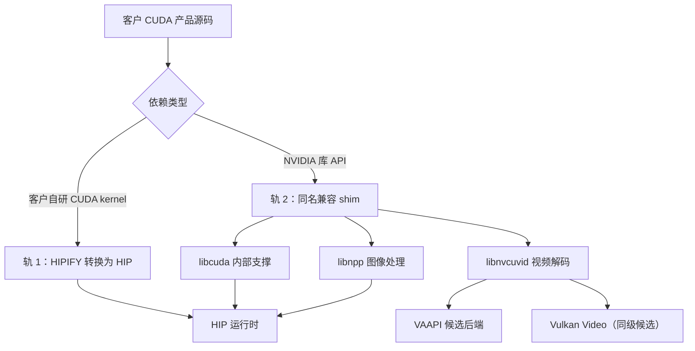
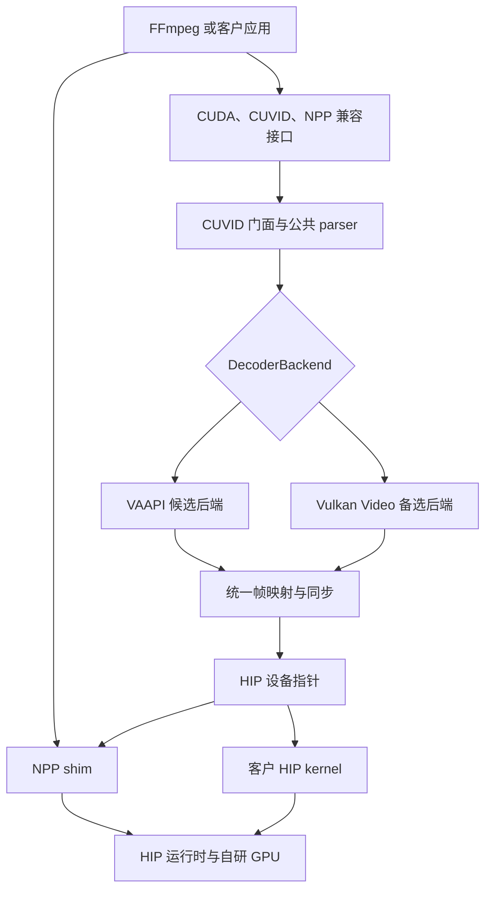
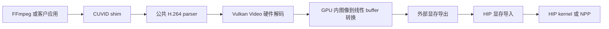
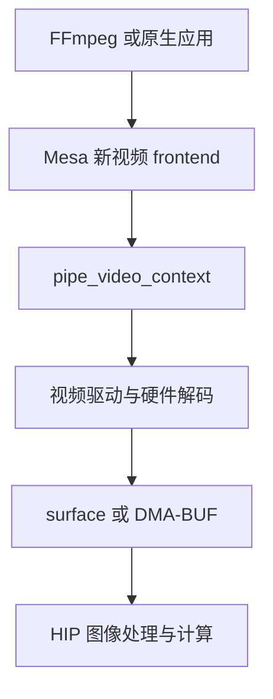
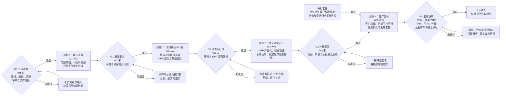

# CUDA 兼容层总体方案

> 版本：v6.6
> 文档日期：2026-11-13
> 技术事实截止：2026-11-12
> 一句话：让客户现有基于 NVIDIA CUDA 的视频软件，以少量构建适配和重新编译迁移到自研 GPU，当前聚焦“视频解码 → 图像处理”主链路。
> 职责：本文是项目**总体架构与实施决策的唯一权威文档**，负责目标范围、兼容方式、技术选型、业务价值、成本人力、排期 Gate、发布边界和长期自研 SDK 规划。
> 边界：技术实现、验证方法、实验证据、实现缺口及防御性风险见[方案整合版](CUDA兼容层方案_整合版.md)；字段映射和运行步骤见对应专题文档。
> 读者：管理层、产品负责人、法务、架构评审、工程实施与客户交付团队。

> **后端决策状态（2026-11-13）**：领导尚未拍板，VAAPI 与 Vulkan Video 是**同级候选后端，不存在已批准的主线或 Tier 2 降级关系**。本文中“VAAPI 主线/Vulkan Tier 2”的表述及以 VAAPI 单后端测算的 WBS 均为待决提案，不能作为资源优先级、验收豁免或对外承诺；正式决策后须重新冻结范围、WBS 和 Gate。

---

## 0. 决策摘要

| 决策项 | 建议结论 |
|---|---|
| 兼容方式 | 采用**源码级重编译兼容**，保留主要 CUDA、CUVID、NPP 调用方式，不承诺预编译二进制直接替换运行 |
| 技术主线 | **尚未决策**；VAAPI 转接与 Vulkan Video 为同级候选，均不能称为主线 |
| 备选路线 | 无“已确定主线/备选”之分；两后端按同一验收口径验证，选型后再确定投入与发布策略 |
| 长期路线 | **Mesa 新增 frontends** 本期排除，作为平台级视频能力的长期选项 |
| 业务范围 | H.264、8-bit、4:2:0、NV12；FFmpeg 7.1 双路径；3 个 NPP 函数及必要支撑 |
| 当前阶段 | 两个后端的底层解码到 HIP 数据通路、FFmpeg 宿主 P0 矩阵均已打通；NPP 联合链路、真实业务场景和目标平台交付仍待完成 |
| 工期与人力 | VAAPI 既定范围基线：一期 8–10 周、二期 4–6 周，合计 12–16 周；一期 4.0–4.5 FTE，以 G0 通过及资源到位为前提 |
| 客户前提 | 客户提供源码、构建环境、构建权和业务回归条件 |
| 法律路径 | NPP 路线 A、FFmpeg LGPL 干净构建、专利与兼容声明审查 |
| 长期软件战略 | 兼容层承接存量业务，自研 SDK 发展新业务；自研 SDK 独立立项 |

当前交付的是**限定范围内的视频兼容能力**，不是完整 CUDA 生态替代。实际支持范围以发布时的接口、格式、平台和业务验收结果为准。

---

## 1. 目标、范围与业务价值

### 1.1 项目目标

在约定范围内，使客户现有视频软件能够迁移到自研显卡，并完成：

- H.264 视频解码与图像处理；
- 解码帧在显存内直接提供给 HIP 计算使用；
- 多路、跳转、分辨率变化等业务场景；
- 客户应用与目标平台的完整业务验收；
- 可持续构建、发布和维护的兼容层产品。

### 1.2 兼容方式与客户前提

客户使用兼容层提供的头文件、库和构建说明重新编译。客户自研 CUDA kernel 通过 HIPIFY 转为 HIP；NVIDIA 视频与图像库调用由兼容层承接。

选择源码级兼容的原因：当前目标是限定链路而非通用二进制替换；可以锁定真实源码调用面和依赖版本；现有接口清单与底层实现能够直接复用；客户问题可部分提前到编译和链接阶段暴露。

项目启动前应书面确认客户能够从干净环境重建产品，并允许构建适配进入正式发布流程。若重点客户只能提供预编译二进制，应单独重新评估兼容方式和周期。

### 1.3 P0 交付范围

| 维度 | 交付范围 |
|---|---|
| 操作系统与计算平台 | Ubuntu 24.04；自研 GPU 的 GFX/HIP 环境；AMD 环境用于现阶段开发与概念验证 |
| 验证宿主 | 官方源码构建的 FFmpeg 7.1，覆盖 `h264_cuvid` 与 `h264_nvdec` |
| 解码格式 | H.264、4:2:0、8-bit、NV12 |
| 码流能力 | I/P/B、DPB、显示顺序、crop、seek/flush、动态分辨率和长期参考 |
| CUVID | FFmpeg 所需的动态加载符号与解码、解析、映射功能子集 |
| NPP | `nppiResizeSqrPixel_8u_C1R`、`nppiYCbCr420_8u_P2P3R`、`nppiYCbCr420_8u_P3P2R` 及必要 nppc；resize 插值先实现 FFmpeg 核心 cubic/NN/linear，再逐步覆盖全部 interp_algo |
| libcuda | FFmpeg 解码与 NPP 联合链路所需的内部支撑，不作为独立完整 CUDA driver API 交付 |
| 数据通路 | 同进程 LINEAR surface、DMA-BUF、HIP 导入与设备指针映射 |
| 同步方式 | 首期采用主机同步；异步跨栈 fence 作为后续优化 |
| 业务场景 | 1080p、4K、1 路和 8 路，以及持续运行与资源稳定性场景 |
| 性能目标 | 一期建立性能基线；二期前由产品和客户确定生产门槛 |

### 1.4 当前非目标

- NVENC、视频编码及 HIP 到 VAAPI 的编码链路；
- HEVC、AV1、VP9、MPEG-2、P010、10/12-bit 和非 4:2:0 格式；
- 完整 CUDA 二进制兼容、完整 CUVID、完整 NPP 或完整 driver/runtime；
- 任意用户应用、任意 CUDA kernel 的自动迁移承诺；
- 场/MBAFF、多 GPU、跨进程 DMA-BUF 和异步 fence 的首期交付；
- Vulkan Video 默认启用与正式双后端交付；
- 以开发验证环境的结果替代客户业务和目标平台验收。

### 1.5 当前阶段

| 工作方向 | 阶段判断 |
|---|---|
| 总体架构与公共数据通路 | 已形成统一 shim、公共 parser、后端抽象和 HIP 帧映射设计 |
| VAAPI 与 Vulkan 底层链路 | 均已完成解码到 HIP 读取的概念验证 |
| FFmpeg 宿主双路径 | 2026-11-13 修复后 32/32 PASS、0 SKIP，双后端零 D2D；仅覆盖当前 320×240 码流，真实业务和长稳未验收 |
| NPP | Stage A HIP shim 已用真实头文件构建，FFmpeg `scale_npp` 已链接；P2P3/P3P2 双后端逐字节通过，resize golden 与 11.5 ABI 复核待完成 |
| 复杂业务场景 | 多路、seek/flush、crop、动态分辨率等待收敛 |
| 客户与目标平台 | 待进入实际构建、联调和生产验收 |

### 1.6 业务价值与衡量方式

| 业务目标 | 兼容方案的价值 | 建议衡量指标 |
|---|---|---|
| 缩短客户导入周期 | 保留主要业务代码，避免整体重写 | 源码改动量、适配人周、上线时间 |
| 扩大自研硬件可服务的软件范围 | 承接既有 CUDA 视频业务 | 完成验收的应用、客户和场景数 |
| 降低系统运行开销 | 显存直通减少 CPU 中转 | 总吞吐、延迟、CPU/显存和单位流成本 |
| 控制迁移成本 | 在明确版本和接口清单内逐步交付 | 构建适配项、回归通过率、缺陷周期 |
| 为自主平台争取时间 | 先承接存量业务，再建设自有 SDK | 原生组件复用率、SDK 应用数 |

零拷贝收益应通过完整业务链路衡量，不能以单项硬件解码速度代替业务收益。

---

## 2. 总体架构与公共设计

### 2.1 双轨兼容架构

轨 1 在客户存在自研 CUDA kernel 时启用，不属于 P0 独立交付组件；轨 2 是当前兼容层主体。HIPIFY 负责客户计算代码，shim 负责 NVIDIA 库能力。

### 2.2 分层架构

公共逻辑只实现一次，后端只处理解码会话、输出布局和显存导出差异。CUVID 门面、parser/DPB、帧映射、同步契约和 NPP 均属于共享能力。

### 2.3 核心组件

| 组件 | 主要职责 |
|---|---|
| `libcuda.so.1` | 将链路所需的设备、上下文、内存、流和事件能力映射到 HIP |
| `libnvcuvid.so.1` | 提供 CUVID 接口、解码器状态、parser 以及帧 map/unmap |
| `CuvidParser` | 负责 H.264 参数解析、参考帧管理、DPB 和显示顺序 |
| `DecoderBackend` | 统一 VAAPI 与 Vulkan 后端的初始化、解码、映射和重置接口 |
| `HipFrameMapping` | 将后端输出导入 HIP，并提供设备指针和布局信息 |
| `libnpp*.so.11` | 以 HIP 实现 P0 图像处理函数及必要的 stream 支撑 |

### 2.4 公共契约

| 契约 | 总体约定 |
|---|---|
| 调用方式 | 保留宿主现有 CUVID/NPP 调用模型和库加载方式 |
| 帧访问 | map 返回 HIP 可访问的设备指针与 pitch，unmap 前保持有效 |
| 帧顺序 | 解码顺序与显示顺序分离，由公共 parser 管理 |
| 资源生命周期 | DPB 引用、已映射帧和下游计算输入共同决定 surface 回收时机 |
| 后端切换 | 宿主接口保持不变，通过统一后端抽象选择 VAAPI 或 Vulkan |
| 同步基线 | 先保证解码、计算和资源释放顺序正确，再演进异步流水线 |

---

## 3. 技术方案与选型

### 3.1 方案一：VAAPI 转接——候选方案 A

**定位与适用条件**：面向 Linux 近期交付，客户以构建适配为主，接受限定接口和版本的兼容产品。目标平台需要提供 VAAPI、线性 surface、DMA-BUF 和 HIP 导入能力。

| 模块 | 落地职责 |
|---|---|
| CUVID 门面 | 承接宿主调用，管理解码器、映射状态和生命周期 |
| 公共 parser | 复用 FFmpeg H.264 解析能力，补充 DPB、POC 和显示顺序管理 |
| VAAPI 后端 | 创建解码会话和 LINEAR surface，提交解码并输出 NV12 |
| 帧映射 | 导出 DMA-BUF、导入 HIP，向宿主返回设备指针与 pitch |
| NPP shim | 以 HIP 实现缩放和平面转换，承接解码后的图像处理 |

**实施重点**：

1. 完成 `h264_cuvid` 与 `h264_nvdec` 双路径接入，保持宿主调用模型不变。
2. 以线性 surface 直接共享解码结果，不经过 CPU 中转，也不需要额外 GPU 图像转换。
3. 统一两个后端的 parser、map/unmap 和同步契约，VAAPI 只维护后端差异。
4. 实现 3 个 NPP 函数及必要 nppc，形成“解码 → 缩放/平面转换 → HIP 使用”闭环。
5. 补齐多路、crop、seek/flush、动态分辨率和长期参考，再进入客户与目标平台交付。

**主要优势**：现有实现基础最完整，数据通路短，驱动生态成熟，不需要修改 Mesa 内部架构。剩余投入主要集中在宿主、NPP、复杂场景和平台交付。

**方案约束**：主要面向 Linux；CUVID 行为、FFmpeg 内部解析依赖和资源生命周期需要持续维护。底层显存直通不代表完整业务性能已经达标。

**投入口径**：一期 8–10 周、二期 4–6 周，是本项目的排期与人力基准。

### 3.2 方案二：Vulkan Video 转接——候选方案 B

**定位与适用条件**：跨平台是明确的中期业务需求，团队接受额外 GPU 转换和更复杂的平台适配，并愿意按平台分别投入兼容性、性能和回归资源。

| 模块 | 落地职责 |
|---|---|
| 公共兼容层 | 复用 CUVID 符号面、parser、宿主路径和 map/unmap 契约 |
| Vulkan 会话 | 在 SPS/PPS 就绪后建立视频会话，管理输出图像和 DPB |
| 队列与转换 | 解码队列完成视频解码，转换队列将图像拷贝为线性 buffer |
| 显存导出 | 导出外部显存并导入 HIP，保持下游 HIP/NPP 使用方式一致 |
| 平台适配 | 按操作系统、驱动和 GPU 组合维护能力矩阵 |

**实施重点**：

1. 与 VAAPI 使用同一套宿主、像素、零拷贝、PTS 和资源判据，不设置可自动跳过的降级项。
2. 复用现有后端抽象，继续保留解码、转换、导出和 HIP 读取能力。
3. 补齐真实业务宿主、多 slice、多流、reconfigure、复杂场景和平台矩阵。
4. 量化 GPU 内转换成本，建立双后端自动回归；选型前不预设发布优先级。

**主要优势**：开放标准，具备 Windows、Android 和多 GPU 厂商扩展潜力；资源管理显式，客户迁移方式与 VAAPI 相同，不需要维护私有 Mesa 分支。

**方案约束**：每帧多一次 GPU 内转换；跨平台不等于开箱即用；解码与转换队列、图像和 DPB 生命周期增加实现与维护复杂度。

**投入口径**：后端未经批准前，两候选方案的交付范围、WBS 和人力均为待决；当前只确认验证与缺陷修复按同一口径推进。

### 3.3 方案三：Mesa 新增 frontends——长期选项

**定位**：不走外挂 shim 翻译，而是在 Mesa 内新增视频 frontend，让驱动直接承接解码入口。本期排除，不纳入当前交付和排期。

| 接口路线 | 做法 | 评价 |
|---|---|---|
| A. 伪装 `libnvcuvid` | 在 Mesa 内导出 CUVID 兼容符号 | 客户改动少，但需处理专有 ABI，上游接受度低，只适合私有过渡 |
| B. 新 native frontend | 定义自有视频接口，客户改用新接口 | 接口清晰、具备上游可能，但不再属于源码级 CUDA 兼容 |

若未来立项，优先评估 **B**。该路线更接近自研 SDK 的长期方向，但需要客户调整调用方式。

**实施重点**：

1. 先确定接口、上游或私有分支策略，再建立 frontend 骨架和解码会话。
2. 建立 surface、DMA-BUF、同步和资源生命周期能力。
3. 接入 parser、宿主和驱动 CI，形成独立平台回归体系。
4. NPP 和客户自研 kernel 仍由 HIP/HIPIFY 承担，不因改变解码入口而消失。

**长期价值**：行为控制力强，具有性能优化空间，可形成平台级统一视频入口，并与长期自研 SDK 原生接口结合。

**重评条件**：跨平台或统一原生入口成为明确业务需求；公司建立稳定驱动团队；现有后端出现无法满足业务的平台能力瓶颈；上游对通用视频 frontend 有明确接受意愿。

**投入口径**：本期不作交付排期。接口路线、上游策略、目标平台和维护责任经立项决策后，再梳理独立项目的 WBS、人力与工期。

### 3.4 对比与选型结论

| 维度 | VAAPI 转接 | Vulkan Video 转接 | Mesa 新增 frontends |
|---|---|---|---|
| 客户迁移方式 | 构建适配为主 | 构建适配为主 | 取决于接口路线 |
| 解码到 HIP | 线性 surface 直接导入 | GPU 转换后导入 | 由新 frontend 设计决定 |
| 公共兼容层复用 | 完整复用 | 完整复用 | 需要重构解码入口 |
| 平台方向 | Linux 近期交付 | 跨平台扩展 | 跟随 Mesa 与自研驱动 |
| 对 NPP/客户 kernel 的帮助 | 独立实现 | 独立实现 | 仍需独立实现 |
| 维护重点 | 接口与依赖版本 | 双后端与平台矩阵 | 驱动、上游和长期维护 |
| 当前定位 | **同级候选** | **同级候选** | **本期排除，长期选项** |

VAAPI 与 Vulkan 继续按同级候选验证；Mesa 与自研 SDK 统一纳入长期平台战略评估。选型结论在 G0 前后由书面决策形成，不在本章预设。

---

## 4. 实施与交付方案

### 4.1 交付基线与投入

> 后端未经批准前，本章仅保留**原 VAAPI 单后端测算草案**，不是已生效排期；VAAPI 与 Vulkan Video 按同级候选验证。后端选型、范围和资源正式决策后，须重做 WBS、人力与 Gate 日期，不得直接沿用本章数字。

本章只给出 **原提案的 VAAPI 单后端、既定 P0 范围**测算：一期目标 W8 验收，W9–W10 为缓冲；二期在 G3 后用 4–6 周完成生产交付，标准总周期 12–16 周，准备充分时可压缩至 12–14 周。周次以 G0 通过、人员与资产到位、目标平台可用、范围不扩张为前提，不适用于尚未决策的新增需求或双后端方案。

| 角色 | 一期投入 | 二期投入 | 核心责任 |
|---|---|---|---|
| 视频兼容/解码 | 1.0 人，W1–W10 | 0.5 人，W9–W14 | CUVID、parser/DPB、双路径与解码缺陷 |
| HIP/NPP | 1.0 人，W1–W10 | 0.5 人，W9–W14 | NPP、联合链路、数值对照与 HIP 问题 |
| 平台集成 | 1.0 人，W1–W14 | 1.0 人，W9–W14 | 目标平台、驱动协同、部署与回退 |
| 测试/自动化 | 0.5–1.0 人，W2–W8 | 1.0 人，W9–W14 | 功能、资源、稳定性、性能与自动回归 |
| 构建/发布 | 0.5 人，W1–W14 | 0.5 人，W9–W14 | 构建、CI、打包、版本与发布材料 |
| 法务/合规 | W1–W2、W12–W14 按需 | 发布前按需 | 授权、许可、专利、商标与兼容声明 |
| 客户接口人 | 客户侧 1.0 人，W1–W14 | 客户侧 1.0 人，W9–W14 | 源码、构建环境、业务数据与回归 |

一期按 **4.0–4.5 FTE、32–44 人周**配置。视频兼容与 HIP/NPP 不宜长期由同一人兼任；持续运行和双平台回归阶段测试不低于 1.0 人。AMD 验证环境、首套自研平台、FFmpeg 7.1、锁定头文件和客户构建环境在 W1 到位；NVIDIA NPP 参考环境与自动回归环境在 W2 前到位；第二套自研平台在 W6 到位。

### 4.2 可执行排期

下表合并工作包、周次、交付物与出口，不再另设重复 WBS。一期人周按原工作包归集，二期投入按上表角色预算控制。

| 周次 | 工作包与明确交付物 | 人周 | 主责（协同） | 出口 |
|---|---|---:|---|---|
| W1 | WP1：冻结应用、接口、格式、版本、场景和验收清单；确认客户条件并启动法务 | 2–3 | 产品（视频、平台、法务、客户） | G1 输入 |
| W1–W2 | WP2：形成可复现 shim 构建、依赖/头文件基线、宿主冒烟和证据包；验证目标平台 VAAPI、LINEAR、DMA-BUF、HIP 导入 | 3–4 | 平台（构建、视频、测试） | **G1** |
| W2–W4 | WP3：完成 CUVID 解码、映射/释放和 FFmpeg 双路径基础链路，输出像素与帧序结果 | 7–9 | 视频（平台、测试） | **G2** |
| W2–W5 | WP4：完成 NPP 参考矩阵和数值原型，再完成 3 函数、必要 nppc、SONAME 及 FFmpeg 链接 | 7–10 | HIP/NPP（构建、测试） | **G2/G3** |
| W4–W5 | WP5：形成“解码 NV12 → NPP → HIP 使用”联合链路及数值报告 | 3–4 | HIP/NPP（视频、测试） | G3 输入 |
| W5–W7 | WP6：完成 crop、seek/flush、动态分辨率、长期参考、1080p/4K 和 1/8 路回归 | 4–5 | 视频（测试、平台） | G3 输入 |
| W6–W8 | WP7：完成持续运行、资源、吞吐、延迟、CPU/显存基线及原始日志 | 4–6 | 测试（视频、HIP、平台） | G3 输入 |
| W8 | WP8：全量回归、缺陷收口、证据归档和一期评审 | 2–3 | 测试（全体、产品） | **G3** |
| **一期合计** | 目标 W8 完成；W9–W10 仅用于吸收 G1–G3 延期 | **32–44** | — | — |
| W5–W8 | WP9：并行完成客户源码、构建脚本、依赖和加载路径预检，不等待一期结束 | 二期 | 平台（客户、构建） | G3 输入 |
| W9–W10 | WP10：完成客户应用重编译、链接、版本/依赖适配及首轮业务回归 | 二期 | 平台（客户、视频、HIP） | G4 输入 |
| W9–W12 | WP11：两套自研目标平台完成业务、场景、资源和稳定性全量回归 | 二期 | 测试（平台、客户） | G4 输入 |
| W11–W13 | WP12：按已确认门槛完成性能优化和零拷贝收益评估 | 二期 | 视频/HIP（测试、平台） | G4 输入 |
| W12–W14 | WP13：完成部署、升级回退、法务、发布物和客户文档；至少保留 1 周发布缓冲 | 二期 | 构建（法务、平台、测试、客户） | **G4** |

关键路径为 **G1 → 解码与 NPP 可行性 → 联合链路 → 复杂场景 → 稳定性/性能 → G3 → 客户构建与平台回归 → G4**。一期使用缓冲或关键外部条件延期时，二期相应顺延；客户预检、法务和证据归档可并行，不得通过压缩正确性、稳定性或合规工作吸收延期。

### 4.3 Stage-Gate 与评审口径

每个 Gate 必须形成书面结论：**Go（通过）**、**Recycle（整改后复审）**、**Hold（等待决策，暂停承诺日期）**、**Kill（终止路线）**。只有 Go 可以进入下一阶段；Recycle 消耗缓冲或触发重排，Hold/Kill 不沿用原发布日期。图中“未通过”分支包含 Recycle 和 Hold；Kill 经书面评审后直接终止对应路线。

| Gate | 通过条件与决策输出 | 未通过时的处理 |
|---|---|---|
| **G0 立项** | 确认源码级兼容、后端选型、P0 范围、4.0–4.5 FTE、客户源码/构建/回归条件及可执行法律路径 | 未决事项转入第 6 章；路线或范围决策后再梳理 WBS、资源和工期，不启动承诺排期 |
| **G1 基线** | 范围与验收清单冻结；构建可复现；目标平台 VAAPI/HIP、LINEAR surface、DMA-BUF 和 HIP 导入可用；客户与法务工作已启动 | 平台问题由平台/驱动闭环，构建问题由构建负责人闭环；复测后复审，影响关键路径时重排 |
| **G2 可行性** | FFmpeg 双路径基础解码的像素、帧序、map/unmap 与资源释放正确；3 个 NPP 函数原型逐字节对照通过；实现与库组织路径明确 | 解码回到 WP3，NPP 回到 WP4；若需更换实现路线，先决策再重排，不带病进入功能扩展 |
| **G3 一期验收** | 双路径及 3 个 NPP 函数通过；复杂场景、1080p/4K、1/8 路、持续运行和资源稳定性达标；性能基线与证据可复现；法律路径可执行；产品和客户确认生产性能门槛 | 功能缺陷进入 Recycle；平台或性能门槛未决进入 Hold；W9–W10 缓冲用完后重新确认二期日期 |
| **G4 发布** | 客户约定版本和业务回归通过；自研目标平台全量通过；性能达到已确认门槛或形成书面偏差结论；升级回退演练完成；发布物、许可、对应材料、兼容声明和客户文档齐备 | 缺陷、性能或合规项分别退回对应工作包；保留上一已验证版本，整改复审后再确认发布日期 |

验证方法、测试入口和证据追溯统一见[方案整合版](CUDA兼容层方案_整合版.md)，本文不再另设一套重复的验收清单。

### 4.4 发布、客户与法律边界

| 主题 | 本方案约束 | 责任与时点 |
|---|---|---|
| 支持清单 | 只发布通过验收的应用、版本、接口、格式、平台和场景；实验性与正式后端分列，不宣称任意 CUDA 软件可运行 | 产品维护，G4 审核 |
| 源码与构建 | 客户需提供源码、构建脚本、第三方库构建权，并能从干净环境重建；适配需进入正式构建与发布流程 | 客户确认，G0 准入 |
| 客户迁移 | 调整头文件、链接库、加载路径和版本检查，并承担约定的业务回归；简单应用初步按 2–6 周规划，复杂应用在源码扫描和试点后再估算 | 双方按合同分工；不包含在兼容层一期内 |
| 自有 CUDA kernel | HIPIFY 后可能需要人工修改和性能调优；特殊指令、闭源库和复杂流控制不纳入自动迁移承诺 | 源码扫描后确定范围与责任 |
| 发布与追溯 | 保存版本、构建配置、输入、参考结果和日志；明确安装/加载路径和诊断能力；完成升级回退演练并保留上一已验证版本 | 构建/测试负责，G4 准入 |
| NPP 与独立实现 | 采用路线 A：使用另行提供的授权 CUDA/NPP 11.5 头文件，发布物不含未获许可的专有头文件；**FFmpeg 将 libnpp 标记为 nonfree，`scale_npp` 构建必须 `--enable-nonfree` 且产物不可再分发，发布方案未决** | 法务在 W1 启动、G4 确认分发条件；未决前只做内部验证 |
| FFmpeg 与开源组件 | 普通解码构建继续使用 `--disable-gpl --disable-nonfree --enable-pic` 的 LGPL 构建；启用 NPP `scale_npp` 的 FFmpeg 构建单独标记 nonfree，不得与可分发 LGPL 产物混报；保留源码、构建脚本和再链接材料 | 构建提供材料，法务发布前复核 |
| 专利与对外表述 | 确认硬件、软件及销售地区的专利覆盖；兼容清单与验收报告一致，不使用完整兼容或官方认证等误导表述 | 法务/产品发布前确认 |

### 4.5 变更与持续维护

新增格式、函数、应用、客户或多路范围，改为二进制兼容，正式启用 Vulkan，启动 Mesa frontend，以及新增目标平台驱动工作，均不直接塞入本基线；先按第 6 章完成决策，再梳理 WBS、资源和工期。首版后建议预留 **0.5–1 名工程师**持续维护；FFmpeg、Mesa 或 ROCm 关键升级可初步预留 **1–3 周**评估与回归。所有 Gate 结论、缓冲消耗、范围变更和版本支持责任均形成书面记录。

---

## 5. 长期自研 SDK 规划

### 5.1 兼容层的长期定位

兼容层适合作为存量业务迁移的桥梁，不应成为自研平台唯一的长期软件战略，原因包括：

- CUDA、FFmpeg 和客户依赖变化需要持续跟随；
- 不同客户可能不断扩大函数、格式和行为兼容范围；
- 兼容保真会约束原生接口和性能优化空间；
- 问题定位跨越客户调用、转接层、解析器、视频驱动和 HIP；
- 只有兼容库，难以形成统一原生接口、工具、文档和示例；
- 兼容成果主要解决存量迁移，不足以形成长期产品差异化。

### 5.2 自研 SDK 的目标

- 提供清晰的视频解码、图像处理、内存和同步接口；
- 为 FFmpeg、GStreamer 等常见框架提供原生接入；
- 建立示例、诊断、性能分析、版本政策和自动回归；
- 让新业务直接发挥自研硬件优势，而不是先模拟 CUDA 行为；
- 逐步减少专有头文件和外部接口变化对产品的约束；
- 把“每个客户适配一次”转化为“多个客户复用一套能力”。

### 5.3 兼容层与自研 SDK 的分工

| 阶段 | 主要目标 | 兼容层的作用 | 自研 SDK 的作用 |
|---|---|---|---|
| 当前：存量客户导入 | 降低迁移门槛，形成可验收业务 | 保留主要 CUDA 调用，承接已有应用 | 复用底层能力，不强制客户立即迁移 |
| 中期：能力产品化 | 减少重复定制，建立原生开发方式 | 维护已承诺客户和接口 | 提供原生视频、图像、内存和同步组件 |
| 长期：自主生态 | 提升开发效率和平台差异化 | 作为旧应用支持或迁移工具 | 成为新应用默认开发入口 |

### 5.4 长期演进路径

| 步骤 | 主要工作 | 与当前项目的衔接 |
|---|---|---|
| 1. 有限兼容交付 | 完成 H.264 + 图像处理链路 | 解决存量客户导入，不等待完整 SDK |
| 2. 沉淀原生组件 | 整理解码会话、显存共享、图像处理、同步和诊断模块 | 兼容层与 SDK 共用底层实现 |
| 3. 建立原生开发入口 | 提供公开接口、FFmpeg/GStreamer 接入、示例和迁移指南 | 新业务优先 SDK，老业务继续兼容层 |
| 4. 建立版本与工具体系 | 完成兼容矩阵、诊断、性能分析、自动回归和发布政策 | 将项目制适配转为产品维护 |
| 5. 分阶段迁移客户 | 按业务收益将适合的应用迁往 SDK | 兼容层逐步转为存量维护 |

自研 SDK 应作为**独立长期项目**立项，不纳入当前三种兼容方案的实施周期。启动时机结合客户数量、重复适配成本、原生业务需求和团队承载能力决定。若未来启动 Mesa native frontend，应优先与自研 SDK 的统一视频入口协同设计。

---

## 6. 待管理层决策事项与排期触发

第 4 章只承诺既定 VAAPI 基线。下表事项对应的交付范围在决策前保持 Hold 或不纳入排期，已批准的基线工作可继续；决策形成明确范围后，再更新对应 WBS、资源、Gate 和日期，不以未评审的估算代替正式计划。

| 决策项 | 需要形成的明确结论 | 最迟决策点 | 决策后的计划动作 |
|---|---|---|---|
| 兼容方式与客户前提 | 是否确认源码级重编译；首批客户能否提供源码、构建环境、构建权和业务回归条件 | **G0 / W1 前** | 条件满足则启动第 4 章基线；只能提供二进制时，重新评估方案后再排期 |
| 技术主线 | 在 VAAPI、Vulkan Video 或双后端之间作出书面选型；确认前两者同级，不设默认主线 | **G0 / W1 前** | 按选定路线重做技术方案、WBS 与 Gate，不沿用当前日期 |
| 业务边界 | 冻结首批客户、宿主、格式、接口、平台和生产场景 | **G0 / W1 前** | 按冻结清单确认 32–44 人周基线；新增范围另行估算 |
| 时间与资源 | 是否批准一期 8–10 周、二期 4–6 周和一期 4.0–4.5 FTE，并确认关键人员及资产到位 | **G0 / W1 前** | 按实际到位时间锁定 W1 和 Gate 日期 |
| 法律路径 | NPP 头文件、FFmpeg LGPL、libnpp 导致的 nonfree 构建、专利、商标及兼容声明是否可执行 | **G0 确认路径，G4 确认分发** | 若不能合法分发 `scale_npp` 集成产物，改为内部工具/客户自建或重新评估 NPP 实现路线 |
| 客户责任 | 重编译、业务测试、复杂 kernel 迁移和版本升级分别由哪一方承担 | **G0 明确原则，G3 前落实分工** | 源码扫描后形成客户侧计划；新增厂商工作重新估算 |
| 生产发布门槛 | 以哪组业务、稳定性、吞吐、延迟、资源和目标平台结果作为承诺依据 | **G3 前** | 门槛确认后细化二期优化与回归；超出现有基线的工作另行排期 |
| 跨平台与 Vulkan | 跨平台是已有订单需求还是未来选项；需支持哪些 OS、GPU、驱动和客户 | 有明确跨平台需求时独立决策 | 决策后再梳理正式双后端 WBS、人力、平台矩阵和工期 |
| Mesa frontend | 是否满足重评条件，选择何种接口路线及上游/私有分支策略 | 独立立项评审 | 决策后再形成平台项目计划，不进入当前兼容层周期 |
| 长期 SDK | 是否同意“兼容层承接存量、自研 SDK 发展新业务”，以及启动条件和立项时机 | 独立立项评审 | 决策后制定 SDK 路线图、版本政策、资源与阶段计划 |

---

## 7. 文档导航与术语

### 7.1 文档导航

| 关注内容 | 权威文档 |
|---|---|
| 总体架构、技术选型、成本人力、排期 Gate、发布边界和长期 SDK | 本文 |
| 技术实现、验证细节、证据边界、实现缺口和防御性说明 | [方案整合版](CUDA兼容层方案_整合版.md) |
| CUVID 符号与字段级映射 | [CUVID 到 VAAPI 映射表](CUVID到VAAPI映射表.md) |
| 内存、同步与零拷贝契约 | [内存与同步模型](内存与同步模型.md) |
| Vulkan 后端专题设计 | [Vulkan 后端实现](Vulkan后端实现.md) |
| NPP 能力、VPE 对比与许可 | [NPP 兼容方案与 VPE 对比](NPP兼容方案与VPE对比.md) |
| 验证操作与排障 | [验证手册](../verification/验证手册.md) |
| P0 原始结果 | [P0 闭环验证结果](../evidence/P0闭环验证结果_2026-11-12.md) |

### 7.2 维护规则

1. 本文统一维护路线、范围、成本、周期、人力、Gate、客户与法律决策，不再另设决策实施版。
2. 技术实现、验证细节、证据边界、实现缺口和防御性说明统一维护在整合版。
3. 接口、内存、同步及后端专题内容变化时，同步更新对应专题文档。

### 7.3 术语

| 术语 | 含义 |
|---|---|
| shim / 转接库 | 保留 NVIDIA 调用方式、内部改用其他实现的兼容库 |
| 源码级兼容 | 保留主要调用方式，但客户需要重新编译和验收 |
| 二进制兼容 | 客户原程序不重编译，直接加载兼容实现 |
| VAAPI | Linux 通用视频硬件加速接口，本项目候选后端之一 |
| Vulkan Video | Khronos 视频编解码接口，本项目与 VAAPI 同级的候选后端 |
| HIP / ROCm | 自研 GPU 计算链路所使用的计算接口与平台 |
| 零拷贝 | 解码与计算共享显存数据，不经过 CPU 中转 |
| 主机同步 | 由 CPU 管理解码、计算和资源回收顺序的首期同步方式 |
| 一期 / 二期 | 功能兼容验收 / 真实业务与生产交付验收 |
| FTE / 人周 | 全职人力投入 / 一名工程师一周的工作量 |
| Gate | 决定项目能否进入下一阶段的正式评审点 |
| 自研 SDK | 面向新应用的原生视频、图像、内存、同步与工具体系 |

---

> v6.6（2026-11-13）：NPP shim 与 FFmpeg scale_npp 完成本地集成，P2P3/P3P2 双后端逐字节通过；补充 FFmpeg libnpp nonfree 发布约束和 11.5 golden 待办。
>
> v6.5（2026-11-13）：落地 NPP Stage A HIP shim 与参考/候选探针，本地自检通过；NVIDIA golden 与 FFmpeg 集成待完成。
>
> v6.4（2026-11-13）：明确 NPP resize 最终覆盖全部 interp_algo，分阶段从 FFmpeg 核心 cubic/NN/linear 扩展。
>
> v6.3（2026-11-13）：FFmpeg 宿主矩阵修复后 32/32；同步双后端零 D2D、PTS 和额外 surface 约束。
>
> v6.2（2026-11-13）：明确 VAAPI 与 Vulkan Video 尚未决策、同级候选；原 VAAPI 单后端 WBS 标注为待复核草案，并同步 FFmpeg 宿主 32 组合基线状态。
>
> v6.1（2026-11-13）：合并原成本/WBS、排期/Gate、验收/发布三章为“实施与交付方案”，以单一排期表消除重复；改用带通过/未通过回路的 Stage-Gate 图，明确 G0～G4 的时间、出口与责任；未决策事项统一在决策后梳理计划，不再与 VAAPI 既定范围基线混排。
>
> v6.0（2026-11-13）：合并原总体方案与决策实施版，形成唯一的总体架构与实施决策文档；细化三种技术路线，保留成本、人力、工期、Gate、发布边界和长期自研 SDK 规划。防御性风险不进入本文，技术细节与验证证据继续由[方案整合版](CUDA兼容层方案_整合版.md)承载。
