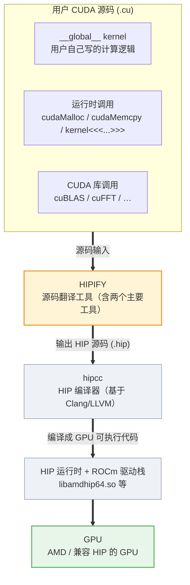
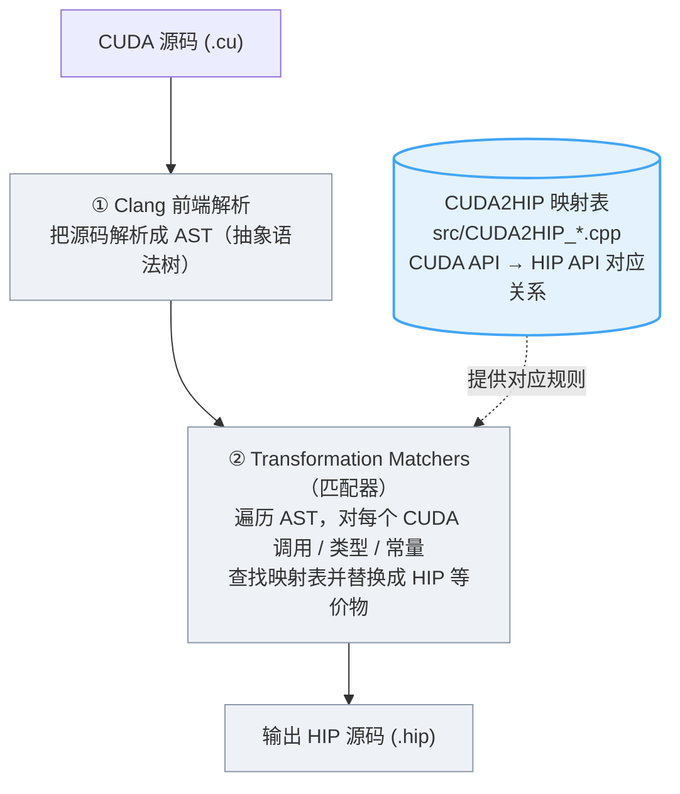
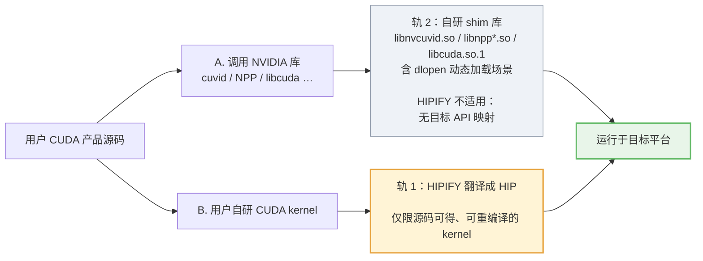

# HIPIFY 调研说明

> 版本：v1.1
> 调研/复核时间：2026-10-29（初稿）、2026-11-10（复核）
> 调研对象：HIPIFY（AMD ROCm 官方项目；本仓库不包含其源码，路径以 ROCm/HIPIFY 上游仓库为准）
> 调研基线：源码 HEAD `1a9c5f0`（2026-10-27，`amd-develop` 分支）；本机安装包 `hipify-clang 22.0.0.70200`（ROCm 7.2.0）
> 读者：需要了解"HIPIFY 是什么、能做什么、不能做什么"的工程师/决策者
> 文档定位：本文是 **HIPIFY 工具技术调研**，聚焦工具本身的能力、边界和使用方法。

> **结论先行**：HIPIFY 是"源码→源码"的自动翻译工具，只适用于**源码可得、可重新编译**的 CUDA kernel；它不翻译 NVDEC/NVENC/NPP 等 NVIDIA 闭源库的调用，也不处理已编译二进制或 `dlopen` 动态加载的库。

---

## 1. 一句话说明

**HIPIFY 是 AMD 官方提供的一套"源码翻译工具"，能把 NVIDIA CUDA 的源代码自动转换成 HIP 源代码，让原本只能跑在 NVIDIA GPU 上的 CUDA 程序，经过重新编译后能跑在 AMD 或兼容 HIP 的 GPU 上。**

它属于 AMD ROCm 生态，是"CUDA → HIP"移植环节的**自动化工具**，解决"逐行手工改写 CUDA 代码太痛苦"的问题。

---

## 2. 解决什么问题

CUDA 是 NVIDIA 的专有编程框架，CUDA 程序通常只能在 NVIDIA GPU 上运行。移植到其他 GPU 时，若逐行手工改写所有 CUDA 调用，工作量大且易错。

HIPIFY 把"改写"这一步自动化：输入 `.cu`（CUDA 源码），输出 `.hip`（HIP 源码）；之后还需用 HIP 工具链重新编译、调整构建与链接配置，并完成数值和性能验证。

**HIP 是什么**：HIP 是 AMD 主导、开源的、与 CUDA **高度相似**的 GPU 编程接口。HIP 的 API 命名和语义与 CUDA 基本一一对应（`cudaMalloc` ↔ `hipMalloc`），因此 CUDA 代码可以较机械地翻译成 HIP 代码；HIPIFY 就是完成这一步翻译的工具。

---

## 3. 总体架构图

> 下列图示使用 Mermaid 语法，GitHub / GitLab / VS Code / Typora / Obsidian 可直接渲染。



实线主链路即移植流水线；**HIPIFY 只做"源码 → 源码"的翻译，不参与编译和运行**，它是移植流水线的第一环。

---

## 4. HIPIFY 的两个主要工具

HIPIFY 实际包含**两个主要**翻译工具，原理和适用场景不同：

| 维度 | **hipify-clang** | **hipify-perl** |
|---|---|---|
| 原理 | 基于 **Clang**，把 CUDA 源码解析成 **AST（抽象语法树）**，用变换规则遍历改写 | 基于**正则表达式**的 perl 脚本做文本替换 |
| 精确度 | **高**：能理解语法结构，复杂写法也能正确处理或明确报错 | **较低**：遇到复杂语法（宏、模板、命名空间、复杂参数）可能出错 |
| 依赖 | 需要 **CUDA Toolkit**（提供头文件/库，不需要 NVIDIA GPU），需要正确的 include/define | 仅需 Perl；不需要 CUDA |
| 输入要求 | 输入 CUDA 代码必须能被 Clang 以 CUDA 模式**成功解析**（include/宏/参数齐全） | 不检查输入正确性 |
| 速度 | 相对慢（需解析 AST） | 快（纯文本替换） |
| 生成方式 | 主工具（C++ 实现） | 由 `hipify-clang --perl` 自动生成的脚本（仓库 `bin/` 下有预生成版本） |

**选用建议**：
- 复杂项目、要求翻译正确性 → **hipify-clang**。
- 快速批量处理、代码简单 → hipify-perl。
- 官方也建议"更复杂/精确的翻译用 hipify-clang"。

> 除上述两个主要工具外，HIPIFY 还提供 `--python` 生成 pyHIPIFY 映射，以及 `bin/` 下的 `hipconvertinplace.sh`、`hipexamine.sh`、`findcode*.sh` 等批量辅助脚本；它们不是独立的翻译器，本文不展开。

---

## 5. 内部工作原理（hipify-clang）



**核心是"CUDA2HIP 映射表"**：源码里是一系列 `CUDA2HIP_<库>_API_functions.cpp` / `_types.cpp` 文件，逐条记录"CUDA 的某个函数/类型/常量 → HIP 的对应物"。HIPIFY 的翻译能力**主要由这张映射表决定**（另有少量硬编码的语法变换，例如 `<<<...>>>` kernel launch 的处理）——表里没有的，通常就翻译不了。

---

## 6. 能翻译什么（支持的 CUDA API 范围）

HIPIFY 能翻译的，是**映射表中存在目标 HIP/ROC 实现**的 CUDA API。根据上游仓库的 `docs/reference/supported_apis.md`（与官方文档同源）：

| CUDA | 默认映射（HIP） | ROC 模式（`--roc`） / 备注 |
|---|---|---|
| CUDA Runtime API | HIP API | — |
| CUDA Driver API | HIP API | — |
| CUDA Device API | HIP Device API | — |
| CUDA RTC API | HIP RTC API | — |
| CUComplex | HIP Complex | — |
| CUFile | HIP FILE API | 仅 Linux 支持 |
| **cuBLAS** | hipBLAS | `--roc` → rocBLAS |
| **cuSPARSE** | hipSPARSE | `--roc` → rocSPARSE |
| **cuSPARSELt** | hipSPARSELt | — |
| **cuSOLVER** | hipSOLVER | `--roc` → rocSOLVER（视版本） |
| **cuRAND** | hipRAND | `--roc` → rocRAND |
| **cuFFT** | hipFFT | — |
| **cuDNN** | 不映射 | 需 `--miopen`（或 `--roc`）才映射到 MIOpen |
| **cuTENSOR** | hipTENSOR | — |
| **CUB** | hipCUB | — |

> 说明：
> - 默认模式输出 HIP API；`--roc` 优先映射到 ROC 库；`--miopen` 用于 cuDNN→MIOpen（官方文档说明不要与 `--roc` 同时显式指定）。
> - 表中只列 API 家族。具体函数是否在目标 ROCm 版本可用，需查上游仓库的 `docs/reference/tables/` 中的 A/D/C/R/U/E 标记；"能转换"不等于"HIP 实现一定可用"。
> - 映射表源码文件（`src/CUDA2HIP_*.cpp`）覆盖：Runtime、Driver、Device、RTC、BLAS、SPARSE、SPARSELT、SOLVER、RAND、FFT、DNN、TENSOR、CUB、Complex、FILE。

---

## 7. 不能翻译什么（关键边界）

**HIPIFY 只改写调用点，不翻译库实现。** 它能否处理一个调用，取决于是否存在目标 API 和映射表项，与源库是否开源无关。对没有对应目标 API 的 NVIDIA 库，HIPIFY 不处理：

| NVIDIA 库 | HIPIFY 是否有目标 API/映射 | 结果 |
|---|---|---|
| **NVDEC / CUVID**（视频解码） | ❌ 无同名/等价 HIP API | ❌ 不翻译 |
| **NVENC**（视频编码） | ❌ 无同名/等价 HIP API | ❌ 不翻译 |
| **NPP**（图像处理原语） | ❌ 无同名/等价 HIP API | ❌ 不翻译 |

说明：
- ROCm 生态中存在功能相近但接口不同的库（例如视频解码的 rocDecode、图像处理的 RPP 等，具体以目标 ROCm 版本为准），HIPIFY 并未提供 NVDEC/NPP → 这些库的映射，因此不能依赖 HIPIFY 完成迁移。
- HIPIFY 也**不处理已编译的二进制**，以及通过 `dlopen` 动态加载的库（例如 FFmpeg 动态加载 `libcuda.so.1`）；这类场景只能由兼容层或手工迁移承接。
- NVIDIA 的解码/编码/NPP 库是闭源的，没有可直接链接的 HIP 等价实现，也没有可供参考的实现源码；移植时需要按公开头文件/API 语义和实测行为自行实现兼容层。

因此，`cuvidCreateDecoder`、`nppiResize` 等调用没有 `hipCuvid` / `hipNPP` 可映射；若必须保留这些调用，需要另行实现兼容层，或在目标平台上改用等价 API。

---

## 8. HIPIFY 在我们项目中的角色

> 状态说明：本节只说明 HIPIFY 与项目的关系；**项目范围、交付承诺和决策口径不在本文展开**。

我们的 CUDA 兼容方案按调用来源分两条路：



**结论**：
- HIPIFY 负责"用户自己写的 CUDA kernel"的源码翻译；NVIDIA 的库（NVDEC/NPP、CUDA Driver API 等）靠自研 shim 库承接；NVENC 不在当前 P0 范围。
- HIPIFY 是**补充工具，不是替代方案**：它不能替代视频解码/图像处理兼容层，也不能处理二进制或动态加载的库。
- 当前 P0 交付主线是 CUVID shim→VAAPI + NPP shim→HIP；HIPIFY 不属于 P0 交付组件，客户自有 kernel 的翻译需求需另行评估（人工改写、数值验证、性能调优）。

---

## 9. 使用示例

### 安装与版本自检

```bash
# Debian/Ubuntu；包名随 ROCm 版本可能为 hipify-clang 或 amdrocm-hipify
sudo apt install hipify-clang
# RHEL
sudo dnf install hipify-clang

hipify-clang --version     # 工具版本（本机为 AMD LLVM 22.0.0git）
hipify-clang --versions    # 支持的 ROCm / CUDA / cuDNN 范围
```

本机（ROCm 7.2.0 安装包）的 `--versions` 输出：

```text
[HIPIFY] Supports ROCm HIP from 5.0.0 up to 7.2.0
[HIPIFY] Supports CUDA Toolkit from 7.0 up to 12.9
[HIPIFY] Supports cuDNN from 7.0.5 up to 9.14.0
```

> 新版 ROCm Core SDK 文档使用 `amdrocm-hipify` 包名，以目标 ROCm 源为准。源码构建的 HIPIFY 可能比发行版安装包更新（本地源码树文档声称支持到 CUDA 13.2），使用前先确认版本，并在报告中固定基线。

### 前置条件

- 安装 CUDA Toolkit（提供头文件/库；**不需要 NVIDIA GPU**），`--cuda-path` 指向其安装目录；本机未安装 CUDA Toolkit 时，示例会报 `cannot find CUDA installation`。
- 输入源码的 include 路径、宏定义和 C++ 标准需齐全，确保 Clang 能按 CUDA 模式解析。
- `hipify-clang` 默认在源文件旁生成 `<源文件名>.hip`；`--inplace` 会原地修改输入文件，**当前实现不自动保留备份**（建议先提交版本库或手动备份；hipify-perl 版本会保留 `.prehip`）。
- 下文示例用 `./hipify-clang` 表示源码构建的二进制；通过包安装时直接使用 `hipify-clang`。

### hipify-clang（推荐，精确）

```bash
# 翻译单个文件（需要指定 CUDA 路径和 include）
./hipify-clang square.cu --cuda-path=/usr/local/cuda-12.9 \
    -I /usr/local/cuda-12.9/samples/common/inc

# 多文件 + C++ 标准
./hipify-clang a.cu b.cu --cuda-path=/usr/local/cuda-12.9 -- -std=c++17

# 查看翻译统计（转换率、哪些没转）
./hipify-clang intro.cu --cuda-path=/usr/local/cuda --print-stats

# 生成"支持的 CUDA API"文档（Markdown/CSV）
./hipify-clang --md --doc-format=full --doc-roc=joint
```

> 使用 CMake 工程时，优先用编译数据库：`cmake -S . -B build -DCMAKE_EXPORT_COMPILE_COMMANDS=ON`，然后 `hipify-clang -p build --cuda-path=...`。按官方说明，使用 `-p` 时不要再加 `--` 分隔符。

### hipify-perl（快速，简单场景）

```bash
hipify-perl square.cu -o square.cu.hip
```

### 翻译后编译

```bash
hipcc square.cu.hip -o square    # 用 hipcc 编译 HIP 源码
```

> `hipcc` 只完成编译；工程还需要调整构建系统、链接库和架构参数（`sm_XX` → `gfxXXX` 等），并通过数值/性能验证，才算完成迁移。

### 常用选项速查

| 选项 | 用途 |
|---|---|
| `--cuda-path=<dir>` | 指定 CUDA Toolkit 路径（必需） |
| `-p <build-dir>` | 读取 `compile_commands.json` |
| `--inplace` | 原地改写输入文件（建议先提交版本库） |
| `-o <file>` / `--o-dir=<dir>` | 单文件输出 / 多文件输出目录 |
| `--exclude-path` / `--include-path` | 排除/包含路径 |
| `--amap` | 尽可能多翻译（忽略 default-preprocessor） |
| `--experimental` | 启用实验性 API 翻译 |
| `--local-headers` / `--local-headers-recursive` | 处理引号包含的本地头文件 |
| `--print-stats` / `--print-stats-csv` | 输出统计（stderr / CSV） |
| `--hip-kernel-execution-syntax` | 将 `<<<...>>>` 改为 `hipLaunchKernelGGL` 调用 |
| `--save-temps` / `-v` | 保留临时文件 / 详细日志 |

### 批量迁移辅助脚本

仓库 `bin/` 下提供：

- `findcode.sh` / `findcode_sources.sh` / `findcode_headers.sh`：查找待处理文件；
- `hipconvertinplace.sh`：对目录内代码批量原地 hipify；
- `hipexamine.sh`：只统计不输出，用于评估转换率；
- `hipconvertinplace-perl.sh`、`hipexamine-perl.sh`：对应的 perl 版本。

推荐流程：`hipexamine.sh` 评估 → `hipconvertinplace.sh` 转换 → `git diff` 审查 → 重新构建 → 用 `--print-stats` 复核 UNCONVERTED 项。

### 统计输出怎么读

`--print-stats` 输出到 **stderr**（管道采集时注意 `2>&1`），多文件时给"每个文件 + 总计"。重点看：

- `CONVERTED refs count` / `UNCONVERTED refs count` / `CONVERSION %`：整体转换覆盖率；
- `CONVERTED refs by names`：哪些 API 被转换；
- `CODE CHANGED (in lines) %`：改动规模；
- `UNCONVERTED` 清单：需要人工处理或由 shim 承接的部分。

> 统计只说明"自动改写了多少调用"，不代表翻译后的代码能编译、数值正确或性能达标；这些必须单独验证。

---

## 10. 局限与注意事项

1. **输入必须能解析**（hipify-clang）：需以 CUDA 模式成功解析源码；include/宏/编译参数不全或有语法错误时无法翻译。
2. **需要 CUDA Toolkit，但不需要 NVIDIA GPU**：翻译阶段只用头文件/库；多版本时用 `--cuda-path` 指定。预编译包已静态链接 Clang；源码构建才需要匹配的 LLVM 版本。
3. **映射表覆盖有限**：映射表没有的 API/特性（部分新版 CUDA 特性、NVDEC/NVENC/NPP 等）不会被转换，统计中显示 `UNCONVERTED`；未文档化/实验性 API 需 `--experimental`。
4. **翻译≠迁移完成**：还需调整构建系统（nvcc→hipcc、`sm_XX`→`gfxXXX`）、链接库、头文件和版本检查，并重新做数值、稳定性和性能验证。
5. **语义差异需人工处理**：AMD 的 wavefront 大小与 NVIDIA warp 不同（RDNA 通常 32、CDNA 64），依赖 `warpSize`、`__shfl*`、`__ballot*`、`__syncwarp` 的代码要逐处核对；内联 PTX、特殊指令、cooperative groups、CUDA Graphs、动态并行、texture/surface、复杂控制流等也需单独评估；若依赖闭源库，需另行评估 shim 或替代方案。
6. **"能转换"不等于"目标版本可用"**：具体 API 在目标 ROCm 版本可能是实验性或不支持，需查上游仓库的 `docs/reference/tables/` 的 A/D/C/R/U/E 标记。
7. **版本基线要固定**：hipify-clang 与 CUDA/ROCm 版本有配套关系；换版本后应重跑统计和回归。本机 7.2.0 安装包支持 CUDA 7.0–12.9，源码 HEAD 的文档声称支持到 CUDA 13.2；以实际使用的版本为准，可用 `hipify-clang --versions` 自检。

