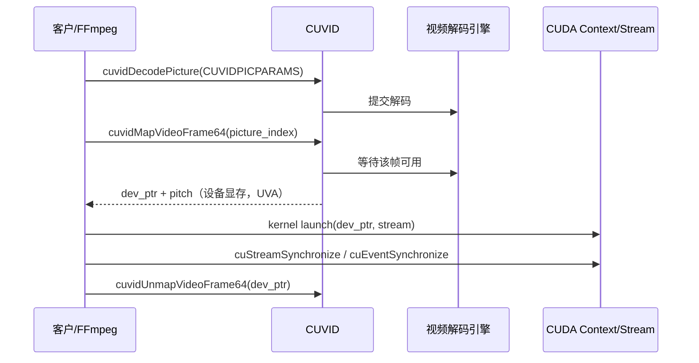
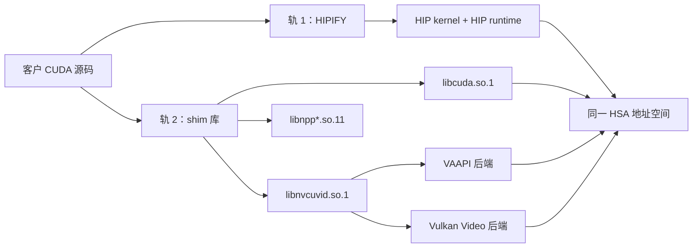
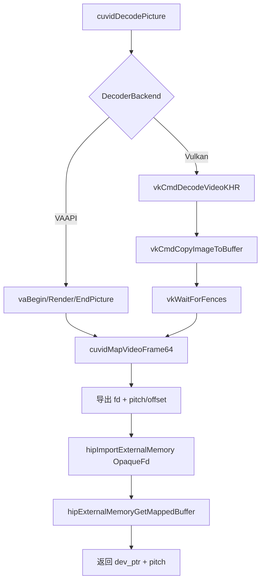
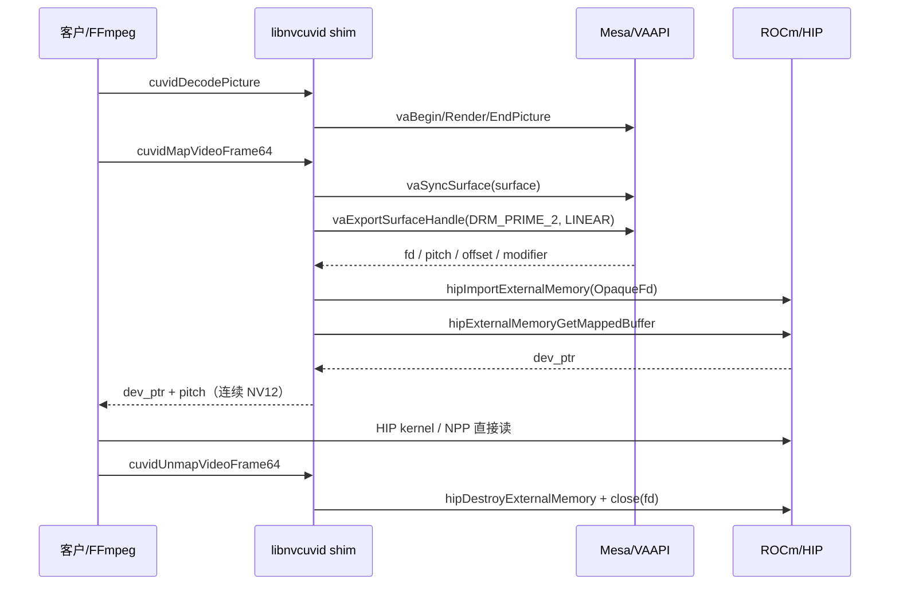
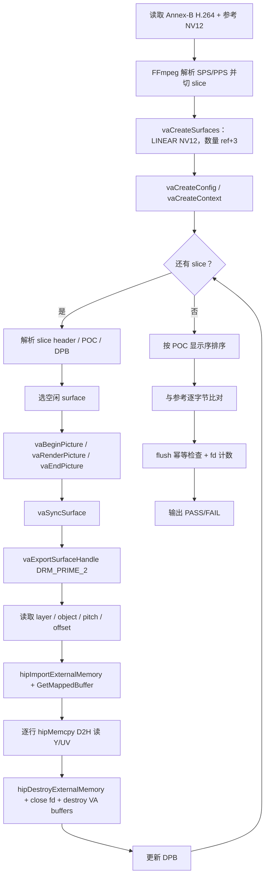
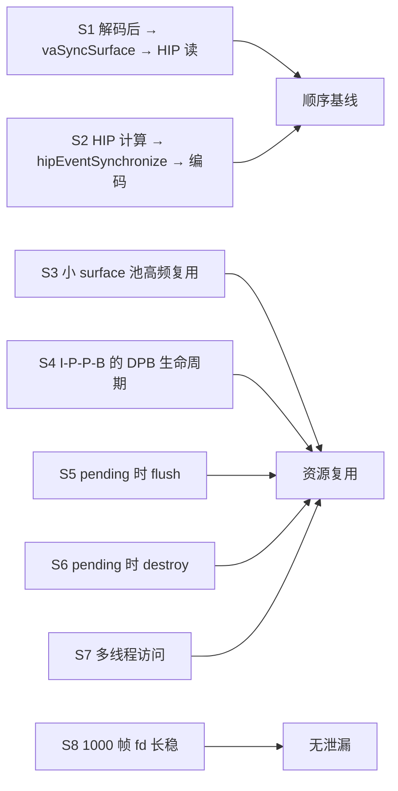
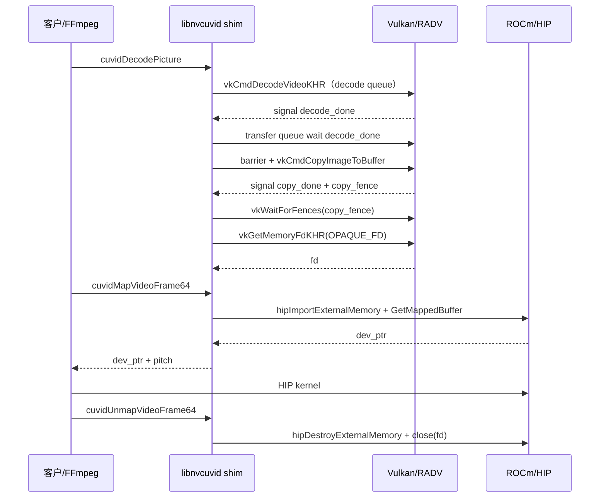

# CUDA 解码链路内存管理与同步模型

> 版本：v1.1
> 文档日期：2026-11-12
> 范围：NVDEC/CUVID 解码 → CUDA/HIP 计算这一段链路的显存管理与同步；分别覆盖 VAAPI 后端与 Vulkan Video 后端。  
> 依据：本目录《docs/architecture/cuda-compat-plan-integrated.md》《docs/architecture/cuda-compat-plan-decisions.md》《docs/architecture/cuvid-vaapi-mapping.md》及 `cuda_shim/`、`tests/zerocopy/`、`tests/sync/` 现有实现与验证记录。  
> 边界：所述验证结果来自 AMD 验证机（Radeon RX 7900 XTX / RADV / ROCm 7.x），不等同于自研目标平台验收；当前功能范围以 H.264、8-bit、4:2:0、NV12 为主。

---

## 结论先行

1. **CUDA 解码链路的“统一内存”不是 UVM。** NVDEC 解码输出本来就是设备显存，`cuvidMapVideoFrame64` 返回的是解码器拥有的设备指针；客户 kernel 直接把这个 `CUdeviceptr` 当参数使用。这里起作用的是 **UVA（统一虚拟地址）+ map/unmap 契约**，不是 `cudaMallocManaged` 的按页迁移。`cudaMallocManaged` 是另一条独立路径。
2. **兼容层的核心契约只有一句话：`cuvidMapVideoFrame64` 必须返回一个 HIP kernel 能直接使用的设备指针，且该指针在 unmap 前保持有效、内容完整。** 为此，解码 surface 必须被映射进 HIP 的 HSA 地址空间，而不是做一次 CPU 中转。
3. **VAAPI 路径可以做到真零拷贝**：线性 surface 导出 dma-buf，HIP 直接导入并映射；解码输出本身就是计算要读的那块显存。
4. **Vulkan Video 路径多一次 GPU 内拷贝**：Vulkan Video 只允许 OPTIMAL/tiled 输出，必须先用 `vkCmdCopyImageToBuffer` 转成线性 buffer，再导出给 HIP。它是“无 CPU 中转”，但不是严格零拷贝。
5. **同步目前是主机同步基线**：VAAPI 用 `vaSyncSurface`，Vulkan 用 semaphore + fence + 主机等待，计算侧用 HIP stream/event。跨栈异步 fence（sync_file/syncobj）尚未落地，属于厂商/Mesa/ROCr 协同项。
6. **已验证的是底层数据通路和协议，不是完整产品链路。** 实验 C、Vulkan 验证程序和 2026-11-12 的 P0 四路码流证明了“真实解码 → 导出 → HIP 逐字节正确”；`verify_kernel_read` 证明 mapped 指针的 kernel 可访问性；同步测试 S1–S8 证明了顺序与资源管理协议。但 FFmpeg 宿主双路径/`h264_nvdec` 零拷贝仍未验收。

---

## 一、CUDA 自身的内存管理与同步模型

### 1.1 内存模型：重点是 UVA，不是 UVM

CUDA 在 64 位 Linux 上使用统一虚拟地址（UVA）：设备显存、页锁定主机内存、managed 内存、导入的外部内存都落在同一个进程的 64 位虚拟地址空间中。对 kernel 来说，**指针值就是唯一的句柄**，不需要额外携带“这块内存在哪”的标记。

| 内存类别 | 典型 API | 谁可访问 | 与解码链路的关系 |
|---|---|---|---|
| 设备显存 | `cuMemAlloc` / `cudaMalloc` | GPU；CPU 需显式拷贝 | 解码输出、NPP 输出、kernel 输入输出 |
| 页锁定主机内存 | `cuMemHostAlloc` / `cudaHostAlloc` | CPU 与 GPU | 异步 H2D/D2H 的 staging，不在解码→计算主路径 |
| 统一内存（UVM） | `cuMemAllocManaged` / `cudaMallocManaged` | CPU 与 GPU，缺页迁移 | 客户自己的 buffer 可能用；不是 NVDEC 输出机制 |
| 外部内存 | dma-buf / VMM / IPC handle | 由导入方决定 | 兼容层把视频 surface 映射进 HIP 的核心机制 |

需要特别区分：

- **UVA**：所有分配共享一个虚拟地址空间。`cuvidMapVideoFrame64` 返回的设备指针能直接传给 kernel，靠的是 UVA。
- **UVM**：`cudaMallocManaged` 分配的 managed 内存，驱动在 CPU/GPU 访问缺页时迁移页面，可配合 `cudaMemPrefetchAsync`、`cudaMemAdvise` 控制驻留。NVDEC→CUDA 的典型路径不涉及它。
- **解码输出不是客户分配的**：它属于解码器，`cuvidMapVideoFrame64` 只是把它“发布”出来；客户不能 `cuMemFree` 这个指针，只能在 map/unmap 之间使用。

### 1.2 解码自身的模型

NVDEC 是一个独立的视频引擎，和 CUDA 计算引擎不是同一个队列。CUVID 用 map/unmap 把“解码完成”这件事暴露给调用方：



关键点：

1. `cuvidMapVideoFrame64` 返回的 `dev_ptr` 是**设备指针**，不是主机映射地址。下游 CUDA kernel 直接使用，无需 `cudaMemcpy`。
2. map 返回意味着这一帧已经可以被读取；unmap 之前，解码器不能把这块 surface 复用给新帧。
3. `CUVIDPROCPARAMS::output_stream` 允许调用方指定一个 CUDA stream，让 map 的完成与 stream 排序关联。它是 CUDA 侧“同步模型”的一部分，不是纯内存参数。
4. `cuvidCtxLock/Unlock` 用于多线程串行化对 CUDA context 的访问；它保护的是上下文操作，不替代显存同步。
5. FFmpeg 的实际用法：
   - `nvdec.c`（hwaccel 路径）map 后直接把 `frame->data[i]` 指向 `devptr + offset`，`linesize = pitch`，交给下游 CUDA 代码；
   - `cuviddec.c`（`h264_cuvid` 的 CUDA 输出）会自己分配 CUDA frame，再对每个平面 `cuMemcpy2DAsync` 一次。这是 FFmpeg 的行为，不是解码器的要求。

### 1.3 同步模型

CUDA 的同步是三层结构：

| 层 | 原语 | 语义 |
|---|---|---|
| Context | `cuCtxSynchronize` | 同步该上下文内的工作（实现上可能更强） |
| Stream | `cuStreamSynchronize`、`cuStreamWaitEvent` | 同一 stream 内按提交顺序执行；跨 stream 默认无序 |
| Event | `cuEventRecord`、`cuEventSynchronize`、`cuEventQuery` | 在 stream 中插标记，做跨 stream 依赖或主机等待 |
| 隐式 | legacy default stream | 默认流与其他 blocking stream 之间有隐式同步；HIP 不一定等价 |

对解码→计算这条链路，真正需要保证的顺序只有四段：

1. **解码引擎 → map**：map 返回前，这一帧必须写完。
2. **map → 计算 kernel**：kernel 在 map 之后提交，且读的是同一块显存。
3. **计算 kernel → 后续消费者（编码/回读/下一个 kernel）**：用同一 stream 顺序、event 或 stream 同步保证。
4. **计算完成 → unmap**：unmap 前不能回收或覆盖这块 surface。

在 NVIDIA 原生实现里，1 由 CUVID 内部保证，2/3 由 CUDA stream 顺序保证，4 由调用方在合适的生命周期点调用 unmap（FFmpeg 通过 AVBuffer 的 free 回调延迟 unmap）。兼容层要做的，就是把同样的契约在 VAAPI/Vulkan 上重建出来。

---

## 二、兼容层怎么对接

### 2.1 双轨边界

兼容层不是一个“CUDA 模拟器”，而是两条轨道：



- **轨 1（HIPIFY）**：客户自己写的 `__global__` kernel、`cudaMalloc`、`kernel<<<>>>` 被翻译成 HIP，由 hipcc 编译，链接 HIP runtime。计算侧看到的是 HIP 指针。
- **轨 2（shim）**：客户调用的 NVIDIA 现成库（CUVID/NPP/libcuda）由同名 `.so` 接住，内部改用 VAAPI/Vulkan/HIP 实现。
- `libcuda.so.1` 里的 `cuLaunchKernel` 是 stub（`CUDA_ERROR_NOT_SUPPORTED`）。也就是说，**CUDA 计算不是通过 libcuda 跑的**；libcuda 只承接设备、上下文、内存、拷贝、流和事件这些管理 API。

### 2.2 libcuda：内存与同步 API 的映射

`cuda_shim/src/libcuda.cpp` 采用 HIP 薄映射：

| CUDA API | HIP 实现 | 说明 |
|---|---|---|
| `cuMemAlloc_v2` | `hipMalloc` | 设备显存 |
| `cuMemAllocManaged` | `hipMallocManaged` | 统一内存的薄映射；不等于 NVIDIA UVM 的完整语义 |
| `cuMemAllocAsync` | `hipMallocAsync` | 异步分配 |
| `cuMemHostAlloc` | `hipHostMalloc` | 页锁定主机内存 |
| `cuMemcpy2DAsync` | `hipMemcpyParam2DAsync` | FFmpeg `h264_cuvid` 的逐平面拷贝依赖它 |
| `cuStreamCreate/Synchronize/Query` | `hipStream*` | 流 |
| `cuEventCreate/Record/Synchronize/Query` | `hipEvent*` | 事件 |
| `cuStreamWaitEvent` | `hipStreamWaitEvent` | 跨流依赖 |
| `cuCtxSynchronize` | `hipDeviceSynchronize` | 因 `hipCtxSynchronize` 在 ROCm 7.x 已废弃；语义是设备级，比上下文级更强 |

需要明确的限制：

- **没有完整 UVM**：`cudaMemPrefetchAsync`、`cudaMemAdvise`、CPU/GPU 并发访问、缺页迁移性能特征都没有按 NVIDIA 语义验证。客户如果依赖 UVM 的这些能力，必须单独评估。
- **上下文同步语义更强**：`cuCtxSynchronize` 实际是设备级同步，功能安全但可能多等。
- **默认流语义未完全对齐**：CUDA legacy default stream 的隐式跨流同步在 HIP 上不一定等价；FFmpeg 使用显式 stream，所以当前链路不受影响。
- **IPC/VMM/外部 semaphore 不在已验收范围**：跨进程共享、`cuMemCreate/cuMemMap`、`cuImportExternalSemaphore` 等没有作为本期承诺。

### 2.3 libnvcuvid：解码与 map 的实现位置

`libnvcuvid.so.1` 通过 `DecoderBackend` 抽象出两个后端：

- `VaapiBackend`：VAAPI 解码 + VAAPI surface 导出；
- `VulkanBackend`：Vulkan Video 解码 + GPU 内拷贝 + 导出。

两条路径最终都落到 `HipFrameMapping`：



`HipFrameMapping` 的职责：

1. 导入外部内存（`hipExternalMemoryHandleTypeOpaqueFd`）。
2. 取映射后的设备指针。
3. 校验 Y/UV 能否用一个基址 + pitch 表达；NV12 连续布局要求 `uv_offset == pitch * height`。
4. 在 unmap/析构时 `hipDestroyExternalMemory` 并 `close(fd)`，保证 fd 不泄漏。
5. 如果布局不满足（例如 separate layers 落在不同 object，无法用一个连续 NV12 指针表达），`cuvidMapVideoFrame64` 返回 `CUDA_ERROR_NOT_SUPPORTED`，不返回伪成功。

`cuvidMapVideoFrame64` 还做了两件事：

- 检查 `CUVIDPROCPARAMS`：当前只接受 progressive、非 second field、非 unpaired field；其他显式返回不支持。
- 用 `mapped_indices` 记录已映射的 picture index；`cuvidDecodePicture` 拒绝解码到已映射的 slot，避免下游还在读的时候被写回。

### 2.4 兼容层的同步策略

当前采用**主机同步基线**，原因是跨栈异步 fence 还没有可用的现成通路：

| 边界 | 当前做法 | 说明 |
|---|---|---|
| 解码 → map | VAAPI：`vaSyncSurface`；Vulkan：`vkWaitForFences(copy_fence)` | map 返回时生产者已空闲 |
| map → HIP kernel | map 之后提交 kernel | 同一进程、同一块物理内存 |
| HIP kernel → 编码/回读 | `hipEventRecord` + `hipEventSynchronize`（或 stream 同步） | S2 验证的基线 |
| 多线程访问 CUDA context | `cuvidCtxLock/Unlock` | 目前是 host 递归 mutex，不是 HIP context lock |
| `output_stream` | 未真正接入 | map 是同步的；比 CUDA 的异步 map 语义更强，但性能语义不同 |
| 跨栈异步 fence | 未实现 | HIP 外部 semaphore 在当前 ROCm 不可用；候选是 DRM sync_file/syncobj 桥接 |

资源生命周期要区分三类引用：

- **DPB 引用**：参考帧在参考列表里，不能被新的解码覆盖；
- **mapped frame 引用**：从 map 到 unmap 之间，不能被复用；
- **NPP/计算输入引用**：下游 kernel 还没读完，不能提前 unmap。

这三类引用只要有一类没释放，就不能回收 surface。`tests/sync` 的 S3–S6 就是围绕这个协议做的。

---

## 三、基于 VAAPI 的实现与验证

### 3.1 运行时路径



关键实现位置：

- `cuda_shim/src/vaapi_h264_decoder.cpp:134`：用 `VASurfaceAttribDRMFormatModifiers = [DRM_FORMAT_MOD_LINEAR]` 主动创建线性 surface，不依赖 `AMD_DEBUG` 之类的全局开关。
- `cuda_shim/src/vaapi_h264_decoder.cpp:62-69`：`vaBeginPicture` / `vaRenderPicture` / `vaEndPicture`。
- `cuda_shim/src/hip_frame_mapper.cpp`：`vaSyncSurface` → `vaExportSurfaceHandle`（先 SEPARATE_LAYERS，失败回退 COMPOSED_LAYERS）→ `hipImportExternalMemory` → `hipExternalMemoryGetMappedBuffer`。
- `cuda_shim/src/libnvcuvid.cpp:170`：`cuvidMapVideoFrame64` 的布局门禁、映射记录和返回值。
- `cuda_shim/src/libnvcuvid.cpp:202`：`cuvidUnmapVideoFrame64` 删除 mapping，析构时释放导入对象和 fd。

约束：

1. surface 必须是 LINEAR。VAAPI 默认 tiled+DCC 的 surface 不能按线性地址给 HIP 读。
2. pitch 要按平台要求对齐。AMD 验证机实测线性导入需要 256 对齐；生产实现必须运行时查询，不能写死。
3. Y/UV 必须能用一个基址 + pitch 表达。当前 radeonsi 导出的线性 NV12 是 Y 在 offset 0、UV 在 `pitch * height`；separate layers 但不同 object 时不满足，必须显式降级。
4. `h264_nvdec` 路径是零拷贝目标；`h264_cuvid` 的 CUDA 输出路径中 FFmpeg 自己会做 `cuMemcpy2DAsync`，应单独记录，不能混报为零拷贝。

### 3.2 验证代码实现：`tests/zerocopy/verify_decode_to_hip.cpp`

这个程序不是 shim 本身，而是“libva 真实解码 → 线性 surface → dma-buf → HIP 读取”的底层数据通路验证，对应方案里的实验 C。



程序的关键步骤：

1. 用 FFmpeg 的 `ff_h2645_packet_split` 切 slice，用 `ff_h264_decode_seq_parameter_set` / `ff_h264_decode_picture_parameter_set` 取 SPS/PPS。
2. 自己解析 slice header、POC、参考列表、MMCO 和 DPB 状态，构造 `VAPictureParameterBufferH264` / `VASliceParameterBufferH264`，喂给 VAAPI VLD。
3. 每帧 `vaEndPicture` 后立即 `vaSyncSurface`，然后 `vaExportSurfaceHandle`；导出时先试 SEPARATE_LAYERS，失败再试 COMPOSED_LAYERS。
4. 根据 `num_layers` 区分 Y/UV 的 `object_index`、`pitch`、`offset`；对每个 object 做 HIP 导入和映射。
5. 用**逐行** `hipMemcpy` 读回，而不是整块拷贝：因为 pitch 可能大于宽度（本例 pitch=512、宽 320），整块拷贝会错位。
6. 读完后销毁导入对象、关闭 fd、销毁 VA buffer；最后按 POC 做显示序排序，与参考 NV12 逐字节比较。
7. 末尾再做一次所有 surface 的 `vaSyncSurface`（flush 幂等）和 fd 计数。

验证结果（AMD RX 7900 XTX）：

| 码流 | 帧数 | 检查项 | 结果 |
|---|---:|---:|---|
| I-only | 30 | 11/11 | 逐字节一致 |
| I/P | 30 | 12/12 | 逐字节一致，含参考帧复用 |
| I/P/B | 30 | 12/12 | 逐字节一致，含 B 帧显示序重排 |
| flush | — | 所有 surface | 幂等检查通过 |
| fd | 1000 帧级 | 初始/最终 | 无泄漏 |

布局实测：LINEAR，Y pitch=512、offset=0；UV pitch=512、offset=122880（= `pitch * height`），同一 object，满足连续 NV12 条件。

**这个验证证明了什么**：libva 真实解码后的像素，经过线性 surface 导出和 dma-buf 导入，可以被 HIP 逐字节正确读取；线性直通和 pitch/offset 处理是成立的。

**这个验证没有证明什么**：它不是 `libnvcuvid.so.1` 的端到端验证，没有经过 `cuvidCreateDecoder` / `cuvidDecodePicture` / `cuvidMapVideoFrame64` 的 shim 路径，也没有经过 FFmpeg 的 `h264_cuvid` / `h264_nvdec` 宿主。P0 的 `verify_kernel_read` 另行覆盖了 shim 的 decode/map/kernel 读取通路，但“shim 输出与软解逐字节”以及 FFmpeg `h264_cuvid`/`h264_nvdec` 双路径仍需按方案 §1.7 第 1B 步单独验收。

### 3.3 同步验证：`tests/sync/verify_sync.cpp`

这个程序验证的是**顺序与资源管理协议**，不是真实码流像素。S1–S8 的覆盖如下：



结果：S1–S8 全部 PASS；S8 初始 fd=10、最终 fd=10，无泄漏。

需要如实说明：

- S1/S2 是“模拟提交 + 等待原语”的协议验证，不是真实解码/编码；
- S3–S7 主要验证池复用、DPB 引用、flush/destroy 和多线程的协议；
- 真实像素正确性由实验 C 单独证明；
- 该测试不代表 1 路/8 路 30 分钟业务稳定性已经通过。

### 3.4 FFmpeg 两条宿主路径

| 路径 | 行为 | 与兼容层的关系 |
|---|---|---|
| `h264_nvdec` | `cuvidMapVideoFrame` 后直接把 `devptr + offset` 作为 `frame->data`，`linesize = pitch` | 这是零拷贝目标路径；shim 返回的 HIP 指针被直接使用 |
| `h264_cuvid` | 分配 CUDA frame，逐平面 `cuMemcpy2DAsync` | FFmpeg 自己多一次设备内拷贝；shim 只负责把 2D 拷贝映射到 HIP |

`h264_cuvid` 的额外拷贝不是兼容层引入的，但在性能口径上必须单独记录；不能拿 `h264_cuvid` 的结果宣称零拷贝。

---

## 四、基于 Vulkan Video 的实现与验证

### 4.1 运行时路径

Vulkan Video 的解码输出按规范必须是 `VK_IMAGE_TILING_OPTIMAL`，不支持 LINEAR；HIP 的普通设备指针是线性地址，直接导入 tiled 显存后按线性读必然错位。因此兼容层采用“GPU 内拷贝一次”的方案：



关键实现位置：

- `cuda_shim/src/vulkan_h264_decoder.cpp:738-762`：为每个输出 slot 创建带 `VK_EXTERNAL_MEMORY_HANDLE_TYPE_OPAQUE_FD_BIT` 的线性 `VkBuffer`，pitch 按 `optimalBufferCopyRowPitchAlignment` 对齐，大小 `pitch * H * 3 / 2`。
- `cuda_shim/src/vulkan_h264_decoder.cpp:1145-1171`：transfer queue 等待 `decode_done_`，做 image barrier 后 `vkCmdCopyImageToBuffer` 拷 Y/UV 两个平面；提交时 signal `copy_done_` 和 fence；主机 `vkWaitForFences`。
- `cuda_shim/src/vulkan_h264_decoder.cpp:1174-1185`：`vkGetMemoryFdKHR` 导出 fd。
- `cuda_shim/src/vulkan_h264_decoder.cpp:1231`：`map_frame` 把 fd 交给 `HipFrameMapping::map_fd`，后者完成导入、映射和连续 NV12 校验。

约束：

1. 解码 image 必须是 OPTIMAL/tiled，这是规范锁死 + 硬件寻址层约束，不是 RADV bug。
2. 每帧多一次 GPU 内拷贝；4K 下的成本要在目标平台量化。
3. decode queue 和 transfer queue 通常是两个队列族，需要用 semaphore 桥接；image 使用 CONCURRENT 共享。
4. RADV/VCN<5 要求 DPB 图像与输出图像分离；`pSetupReferenceSlot` 每帧必填（B 帧用临时 slot）。
5. 导出 buffer 的 pitch 按 `optimalBufferCopyRowPitchAlignment` 对齐；UV offset = `pitch * height`。

### 4.2 验证代码实现：`tests/zerocopy/verify_vk_decode_to_hip.cpp`

```mermaid
flowchart TD
    A[读取 Annex-B H.264 + 参考 NV12] --> B[FFmpeg 解析 SPS/PPS 并切 slice]
    B --> C[创建 Vulkan instance/device，找 decode+transfer 队列]
    C --> D[创建 video session + session parameters]
    D --> E[创建 output 图像 + DPB 图像 + 可导出 VkBuffer]
    E --> F[创建 semaphore / fence / command pool]
    F --> G{还有 slice？}
    G -- 是 --> H[解析 slice header / POC / DPB]
    H --> I[构造 reference slots + StdVideo H264 参数]
    I --> J[录 decode 命令并提交，signal decode_done]
    J --> K[录 transfer：barrier + vkCmdCopyImageToBuffer]
    K --> L[提交 transfer，wait decode_done，signal copy_done+fence]
    L --> M[vkWaitForFences(copy_fence)]
    M --> N[vkGetMemoryFdKHR 导出 fd]
    N --> O[hipImportExternalMemory + GetMappedBuffer]
    O --> P[逐行 hipMemcpy D2H 读 Y/UV]
    P --> Q[destroy import + close fd]
    Q --> R[更新 DPB]
    R --> G
    G -- 否 --> S[按 POC 显示序排序]
    S --> T[与参考逐字节比对]
    T --> U[fd 计数 / 资源释放]
    U --> V[输出 PASS/FAIL]
```

程序的关键步骤：

1. 查询 `VK_KHR_video_decode_h264`、`VK_KHR_video_queue` 等能力，确认 decode/transfer 队列族。
2. 创建 video session、session parameters，上传 SPS/PPS。
3. 创建 output 图像（OPTIMAL）和 DPB 图像；DPB 与 output 分离。
4. 创建可导出的线性 `VkBuffer`，按 `optimalBufferCopyRowPitchAlignment` 对齐 pitch。
5. 每帧：
   - 解析 slice header、POC、DPB；
   - 构造 `VkVideoReferenceSlotInfoKHR` 和 `StdVideoDecodeH264PictureInfo`；
   - 提交 decode 命令，signal `decode_done`；
   - transfer 队列 wait `decode_done`，barrier 到 `TRANSFER_SRC_OPTIMAL`，`vkCmdCopyImageToBuffer` 拷两个平面，signal `copy_done` 和 fence；
   - 主机 `vkWaitForFences`；
   - `vkGetMemoryFdKHR` 取 fd；
   - HIP 导入、映射、逐行读回；
   - 销毁导入对象、关闭 fd。
6. 按 POC 做显示序排序，与参考逐字节比较；最后检查 fd 和资源。

验证结果（AMD RX 7900 XTX）：

| 码流 | 帧数 | 结果 |
|---|---:|---|
| I-only | 30 | 逐字节一致 |
| I/P | 30 | 逐字节一致 |
| I/P+B | 30 | 逐字节一致，含 B 帧显示序重排 |
| fd/显存 | — | 无泄漏 |

此外，Vulkan 后端已作为 `libnvcuvid.so.1` 的可选后端接入（`CUVID_SHIM_BACKEND=vk`），FFmpeg `h264_cuvid` 宿主对 I/P/B 码流 30 帧 0 decode error。

**这个验证证明了什么**：Vulkan Video 解码 → GPU 内 tiled→linear 拷贝 → 导出 fd → HIP 导入读取这条数据通路是通的，像素逐字节正确，资源生命周期可控。

**这个验证没有证明什么**：`h264_nvdec` 零拷贝、多流/seek/flush、crop、动态分辨率、HEVC/VP9/AV1 没有在这个后端验收；Vulkan 仍定位为 Tier 2 备选，默认后端仍是 VAAPI。

### 4.3 Vulkan 侧同步

- Vulkan 内部：decode queue → `decode_done` semaphore → transfer queue → `copy_done` semaphore + fence；主机 `vkWaitForFences`。
- Vulkan → HIP：`decode()` 末尾已经主机等待，`map_frame` 只做导入，不需要额外 HIP 等待。
- 计算 → 编码：Vulkan 编码不在 P0；如果将来实现，仍需要 HIP event + 主机等待，或者跨栈 fence。
- 异步 fence：Vulkan semaphore 导出的是 opaque fd，ROCm 不认；正确路线是 `VK_KHR_external_fence_fd` → 标准 sync_file → `DRM_IOCTL_SYNCOBJ_FD_TO_HANDLE` → amdgpu syncobj → ROCr 侧挂成 HIP queue wait fence。缺的是 ROCr 用户态这一环，属于厂商协同项。

---

## 五、两条路径对比

| 维度 | VAAPI | Vulkan Video |
|---|---|---|
| 解码输出布局 | 显式请求 `DRM_FORMAT_MOD_LINEAR` | 规范锁死 `VK_IMAGE_TILING_OPTIMAL` |
| 显存统一方式 | surface 导出 dma-buf → HIP 导入，同一块物理内存直接共享 | image → GPU 拷贝到线性 `VkBuffer` → 导出 fd → HIP 导入 |
| 额外拷贝 | `h264_nvdec` 路径 0 次；`h264_cuvid` 路径 FFmpeg 自己多一次 `cuMemcpy2DAsync` | 每帧 1 次 `vkCmdCopyImageToBuffer`（GPU 内，无 CPU 中转） |
| 导出 API | `vaExportSurfaceHandle(DRM_PRIME_2)` | `vkGetMemoryFdKHR(OPAQUE_FD)` |
| 导入 API | `hipImportExternalMemory(OpaqueFd)` + `hipExternalMemoryGetMappedBuffer` | 同左 |
| 映射结果 | `dev_ptr` + `pitch`，Y/UV 连续 NV12 | 同左 |
| 解码→计算同步 | `vaSyncSurface` 在 map 入口 | Vulkan semaphore + fence，`decode()` 末尾主机等待 |
| 计算→后续同步 | `hipEventRecord` + `hipEventSynchronize` | 同样主机同步基线 |
| 异步跨栈 fence | 未落地；sync_file/syncobj 是候选 | 未落地；external fence fd → sync_file → syncobj 是候选 |
| 当前验证 | P0 四路码流 82/82 逐字节一致；CUVID shim 的 kernel 读取 errors=0；FFmpeg 宿主零拷贝未验收 | P0 四路码流 82/82 逐字节一致；`h264_nvdec` 零拷贝未验收 |
| 主要约束 | LINEAR、pitch 对齐、连续 NV12 | tiled 转换成本、DPB/output 分离、双队列 semaphore 桥接 |

---

## 六、验证矩阵

| 验证项 | 代码/位置 | 结果 | 能证明什么 | 不能证明什么 |
|---|---|---|---|---|
| libcuda 功能子集 | `cuda_shim/tests/test_func_full.cpp` `make check_func` | 47 PASS / 0 FAIL | 设备、上下文、内存、2D 拷贝、流事件、primary ctx 的基本行为 | 完整 driver API/ABI；完整 UVM 语义 |
| VAAPI 真实解码→HIP 读 | `tests/zerocopy/verify_decode_to_hip.cpp` | I/I-P/I-P-B 各 30 帧逐字节一致；11/11、12/12、12/12 | libva 解码、线性 surface、dma-buf 导入、pitch/offset 处理正确 | CUVID shim 端到端；FFmpeg 宿主 |
| 同步协议 | `tests/sync/verify_sync.cpp` | S1–S8 全 PASS；S8 fd 10→10 | 主机同步顺序、池复用、DPB 引用、flush/destroy、多线程、fd 长稳 | 真实码流像素；1/8 路 30 分钟业务稳定性 |
| Vulkan Video 解码→HIP 读 | `tests/zerocopy/verify_vk_decode_to_hip.cpp` | I/I-P/I-P-B 各 30 帧逐字节一致；fd 无泄漏 | VK 解码、tiled→linear 拷贝、导出、HIP 导入读取正确 | `h264_nvdec`、多流、crop、动态分辨率、其他 codec |
| Vulkan 后端接入宿主 | `cuda_shim/src/vulkan_h264_decoder.cpp` + `CUVID_SHIM_BACKEND=vk` | FFmpeg `h264_cuvid` 30 帧 0 decode error；shim 后端 I/IP/IPB 30 帧逐字节一致 | 后端抽象和 FFmpeg 宿主加载路径可用 | 完整业务链路与目标平台性能 |
| P0 双后端闭环（2026-11-12） | `tests/zerocopy/verify_decode_to_hip.cpp` + `verify_vk_decode_to_hip.cpp` + `cuda_shim/tests/verify_kernel_read.cpp` | 四路码流：VAAPI 82/82、Vulkan 82/82 逐字节一致；`verify_kernel_read` errors=0 | 两条后端的数据通路、mapped `dev_ptr` 的 kernel 可访问性、event→unmap 顺序 | FFmpeg 宿主双路径、多流/seek/动态分辨率、目标平台性能 |
| VAAPI CUVID shim 像素 | `cuda_shim/src/vaapi_h264_decoder.cpp` + `libnvcuvid.cpp` | 经 shim 的 `verify_kernel_read` errors=0；四路码流 bit-exact 由直接后端程序验证；FFmpeg 宿主未验收 | shim 的 decode/map/kernel 读取通路可用 | shim 输出与软解参考逐字节、FFmpeg 双路径零拷贝 |

---

## 七、结论

1. **模型层面**：CUDA 解码→计算依赖的是 UVA + `cuvidMapVideoFrame` 的设备指针，不是 `cudaMallocManaged` 的 UVM。兼容层必须让 map 返回一个 HIP kernel 可直接使用的设备指针，并且在 unmap 前保持这块显存不被复用。
2. **实现层面**：兼容层采用“双轨”——用户 kernel 由 HIPIFY 转 HIP，库调用由 shim 接住；解码 surface 通过 dma-buf 导入 HIP 的 HSA 地址空间。`HipFrameMapping` 是内存统一的核心，`cuvidMapVideoFrame64` 是契约的核心。
3. **VAAPI 路径**：线性 surface 可以做到真零拷贝；`h264_nvdec` 是零拷贝验收路径，`h264_cuvid` 的 `cuMemcpy2DAsync` 是 FFmpeg 自身行为，需单独记录。
4. **Vulkan 路径**：由于 OPTIMAL/tiled 的规范约束，必须多一次 GPU 内拷贝；它能做到“无 CPU 中转”，但不能称为严格零拷贝。该路径的解码→拷贝→导出→HIP 读取已经逐字节验证。
5. **同步层面**：当前是主机同步基线。`vaSyncSurface` / Vulkan fence + HIP event 能保证顺序，S1–S8 协议验证通过；跨栈全异步流水线需要 DRM sync_file/syncobj 桥接，尚未实现，不应对外承诺。
6. **验证边界**：P0 已用四路码流在两个后端完成逐字节闭环，`verify_kernel_read` 也证明 mapped 指针可被 kernel 直接寻址；但 FFmpeg 宿主双路径/`h264_nvdec` 零拷贝、多流/复杂码流、自研目标平台和真实业务性能仍未验收。文档和对外表述应区分“底层通路通过”“shim 路径通过”“业务链路通过”三个层级，不能混报。

---

## 参考

- `docs/architecture/cuda-compat-plan-integrated.md`：§4.2 数据通路、§4.3 同步、§4.4 Vulkan Video、§4.12 异步 fence、§5.3 当前数据通路。
- `docs/architecture/cuda-compat-plan-decisions.md`：§3.3 验证基础、§3.4 尚未完成的工作。
- `docs/architecture/cuvid-vaapi-mapping.md`：§2.1 底层 API 映射、§4.3 `cuvidMapVideoFrame64` 语义、§10.3 缩放路径。
- `cuda_shim/src/libcuda.cpp`：内存、流、事件映射。
- `cuda_shim/src/hip_frame_mapper.cpp`：VAAPI/Vulkan 导出导入与布局校验。
- `cuda_shim/src/vaapi_h264_decoder.cpp`：LINEAR surface 创建与 VAAPI 解码。
- `cuda_shim/src/vulkan_h264_decoder.cpp`：Vulkan 解码、拷贝、导出。
- `cuda_shim/src/libnvcuvid.cpp`：`cuvidMapVideoFrame64` / `cuvidUnmapVideoFrame64`。
- `tests/zerocopy/verify_decode_to_hip.cpp`：实验 C。
- `tests/zerocopy/verify_vk_decode_to_hip.cpp`：Vulkan Video 数据通路验证。
- `tests/sync/verify_sync.cpp`：S1–S8 同步与资源管理验证。
- `cuda_shim/tests/test_func_full.cpp`：libcuda 功能子集验证。
- `docs/evidence/p0-2026-11-12.md`：P0 双后端四路码流结果。
