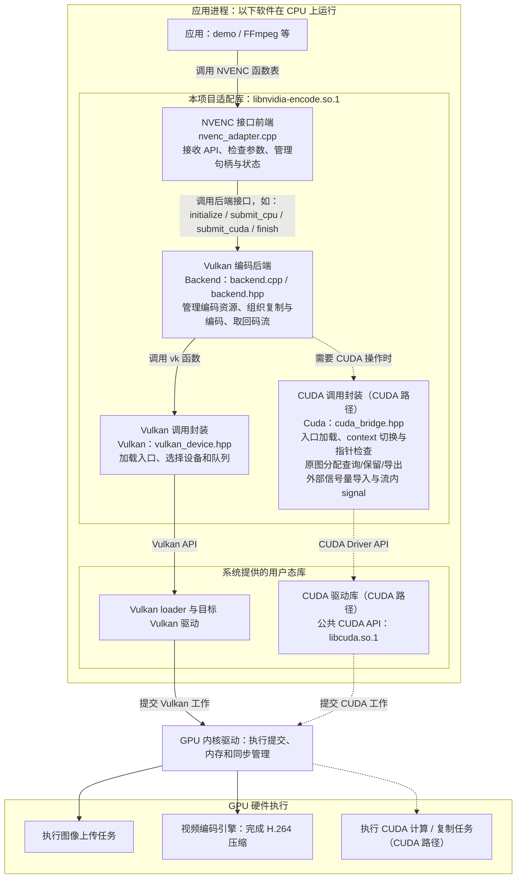
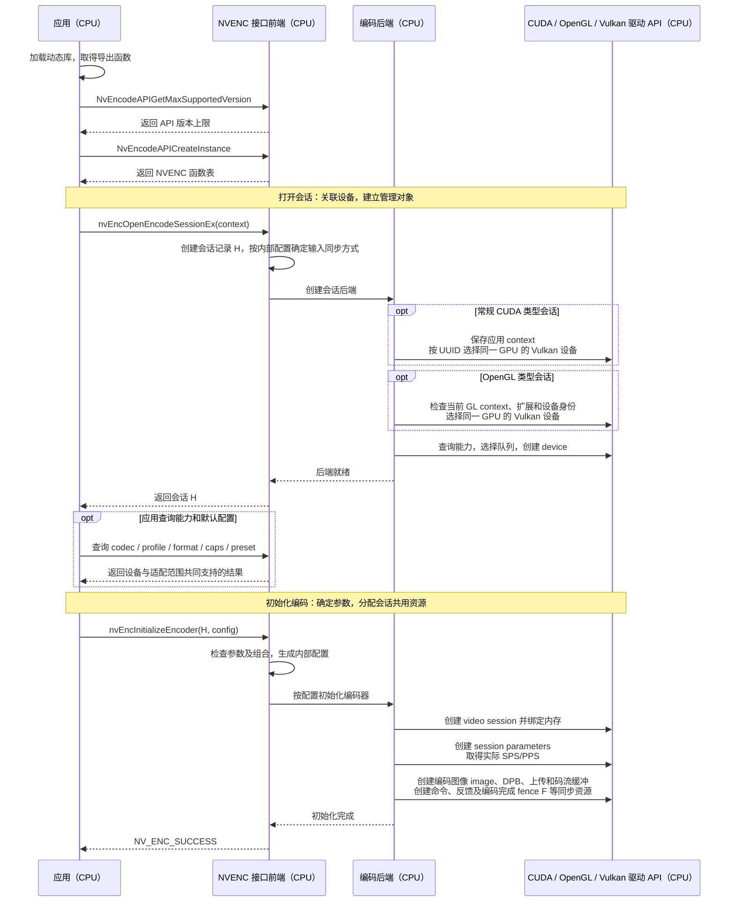
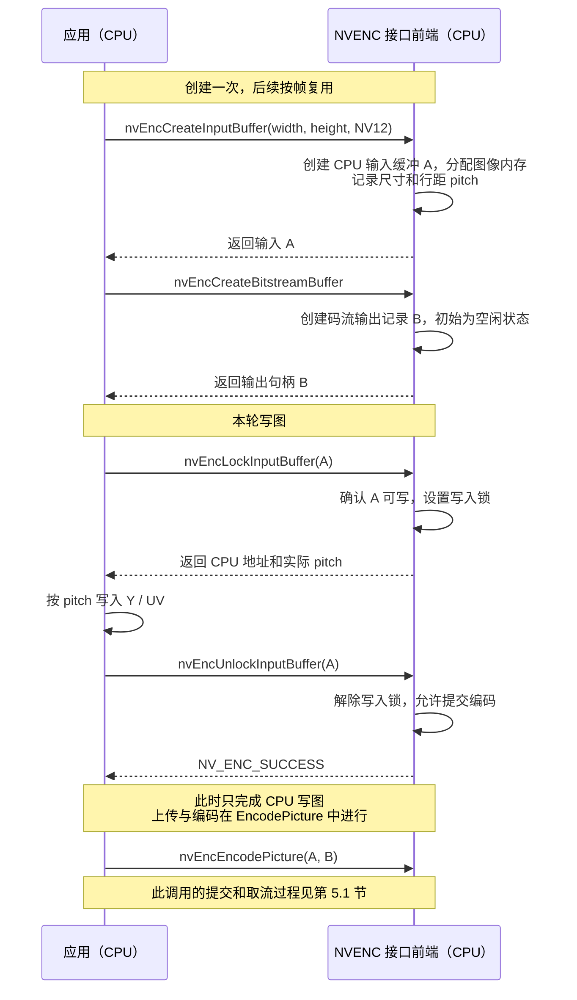
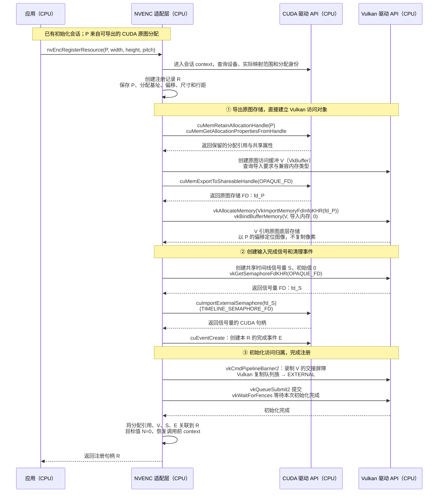
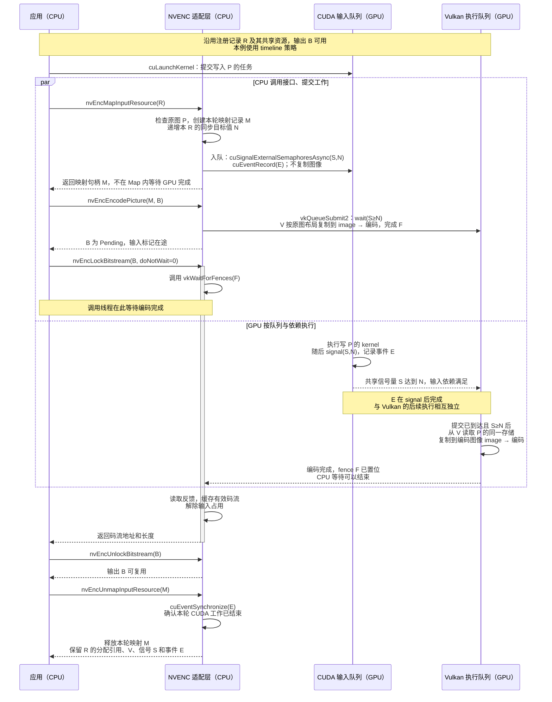
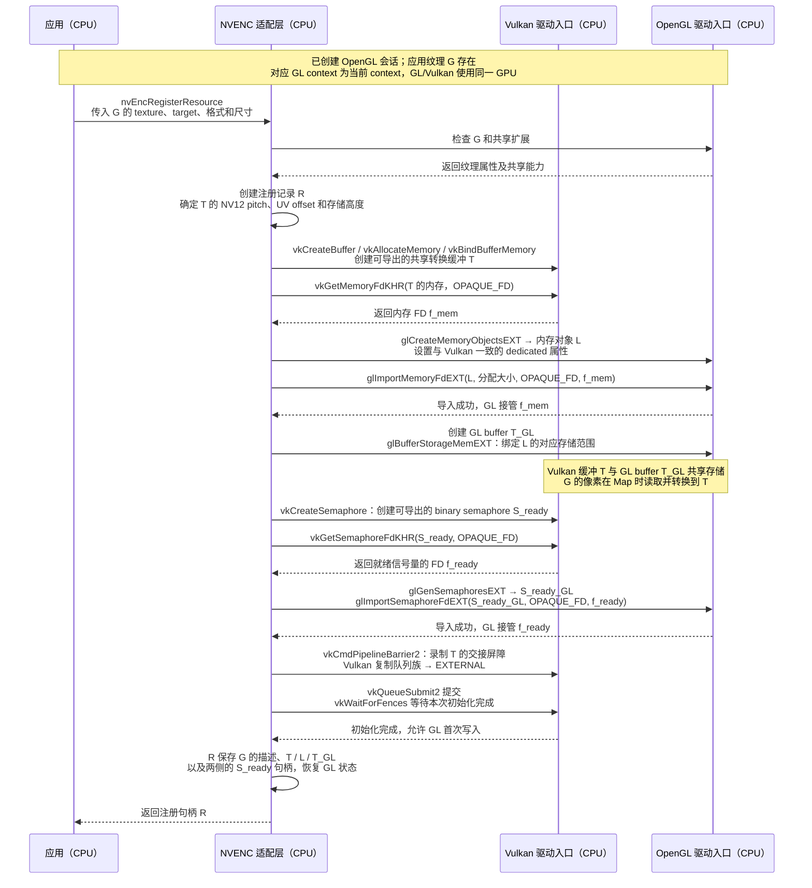
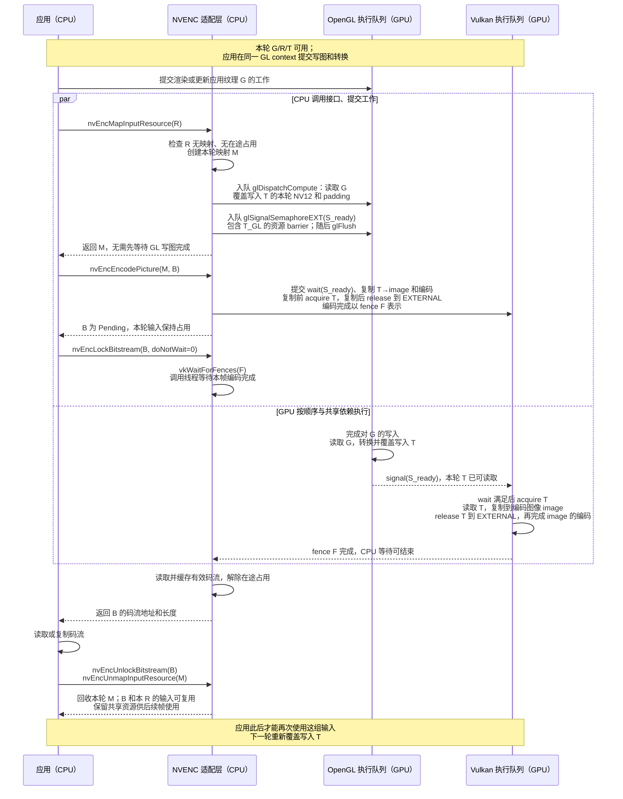
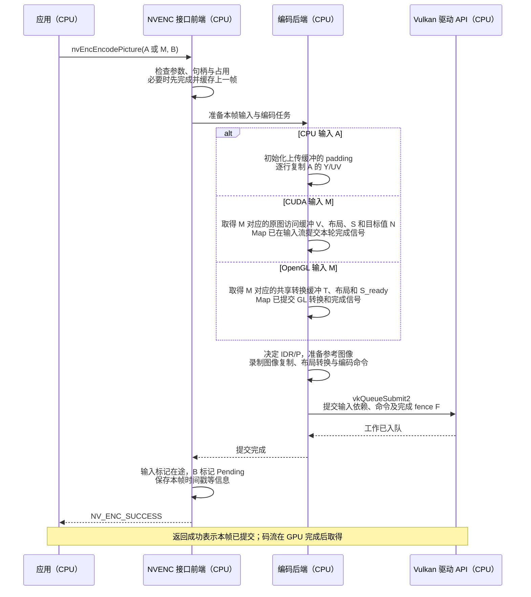
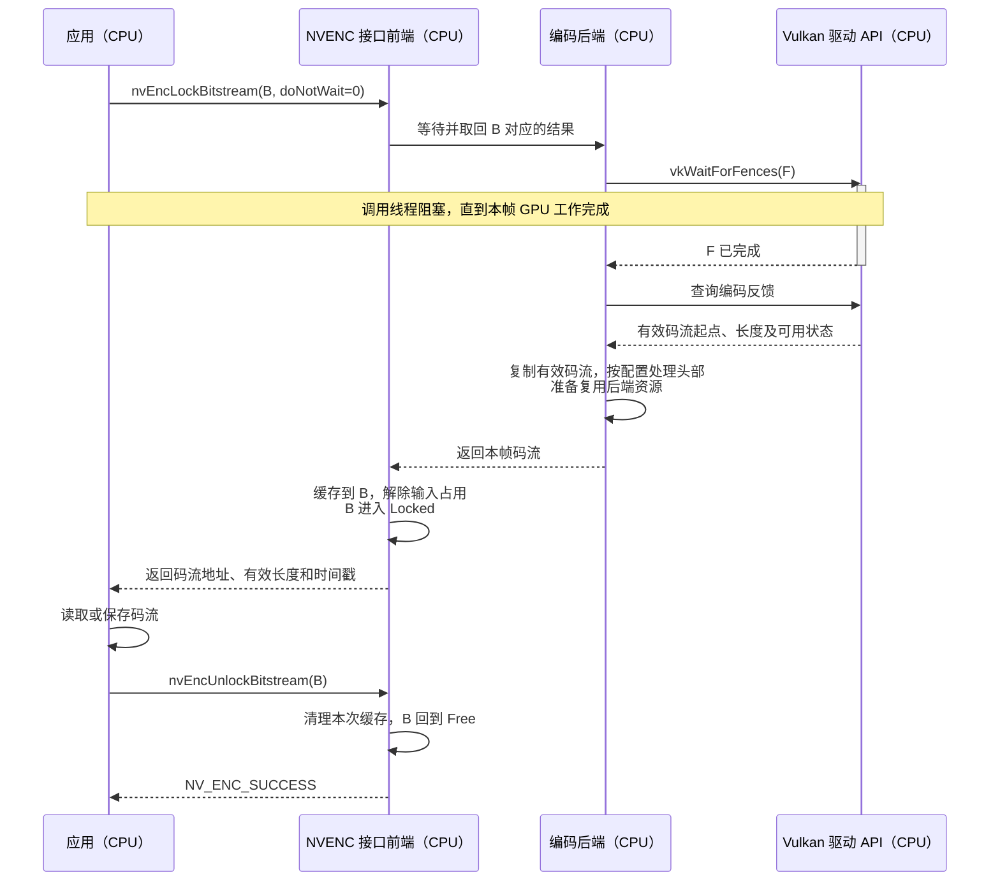

# 基于 Vulkan Video 的 NVENCODE API 适配层实现方案

目标系统：Linux x86-64 / Ubuntu 24.04。前端 API：NVENC API 12.1；编码后端：Vulkan Video H.264 Encode。

本方案的目标是：**应用继续调用 NVENCODE API，由适配层把编码工作交给目标 GPU 的 Vulkan Video 驱动执行。** 应用仍加载 `libnvidia-encode.so.1`，仍按原来的方式创建编码器、送入图像和取回码流。


下文将 NVENCODE API 简称为 NVENC。第 1～2 节说明适配目标和总体设计；第 3～5 节依次展示初始化、输入准备和编码取流；第 6 节说明参数转换；第 7 节说明核心 API 的实现思路；第 8 节说明核心链路的验证内容与复现入口。

| 阅读目的 | 对应章节 |
| --- | --- |
| 目标和总体设计 | [适配目标](#1-适配目标)、[总体架构](#2-总体架构与模块职责) |
| 核心流程 | [初始化](#3-接口加载会话创建与初始化) → [输入与同步](#4-输入接入资源共享与完成同步) → [编码与取流](#5-编码提交与码流输出) |
| 实现细节 | [参数转换](#6-参数转换) |
| API 的实现思路 | [核心 API 的功能与实现](#7-核心-api-的功能与实现思路) |
| 验证与复现 | [核心链路验证](#8-验证) |

## 1. 适配目标

### 1.1 目标链路

考虑两种常见链路：应用在 CPU 内存中填写图像，或用 CUDA 在 GPU 内存中生成图像。两种输入最终都要送入 Vulkan 编码图像，再由编码引擎硬件生成 H.264 码流。

```text
CPU 输入：CPU 填图 → 上传缓冲 → Vulkan 编码图像 → GPU 编码 → 取回码流
CUDA 输入：CUDA 写图 → 导入到Vulkan → Vulkan 编码图像 → GPU 编码 → 取回码流
OpenGL 扩展：GL 纹理 → 共享 NV12 缓冲 → Vulkan 编码图像 → GPU 编码 → 取回码流
```


### 1.2 能力与设计约束

优先实现以下核心能力，核心功能完成后，再在统一框架上按应用需要扩展其他功能。

- 编码格式：H.264 High、NV12 8-bit 4:2:0、逐行、单 slice、单参考 IP；核心功能的分辨率上限为 **4K UHD（3840×2160）**。Level 按尺寸、帧率、码率和参考缓冲要求选择，具体帧率由目标应用场景确定，并受设备能力限制。
- 图像输入：CPU 填写的输入缓冲，以及 CUDA `CUdeviceptr` 注册输入。CUDA array、OpenGL 纹理按应用需要扩展；OpenGL 接入思路见第 4.4 节。
- 码控：CBR、VBR、固定 QP（I/P 帧使用相同 QP）；支持周期 IDR、FORCEIDR、基本色彩 VUI、AUD 与 SPS/PPS 输出控制。
- 扩展范围：多profile、B 帧、多参考、LTR、lookahead/AQ、多 pass、动态重配置、更多格式/codec 在核心功能完成后按应用需要扩展。

### 1.3 核心 NVENC API

按 NVENC API 12.1 头文件统计，共有 44 个 API。其中的 **32 个：2 个动态库导出函数和 30 个函数表中的函数**作为核心，覆盖 CPU/CUDA 输入和 H.264 IP 编码链路。其余 12 个列在第 1.4 节。


| 分组 | API 列表 | 需要提供的行为 |
| --- | --- | --- |
| 库入口 | `NvEncodeAPIGetMaxSupportedVersion`<br/>`NvEncodeAPICreateInstance` | 版本协商、创建并填充 NVENC 函数表 |
| Codec 查询 | `nvEncGetEncodeGUIDCount`<br/>`nvEncGetEncodeGUIDs` | 枚举支持的编码格式，核心功能为 H.264 |
| Profile 查询 | `nvEncGetEncodeProfileGUIDCount`<br/>`nvEncGetEncodeProfileGUIDs` | 枚举支持的 profile，核心功能为 H.264 High |
| 输入格式查询 | `nvEncGetInputFormatCount`<br/>`nvEncGetInputFormats` | 枚举支持的输入像素格式，核心功能为 NV12 |
| 能力查询 | `nvEncGetEncodeCaps` | 返回设备能力与适配范围的交集，并与参数校验保持一致 |
| Preset 查询 | `nvEncGetEncodePresetCount`<br/>`nvEncGetEncodePresetGUIDs`<br/>`nvEncGetEncodePresetConfig`<br/>`nvEncGetEncodePresetConfigEx` | 返回可接受的 preset 及基础配置，处理 tuning 与默认参数 |
| 会话管理 | `nvEncOpenEncodeSessionEx`<br/>`nvEncInitializeEncoder`<br/>`nvEncDestroyEncoder` | 创建会话、保存 context、初始化编码配置和资源、结束并回收 |
| CPU 输入缓冲 | `nvEncCreateInputBuffer`<br/>`nvEncLockInputBuffer`<br/>`nvEncUnlockInputBuffer`<br/>`nvEncDestroyInputBuffer` | 创建逻辑输入 、提供 CPU 写地址和 pitch、维护写入与占用状态 |
| CUDA 资源注册与映射 | `nvEncRegisterResource`<br/>`nvEncMapInputResource`<br/>`nvEncUnmapInputResource`<br/>`nvEncUnregisterResource` | 管理资源注册和映射，保证映射更新、同步和生命周期 |
| CUDA 流配置 | `nvEncSetIOCudaStreams` | 保存输入/输出 CUstream 配置，确定输入生产完成信号的提交流 |
| 输出缓冲管理 | `nvEncCreateBitstreamBuffer`<br/>`nvEncDestroyBitstreamBuffer` | 创建/销毁逻辑输出，维护码流缓存和占用状态 |
| 编码提交 | `nvEncEncodePicture` | 接收图像或 EOS，处理本帧参数、参考帧、输入依赖与编码提交 |
| 码流读取 | `nvEncLockBitstream`<br/>`nvEncUnlockBitstream` | 阻塞或非阻塞取流，返回有效字节、时间戳和帧类型，结束缓存占用 |
| 序列头读取 | `nvEncGetSequenceParams` | 返回 SPS/PPS，供应用写入全局头部或封装容器 |
| 错误信息 | `nvEncGetLastErrorString` | 返回会话相关错误，辅助应用处理配置或运行失败 |

每个 API 的功能和实现思路见[第 7 节](#7-核心-api-的功能与实现思路)。

### 1.4 扩展 API

以下 12 个 API 在核心功能完成后按需扩展。未实现的函数，函数表仍保留对应函数指针，调用时明确返回 `NV_ENC_ERR_UNIMPLEMENTED`；决定支持某个 API 后，再补齐它的功能。

| 扩展类别 | API 列表 | 作为扩展功能的原因与实现考虑 |
| --- | --- | --- |
| 旧式会话入口 | `nvEncOpenEncodeSession` | 核心功能使用 `nvEncOpenEncodeSessionEx` 创建会话；旧应用确实调用旧式入口时再补充兼容。 |
| 动态重配置 | `nvEncReconfigureEncoder` | 核心功能采用固定初始化配置；动态调整码率、分辨率作为扩展，需处理参数生效时机、资源调整和在途帧。 |
| 参考帧失效 | `nvEncInvalidateRefFrames` | 用于应用主动使参考帧失效，例如丢包恢复。普通 IP 编码不需要调用它，但适配层内部的参考帧管理仍属于核心功能。 |
| 编码统计 | `nvEncGetEncodeStats` | API 12.1 头文件说明它不支持 CUDA 类型会话，并建议通过核心接口 `nvEncLockBitstream` 获取统计信息。 |
| 初始化前获取序列头 | `nvEncGetSequenceParamEx` | 核心功能在初始化后通过 `nvEncGetSequenceParams` 获取 SPS/PPS；初始化前获取头部按应用需要扩展。 |
| 异步编码事件 | `nvEncRegisterAsyncEvent`<br/>`nvEncUnregisterAsyncEvent` | 这套编码完成事件模式用于 Windows WDDM，本方案面向 Linux，采用同步取流模式；CUDA→Vulkan 的 GPU 输入依赖另由外部 semaphore 表达。 |
| 运动估计输出 | `nvEncCreateMVBuffer`<br/>`nvEncDestroyMVBuffer`<br/>`nvEncRunMotionEstimationOnly` | 属于只做运动估计并输出运动矢量的独立功能，不是生成 H.264 码流的必经步骤；需另行定义 MV 输出布局、后端任务和反馈。 |
| 编码状态恢复 | `nvEncRestoreEncoderState` | 核心 IP 编码不依赖历史状态恢复；支持它还需保存编码器内部状态，并定义恢复时机。 |
| 显式 lookahead | `nvEncLookaheadPicture` | 核心功能关闭 lookahead；支持它需要增加预分析、帧缓存和延迟队列。 |


## 2. 总体架构与模块职责

### 2.1 核心实现思路

对应用提供原有 NVENC 接口，内部通过 Vulkan Video 完成编码。适配层承担接口与参数转换、输入接入、同步和资源管理；硬件编码由目标 GPU 的 Vulkan 驱动执行。整体按以下过程组织：

1. **接收原有接口调用。** 应用加载适配库，通过 NVENC 函数表创建会话、配置编码器、送入图像和取回结果。适配层检查结构体版本、参数和调用顺序，维护应用看到的输入输出句柄。
2. **把编码要求转换为 Vulkan 配置。** 将分辨率、帧率、GOP、码控等参数整理为内部配置，创建 video session、编码图像、参考图像和码流缓冲。逐帧决定 IDR/P 类型、参考列表和重建位置，再生成 Vulkan 编码命令。
3. **直接共享 CUDA 原图。** CPU 输入经上传缓冲复制到编码图像。CUDA 输入由公共 CUDA 层提供可导出的原图存储；Register 从应用指针 P 找到该存储，导出 OPAQUE_FD 并导入 Vulkan，建立访问同一存储的 VkBuffer V。Map 只在输入流追加完成信号，不复制图像；编码时由 Vulkan 将 V 的 Y/UV 平面复制到编码图像。

4. **保证先写图、后读图。** 对于 CUDA 等 GPU 输入，需要保证计算、渲染等生产者完成图像写入，且写入结果对编码端可见，才能读取。可以由 CPU 显式等待生产完成，也可以通过 GPU 队列间的信号与等待建立依赖。本方案优先实现 GPU 同步路径，减少 CPU 等待，为计算、复制与编码的重叠执行创造条件；CUDA 路径采用 timeline semaphore 表达逐帧完成点。

    具体做法是：由 Vulkan 创建 timeline semaphore 并导出 OPAQUE_FD，CUDA 导入该信号量。Map 在生产图像的 CUDA 输入流上追加 signal；Vulkan 在读取原图存储的提交中加入 wait。内存 FD 的方向是 CUDA→Vulkan，信号量 FD 的方向是 Vulkan→CUDA，两者分别管理。
5. **取回结果并复用资源。** GPU 完成后，读取编码反馈，把有效码流缓存到对应输出对象，返回长度、时间戳和帧类型。每个注册输入保留自己的共享资源，会话共用编码资源；按各自的完成条件复用和释放。


### 2.2 适配层对 CUDA 层的需求

适配层需要调用 CUDA Driver API，获取应用使用的设备信息、访问输入图像，并建立 CUDA 与 Vulkan 之间的内存共享和同步关系。例如，在应用提供的 CUDA context 中，通过 `cuCtxGetDevice` 取得对应设备，再通过 `cuDeviceGetUuid_v2` 获取 UUID，以选择同一物理 GPU 的 Vulkan 设备。

公共 CUDA 层需要让用于编码的原图可导出。应用仍可调用 `cuMemAlloc` / `cuMemAllocPitch` 等原有接口，由公共层在内部使用 VMM 或等价机制创建可共享存储；视频侧通过 P 查询并保留分配、导出内存 FD，再由 Vulkan 导入。参照 NVIDIA 原生环境的 demo 则显式调用 VMM 分配接口。

完成同步采用相反的共享方向：Vulkan 创建 timeline semaphore 并导出 FD，CUDA 导入；Map 在实际生产流之后调用 `cuSignalExternalSemaphoresAsync`，供 Vulkan 等待。图像不再经 CUDA 复制到另一块中间缓冲。

| 能力 | 目的 | 代表性 API |
| --- | --- | --- |
| 设备与 context | 接收会话 context，按 UUID 选择同一物理 GPU，调用结束后恢复线程原 context | `cuCtxGetDevice`、`cuDeviceGetUuid_v2`、`cuCtxPushCurrent_v2`、`cuCtxPopCurrent_v2` |
| 可导出图像分配 | 由公共分配器创建可导出的设备存储并建立 CUDA 地址；保持应用原有分配、pitch、查询及释放语义 | 应用侧 `cuMemAlloc` / `cuMemAllocPitch`；底层可用 `cuMemGetAllocationGranularity`、`cuMemCreate`、`cuMemAddressReserve`、`cuMemMap`、`cuMemSetAccess` |
| 地址与布局检查 | 查询实际映射范围、设备、分配身份和访问权限，校验 P 偏移、pitch 与两平面边界；VMM 的 CONTEXT 属性可以为空，不能只凭它判断归属 | `cuMemGetAddressRange_v2`、`cuPointerGetAttribute`、`cuMemGetAccess` |
| 原图存储导出 | 根据 P 保留分配引用，确认可导出类型和设备，导出供 Vulkan 导入的 FD；使用结束后释放引用 | `cuMemRetainAllocationHandle`、`cuMemGetAllocationPropertiesFromHandle`、`cuMemExportToShareableHandle`、`cuMemRelease` |
| 外部完成信号 | 导入 Vulkan 创建的 timeline semaphore，在写图之后推进本轮数值，由 Vulkan 在 GPU 上等待 | `cuImportExternalSemaphore`、`cuSignalExternalSemaphoresAsync`、`cuDestroyExternalSemaphore` |
| 本轮完成与清理 | signal 后记录 E；Unmap 或清理时确认本轮 CUDA 工作结束，包括 Map 后没有 Encode；CPU 等待策略另等输入流 | `cuEventCreate`、`cuEventRecord`、`cuEventSynchronize`、`cuEventDestroy_v2`、`cuStreamSynchronize` |
| 应用自身计算 | 创建设备上下文、加载模块、执行 kernel，产生正确图像；具体接口按目标应用确定 | `cuInit`、`cuDeviceGet`、`cuCtxCreate_v2`、`cuModuleLoadData`、`cuModuleGetFunction`、`cuLaunchKernel` 等 |


### 2.3 模块结构

适配层是应用进程中加载的一个动态库，内部主要分为两部分：**接口前端负责接收 NVENC 调用、检查参数和管理句柄；编码后端负责准备 Vulkan 资源、提交编码和取回结果。** 分别把它们记为 `nvenc_adapter` 和 `Backend`。

两部分在同一进程中通过普通函数调用连接。后端使用 Vulkan 完成编码；遇到 CUDA 输入时，还调用公共 CUDA API。OpenGL 扩展在同一后端增加 GL 输入桥接，负责纹理读取、转换和外部信号操作，复用 Vulkan 编码资源与取流流程。

```text
应用 / demo
  │ 调用 NVENC API 函数表
  ▼
NVENC 兼容库 libnvidia-encode.so.1
  ├─ NVENC 接口前端：nvenc_adapter.cpp
  │    接收调用，检查参数，管理会话、输入输出句柄和状态
  │    │ 普通 C++ 函数调用
  │    ▼
  └─ 编码后端：Backend（backend.cpp / backend.hpp）
       管理编码资源，组织输入桥接、图像复制、编码和码流读取
       ├─ Vulkan 调用封装：vulkan_device.hpp
       │    └─ 系统 Vulkan loader / 目标 GPU 驱动
       └─ CUDA 调用封装：cuda_bridge.hpp（CUDA 输入路径）
            提供 context / 指针检查、原图分配查询/保留/导出及同步接口
            └─ 系统 CUDA 驱动 / 公共 CUDA 实现
```

下面的结构图把适配库、系统驱动和 GPU 分开，便于区分“CPU 上执行的接口代码”和“GPU 上执行的编码任务”。




## 3. 接口加载、会话创建与初始化

### 3.1 动态库加载、函数表与 ABI

应用通过动态加载或自己的 SDK 封装找到本项目 `libnvidia-encode.so.1`。库导出 `NvEncodeAPIGetMaxSupportedVersion` 和 `NvEncodeAPICreateInstance`；后者填充 NVENC 函数表，后续 `nvEnc*` 由函数指针进入前端。

ABI 兼容包括导出符号、调用约定、函数签名和结构体布局。本方案按 NVENC 12.1 检查结构体版本，避免用错误的布局读取参数。版本相符后，还需要通过能力查询和参数检查确认具体功能是否可用。

函数表覆盖核心和扩展接口，尚未支持的函数明确返回不支持。各接口的实现思路在第 7 节。

### 3.2 会话、设备选择与初始化流程

打开会话和初始化编码器是两个步骤。Open 接收应用的设备信息，选择对应的 Vulkan 设备并返回会话句柄；Initialize 再按分辨率、GOP 和码控等配置创建编码资源。

打开会话时，`NvEncOpenEncodeSessionEx` 要求指定 deviceType 并提供对应的设备上下文。CUDA 传 CUcontext，DirectX 传 D3D device，OpenGL 使用调用线程上当前的 GL context，此时 device 填 NULL。即使输入是从文件读到 CPU 内存的 NV12，也要选择一种方式。

可能的设计原因是，NVENC 在打开会话时一并确定使用哪张 GPU，以及后续怎样注册和同步应用已有的 GPU 资源。例如，D3D12 应用可以把渲染好的纹理直接交给 NVENC，并用 fence 告知何时可读，省去 CPU 回读和重新上传。纯文件输入用不到这项互操作能力，但沿用了同一个会话入口。



图中的 Session 保存一次编码所需的后端、配置、输入输出、执行中的编码任务。Open 返回的句柄 H 指向这份会话记录，后续 API 通过 H 找到相应资源。

图中的输入同步方式由适配层内部确定，并保存在会话中。CUDA 输入优先使用 GPU timeline 路径：Map 提交完成信号后返回，由 Vulkan 队列等待输入就绪；CPU 等待路径则在 Map 中等图像准备完成再返回。两种方式都使用 GPU 编码。


## 4. 输入接入、资源共享与完成同步

按资源接入方式，输入分为两类：一类是通过 NVENC 接口创建、由 CPU 填写的输入缓冲；另一类是应用在外部分配的图像资源，例如 CUDA 内存、CUDA array 或 OpenGL 纹理。两类输入使用不同的准备接口，最终都通过 `nvEncEncodePicture` 提交编码。

- **CPU 输入**：`nvEncCreateInputBuffer → nvEncLockInputBuffer → CPU 写图 → nvEncUnlockInputBuffer → nvEncEncodePicture`。
- **外部资源输入**：先通过 `nvEncRegisterResource` 登记资源；每次使用时调用 `nvEncMapInputResource`，将返回的映射句柄传给 `nvEncEncodePicture`。


下文先展开 CPU 输入和 CUDA 指针输入两条核心路径，再说明 OpenGL 纹理的扩展接入。

### 4.1 CPU 输入

本图从会话初始化完成后开始。CPU 输入句柄 A 和码流输出句柄 B 均由图中的创建接口返回，后续写图、编码和取流通过这两个句柄关联相应资源。



这里的 Lock/Unlock 只管理应用对 CPU 图像的写入。应用调用 EncodePicture 后，适配层才逐行复制到 CPU 可写的上传缓冲，再提交 GPU 复制和编码。

CPU 输入的行距由适配层选择，默认按 64 字节对齐；应用始终以 Lock 返回的 pitch 为准。这是本方案的分配选择，不是所有 NVENC 输入都必须采用的固定行距。

CreateBitstreamBuffer 创建的是一份码流输出，用来保存该帧码流和状态。

### 4.2 CUDA 输入：直接导入原图存储

P 是应用已经取得的 CUDA 原图地址，来自公共 CUDA 层提供的可导出分配；它不要求等于分配基址。Register 创建注册记录 R，并为该存储创建 Vulkan 访问对象 V。**V 是 VkBuffer，和 P 访问同一份像素存储，不是一份复制出来的图像。** S 是本 R 的共享 timeline semaphore，E 是用于 Map 清理的 CUDA 事件。



这里通过屏障将 V 的访问归属交给外部 API，再等待该次初始化完成。此操作在 Register 阶段执行；后续 CUDA 写图完成由 Map 中的输入信号通知 Vulkan。

### 4.3 CUDA 异步编码：signal / wait

本图沿用上一节创建的注册句柄 R，以及它关联的原图 P、访问同一存储的 Vulkan 缓冲 V、共享信号量 S 和事件 E。输出句柄 B 由 `nvEncCreateBitstreamBuffer` 创建；编码图像 image 和编码完成 fence F 已在会话初始化时准备好。本轮 Map 新建映射句柄 M，并递增该 R 的同步目标值 N。

下面展示 timeline 方式，假设没有上一帧占用后端资源。应用先在输入流提交写图操作，Map 再在同一流追加 signal 和事件记录。流内顺序保证 signal 发生在写图之后，因此 Map 可以在 GPU 尚未完成时返回。

输入流由 `nvEncSetIOCudaStreams` 指定，未设置时使用默认流 0。如果图像由其他流生产，应用需要先把那条流的完成依赖接到输入流上。



图中 CUDA 指向 Vulkan 的虚线表示：S 到达目标值，Vulkan 的等待条件得到满足。两侧通过共享信号量建立依赖，无须CPU介入。

例如第一轮 Map 使用 N=1，第二轮使用 N=2。每一轮都在正确的输入流上追加 `cuSignalExternalSemaphoresAsync`，Vulkan 等待本轮对应的值，避免把上一帧的完成信号误用于下一帧。


### 4.4 OpenGL 输入：导入与同步

OpenGL 接入沿用 `nvEncOpenEncodeSessionEx → RegisterResource → MapInputResource → EncodePicture → Unmap → Unregister`，在现有接口中增加资源类型分支。编码参数转换、DPB 管理和码流输出继续使用同一个 Vulkan 后端。


**导入方案：Vulkan 分配共享存储，OpenGL 导入后写入。** 应用只需提供已有纹理，适配层读取该纹理并生成编码需要的 NV12 图像；共享缓冲和同步对象由适配层内部准备，不要求应用导出纹理的底层内存。需要OpenGL支持相关的扩展，比如：glCreateMemoryObjectsEXT 、glImportMemoryFdEXT 等。

下面的图沿用应用创建的纹理 G。Register 新建注册记录 R，并为它创建共享转换缓冲 T、GL 内存对象 L 和 GL buffer T_GL。**T 和 T_GL 访问同一份存储**，G 保存应用原图。每个 R 创建一个 binary semaphore S_ready，表示 GL 已写好本轮 T。

**Register：创建共享资源，导出 FD，再导入 OpenGL。** 图中四个参与者均为 CPU 软件模块；GL/Vulkan 对象的创建和导入由适配层调用对应 API 完成。

导入时序图如下：



这里通过屏障将 T 的访问归属交给 GL，并等待该次初始化完成；后续 GL 写图完成由 S_ready 通知 Vulkan。

S_ready 在 Register 时创建、导出和导入一次，后续帧复用该对象执行 signal/wait。

内存 FD 引用共享分配，信号量 FD 引用共享同步对象。GL 导入成功后接管相应 FD，适配层不能再次关闭或使用该 FD；GL/Vulkan 各自保留对象句柄，后续按 R 的生命周期回收。导入失败时关闭仍由适配层持有的 FD，并回收已创建对象。[Khronos 外部对象定义](https://registry.khronos.org/OpenGL/extensions/EXT/EXT_external_objects.txt)、[FD 导入及所有权规则](https://registry.khronos.org/OpenGL/extensions/EXT/EXT_external_objects_fd.txt)

下面是编码同步时序图。

**Map 与 Encode：前向使用 GPU 信号，复用等待整帧完成。** 本图沿用 G、R、T 和 S_ready；本轮 Map 创建映射句柄 M。输出 B 来自 `nvEncCreateBitstreamBuffer`，编码图像 image 属于会话。




图中 GL→Vulkan 的虚线表示共享 S_ready 的完成依赖。它保证先完成转换，再读取本帧数据；CPU 只在取流时等待整帧完成。


## 5. 编码提交与码流输出

### 5.1 提交、GPU 执行与输出读取

这一节分两张图：第一张说明如何提交一帧，第二张说明如何取得结果。图中参与者都是 CPU 软件模块。

本图的输入句柄 A 来自第 4.1 节的 CPU 输入创建，M 来自第 4.3 节的 Map；输出 B 由 `nvEncCreateBitstreamBuffer` 创建。编码图像 image、参考图像 DPB 和完成 fence F 均属于已初始化的会话资源；Vulkan分队列提交时使用的复制完成信号 C 也在初始化时创建。

**提交：准备输入和参考帧，把任务交给驱动。** 输入 A/M 与输出 B 必须可用；会话仍有前帧占用共用资源时，先完成并缓存前帧。




**取流：等待完成，返回这一帧的有效码流。** 下图以 B 尚未缓存、`doNotWait=0` 为例。Vulkan 驱动一列表示 CPU API 调用，等待期间由 GPU 执行任务。




### 5.2 码流、头部和应用元数据

后端输出裸 H.264 字节，不承担 MP4/MKV 等容器封装。应用通过 Lock 得到编码结果，再交给原有 muxer。


## 6. 参数转换

### 6.1 参数转换模型

NVENC 的编码要求主要通过三类结构体传入：

| 结构体 | 传入接口 | 描述内容 |
| --- | --- | --- |
| `NV_ENC_INITIALIZE_PARAMS` | `nvEncInitializeEncoder` | 会话级基本设置，例如编码格式、尺寸、帧率和 preset；其中 `encodeConfig` 指向详细编码配置 |
| `NV_ENC_CONFIG` | 通过 `NV_ENC_INITIALIZE_PARAMS.encodeConfig` 指针传入 | 编码策略，例如 profile、GOP、码控及 codec 专用配置；内部还包含 `NV_ENC_RC_PARAMS` 和 H.264 等格式的专用参数 |
| `NV_ENC_PIC_PARAMS` | 每次调用 `nvEncEncodePicture` 时传入 | 本次提交使用的输入、输出、逐帧控制和时间信息，也承载 EOS 等流程控制标志 |

**核心思路是：先解释 NVENC 参数表达的编码要求，形成统一的内部配置和逐帧状态，再填充 Vulkan Video 的结构体，通过 Vulkan API 创建会话、设置编码参数并提交编码。** 内部配置是转换过程中的中间表示，最终交给驱动的是 Vulkan 的参数结构、资源和命令。同一功能可能需要合并多个 NVENC 结构体中的信息，也可能同时影响多个 Vulkan 对象。

通用处理过程如下：

1. **读取并解释输入。** 按版本检查结构体，识别默认值、自动值和功能开关。初始化时，结合 preset 与应用提交的配置，确定有效的参数；逐帧提交时，结合会话配置解释本次参数。

    例如，应用先取得 preset 配置，再将其中的码率从 2 Mbps 改为 4 Mbps 后传入，适配层应按最终的 4 Mbps 解释请求。再如，`level=0` 表示自动选择 Level，而 `enableLookahead=0` 表示关闭该功能；读取时要分别识别这两种含义。

2. **整理为内部表达。** 将尺寸、码控、GOP等归入会话配置，将帧控制、输入输出关联等归入逐帧描述。内部统一枚举、单位和有效值的表示。

    例如，宽高和帧率来自 `NV_ENC_INITIALIZE_PARAMS`，码率和 GOP 来自 `NV_ENC_CONFIG`，整理后形成一份“1920×1080、30 fps、CBR 4 Mbps、GOP 60”的会话配置，供后端统一使用。应用在某一帧要求 FORCEIDR 时，则把“本帧强制 IDR”和该帧的输入、输出关联放入逐帧描述。

3. **检查能否满足要求。** 核对适配层支持范围、目标设备能力和参数之间的约束。单个参数可用，还要确认整套配置可用；自动值应在相关约束下求出有效选择。校验失败应返回错误。

    例如，即使尺寸和帧率分别在支持范围内，“3840×2160、60 fps、显式 Level 4.1”这一组合仍无法满足 Level 限制，应返回错误；若指定自动 Level，则在设备能力和整套配置允许的范围内选择。再如，核心功能尚未支持 lookahead 时，关闭该功能可以继续校验，启用它则应明确返回不支持。

4. **填充 Vulkan 结构体并调用 Vulkan API。** 初始化阶段，将有效配置整理为会话创建和会话参数结构，传给 `vkCreateVideoSessionKHR`、`vkCreateVideoSessionParametersKHR` 等接口。逐帧阶段，填充码控、输入输出和参考帧等结构，通过编码控制及编码命令交给 Vulkan。编码命令先录制到命令缓冲，再连同输入完成依赖，通过 `vkQueueSubmit2` 提交给驱动执行。

    例如，“CBR、4 Mbps、30 fps”的内部配置，最终形成 `VkVideoEncodeRateControlInfoKHR` 和 `VkVideoEncodeRateControlLayerInfoKHR`，用于设置 Vulkan 的码控状态。某帧要求 FORCEIDR 时，适配层生成该帧的 H.264 图像和参考信息，通过 `VkVideoEncodeH264PictureInfoKHR` 关联到 `VkVideoEncodeInfoKHR`，再调用 `vkCmdEncodeVideoKHR` 录制这次编码。


## 7. 核心 API 的功能与实现思路

前面的时序图说明了各接口如何配合。本节回到第 1.3 节的 32 个 API，逐项解释它们的作用和内部处理，便于按接口查阅。

查询和句柄管理主要在前端完成；图像共享、编码与取流则需要后端组合多个 Vulkan/CUDA 调用。表中沿用前文的资源名称：A 为 CPU 输入，P 为 CUDA 原图，R/M 为注册和映射记录，V 为原图的 Vulkan 访问缓冲，B 为输出。

### 7.1 库入口

| API | 功能 | 实现核心思想 |
| --- | --- | --- |
| `NvEncodeAPIGetMaxSupportedVersion` | 查询兼容库声明的 NVENC API 版本上限。 | 按该入口的版本编码方式返回 12.1。应用用它检查接口版本；具体编码能力仍由能力查询和初始化检查确定。 |
| `NvEncodeAPICreateInstance` | 取得后续调用使用的函数指针表。 | 检查函数表版本，填入适配层的处理函数。尚未支持的扩展函数也保留有效指针，调用时明确返回不支持。此时只建立调用入口，会话由 Open 创建。 |

### 7.2 编码能力查询

后端通过 `vkGetPhysicalDeviceVideoCapabilitiesKHR`、`vkGetPhysicalDeviceVideoFormatPropertiesKHR` 等查询设备能力，前端再与本方案支持范围取交集，形成统一的能力描述。下列计数、列表与单项查询都使用这份描述，避免“枚举支持、初始化却无法接受”的矛盾。

| API | 功能 | 实现核心思想 |
| --- | --- | --- |
| `nvEncGetEncodeGUIDCount` | 查询可用编码格式的数量。 | 返回后端设备与适配层共同支持的 codec 数量。核心功能要求设备支持所需 H.264 编码能力；扩展其他 codec 时同步更新列表。 |
| `nvEncGetEncodeGUIDs` | 取得编码格式 GUID 列表。 | 把同一份 codec 列表转换为 NVENC GUID，检查应用数组容量并返回实际数量；核心功能列出 H.264，扩展后列出相应 codec。 |
| `nvEncGetEncodeProfileGUIDCount` | 查询指定 codec 可用的 profile 数量。 | 检查 codec，统计该格式下设备和适配层共同支持的 profile；核心功能为 H.264 High。 |
| `nvEncGetEncodeProfileGUIDs` | 取得指定 codec 的 profile GUID 列表。 | 返回与计数接口一致的列表，并使它与 Initialize 接受的 profile 保持一致。 |
| `nvEncGetInputFormatCount` | 查询指定 codec 可接收的像素格式数量。 | 综合输入接入方式、Vulkan 图像能力和支持范围，生成可用格式集合；核心功能为 NV12，扩展后同步更新列表。 |
| `nvEncGetInputFormats` | 取得具体输入像素格式列表。 | 向应用返回 NVENC 的格式枚举，例如 NV12。后端自行将其对应到 Vulkan 两平面编码图像。 |
| `nvEncGetEncodeCaps` | 查询尺寸、码控或某项编码工具的支持情况。 | 根据 `capsToQuery` 返回数值或位掩码。设备能力还要受适配层支持范围限制，例如硬件具备但适配层尚未支持的功能仍报告不支持；未知查询项单独处理。 |

### 7.3 Preset：默认参数集

| API | 功能 | 实现核心思想 |
| --- | --- | --- |
| `nvEncGetEncodePresetCount` | 查询指定 codec 可选的 preset 数量。 | 维护一份适配层可提供的 preset 列表，返回其长度。这些 preset 由前端生成配置，不要求 Vulkan 有同名对象。 |
| `nvEncGetEncodePresetGUIDs` | 取得 preset GUID 列表。 | 返回与计数接口一致的列表。每个列出的 preset 都要能生成支持范围内可接受的基础配置。 |
| `nvEncGetEncodePresetConfig` | 按 codec 和 preset 取得默认编码配置。 | 由统一配置生成器填写 `NV_ENC_PRESET_CONFIG`。这个入口没有 tuning 参数，按约定的默认策略处理；GOP、码控和工具开关均落在支持范围内。 |
| `nvEncGetEncodePresetConfigEx` | 按 codec、preset 和 tuning 取得默认配置。 | 先检查 tuning，再选择相应配置策略。应用可以覆盖返回字段，所以 Initialize 仍要检查最终配置；同名 preset 的内部算法和效果不作等价承诺。 |

例如应用先取得 preset，再把码率改为 4 Mbps、GOP 改为 60；真正转换为 Vulkan 编码参数的是 Initialize 收到的最终配置，preset 查询本身不改变会话编码状态。

### 7.4 会话管理

下表以核心 CUDA 会话为主，编码后端使用 Vulkan Video；OpenGL 的上下文与资源处理见第 4.4 节。

| API | 功能 | 实现核心思想 |
| --- | --- | --- |
| `nvEncOpenEncodeSessionEx` | 关联应用设备，创建编码会话 H。 | 按 deviceType 关联上下文：CUDA 保存应用传入的 context；OpenGL 读取调用线程当前 context，device 为 NULL。按设备身份找到同一 GPU 的 Vulkan 设备并建立会话；应用 context 由应用管理，内部操作结束后恢复调用线程状态。 |
| `nvEncInitializeEncoder` | 确定编码配置并准备后端资源。 | 检查分辨率、GOP、码控等参数及组合，转换为 `EncodeConfig`，再创建 Vulkan video session、参数、编码图像、DPB、缓冲和同步资源。缓存实际 SPS/PPS；创建中途失败时回收已分配资源。 |
| `nvEncDestroyEncoder` | 结束会话并回收适配层资源。 | 等待使用这些资源的 GPU 工作结束，按依赖顺序释放注册桥接和会话资源，使 H 失效。正常结束前先取回码流；失败会话也要能够清理。应用的原图资源和 context 由应用释放。 |

参数转换的细节见第 6 节；资源分别属于 Session、R 或应用，不能只依靠一次 `vkDestroyVideoSessionKHR` 完成所有回收。

### 7.5 CPU 输入

| API | 功能 | 实现核心思想 |
| --- | --- | --- |
| `nvEncCreateInputBuffer` | 创建供 CPU 填写的输入图像 A。 | 检查格式和尺寸，计算 pitch 与平面范围，为 A 分配 CPU 图像内存并记录占用状态。后端编码图像由会话另行管理。 |
| `nvEncLockInputBuffer` | 取得 A 的 CPU 写地址和 pitch。 | 确认 A 没有被锁定或编码占用，再交给应用写入。返回的 pitch 是实际行距，应用按它定位每一行。 |
| `nvEncUnlockInputBuffer` | 结束 CPU 写入，允许提交 A 编码。 | 检查 Lock/Unlock 配对，清除写入锁。上传和编码留到 EncodePicture 处理。 |
| `nvEncDestroyInputBuffer` | 释放 CPU 输入 A。 | 确认 A 属于本会话、没有写入锁且不在途，再释放其内存和记录。CUDA 映射输入通过 Unmap 回收。 |

CPU 链路为：创建 A → Lock 写图 → Unlock → EncodePicture(A, B) → 取回输出并解除占用 → 再次 Lock A。输入与输出仍须遵守各自的生命周期。

### 7.6 CUDA 输入

下表展开核心功能的 `CUDADEVICEPTR` 分支。相同 API 的 CUDA array、OpenGL 纹理等资源分支可按需扩展，不计为新的 NVENC API；OpenGL 的 Register/Map、格式转换和同步设计见第 4.4 节。

| API | 功能 | 实现核心思想 |
| --- | --- | --- |
| `nvEncRegisterResource` | 登记 CUDA 原图 P，返回可重复使用的 R。 | 检查 P 的设备、类型、布局和实际范围，保留可导出的分配引用；导出内存 FD 并导入为 V，另创建 S/E，把 S 导入 CUDA。P 与 V 共享像素存储，Register 不复制图像。 |
| `nvEncMapInputResource` | 准备本帧输入，返回可交给编码器的 M。 | 再次检查原图映射范围和分配身份；在指定输入流上 signal 本轮 S=N 并记录 E，不复制图像。CPU 策略等待该流后返回，timeline 策略交由 Vulkan 等待 S；M 关联 R 和本轮依赖，输入被消费前应用不得覆盖 P。 |
| `nvEncUnmapInputResource` | 结束本轮 M，允许 R 用于下一轮。 | 先确认编码端不再占用 M，再等待本轮 E 并删除 M。即使 Map 后没有 Encode，也要完成这次等待；V/S/E 和分配引用保留给 R 复用。 |
| `nvEncUnregisterResource` | 撤销 R，释放该输入的桥接资源。 | 要求 M 已解除且资源不在使用中，回收 CUDA 信号量、Vulkan 导入对象 V、S/E 和存储引用，再删除 R；不解除应用 P 的映射。 |
| `nvEncSetIOCudaStreams` | 指定 CUDA 输入与输出处理使用的流。 | 读取参数所指向的 `CUstream` 值并保存，包括默认流 0。Map 的 signal 使用输入流；切流前应结束已有映射和在途任务。核心功能返回 CPU 码流，输出流只保存配置。 |

例如应用在输入流提交写 P 的 kernel 后立即调用 Map，适配层会把 signal 接在 kernel 之后。应用无须先等 kernel 完成；编码后端通过 signal 判断原图何时可读。每轮 Map 更新本 R 的完成目标值，Register 的导入对象可跨帧复用。详细时序见第 4.2～4.3 节。

### 7.7 输出缓冲与取流

| API | 功能 | 实现核心思想 |
| --- | --- | --- |
| `nvEncCreateBitstreamBuffer` | 创建接收一帧编码结果的输出 B。 | 为 B 建立状态、时间戳和 CPU 码流缓存，初始为 Free。各 B 分别保存结果，GPU 码流缓冲则由会话复用。 |
| `nvEncDestroyBitstreamBuffer` | 释放输出 B。 | 检查 B 为 Free，再删除记录和缓存。尚在编码、尚未取回或仍被应用锁定的输出不能销毁。 |
| `nvEncLockBitstream` | 取得有效码流及长度、时间戳和帧类型。 | 若 B 已缓存则直接返回；否则等待或查询 F，未完成的非阻塞请求返回 `NV_ENC_ERR_LOCK_BUSY`。完成后按编码反馈的起点和长度读取有效数据，保证 CPU 可见性并缓存到 B，随后标记 Locked。 |
| `nvEncUnlockBitstream` | 结束应用对本次码流地址的使用。 | 将 B 从 Locked 改回 Free，清理本次缓存。返回指针的使用期到此结束；应用需要保留码流时，应在 Unlock 前复制。 |

输出状态为 `Free → Pending → Ready → Locked → Free`。多 B 的作用是保存多个逻辑结果；单 GPU 任务在途的方案中，再提交下一帧前需要先完成并缓存前一帧。

### 7.8 编码提交

| API | 功能 | 实现核心思想 |
| --- | --- | --- |
| `nvEncEncodePicture` | 提交一帧图像及逐帧参数，或用 EOS 结束输入。 | 把输入、编码参数、参考图像和输出 B 组织成 Vulkan 编码任务；满足输入依赖后执行，以 F 表示完成。提交后记录输入占用和 B 的 Pending 状态；EOS 后仍允许取回已有输出。 |


### 7.9 序列头与错误信息

| API | 功能 | 实现核心思想 |
| --- | --- | --- |
| `nvEncGetSequenceParams` | 取得实际使用的 H.264 SPS/PPS。 | 初始化时通过 `vkGetEncodedVideoSessionParametersKHR` 获取并缓存实际头部。此接口检查应用缓冲容量，复制头部并返回有效长度，供应用封装或传输。 |
| `nvEncGetLastErrorString` | 查询最近一次错误的文字说明。 | 在参数检查或后端失败时保存具体原因，返回有效期受控的会话字符串；会话创建失败时保留线程错误信息。错误码决定调用结果，文字用于定位原因。 |

常规调用顺序是：查询版本并取得函数表 → 打开会话 → 查询编码能力和 preset → 初始化 → 准备输入输出 → 逐帧提交和取流 → 结束并回收。参数范围见第 6 节。


## 8. 验证

已通过最小 demo 验证本方案的核心链路，覆盖以下三个方面：

1. **编码主流程。** 应用提供 CPU 或 CUDA 图像，通过 NVENC 接口提交编码请求。适配层完成基础参数转换，调用 Vulkan Video 编码，并通过 `nvEncLockBitstream` 返回有效的 H.264 码流。
2. **CUDA 图像内存共享。** CUDA 侧创建可导出的原图存储并导出内存 FD，Vulkan 导入后通过 `VkBuffer` 访问同一份图像数据。编码时将该缓冲复制到编码图像。
3. **CUDA 与编码之间的 GPU 同步。** Vulkan 创建 timeline semaphore 并导出 FD，CUDA 导入该信号量，在输入流完成写图后推进信号值；Vulkan 队列等待本轮信号，再执行图像复制和编码，建立生产与消费之间的依赖。


在 NVIDIA 参考环境中，CPU 输入编码、CUDA 图像共享及 GPU 同步链路均已验证通过。AMD 环境已完成 CPU 输入编码，以及独立 OpenGL 纹理→共享 NV12→Vulkan 编码后端通路的验证。


源码、构建和运行入口见 [nvenc-vulkan 项目说明](../README.md)。
