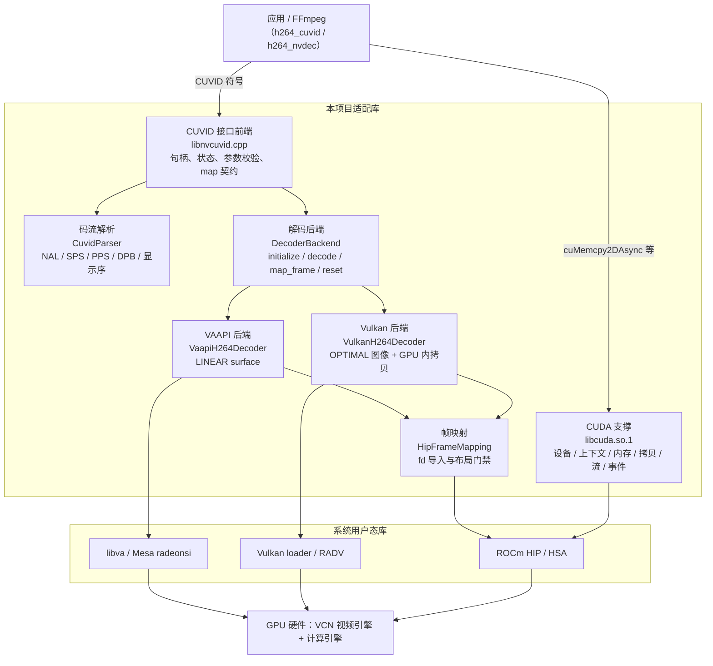
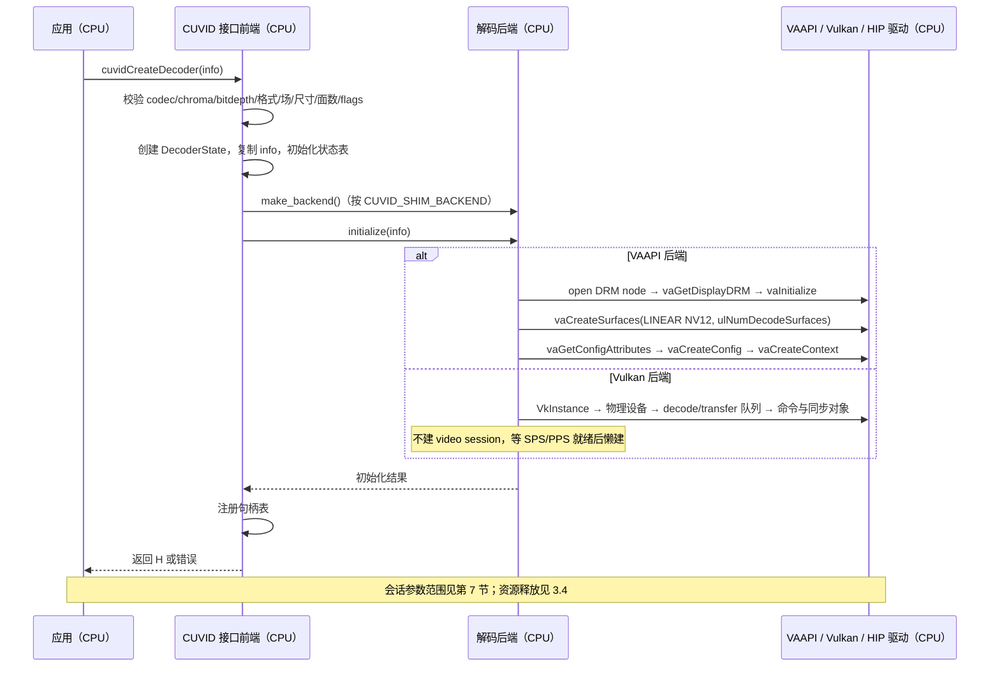
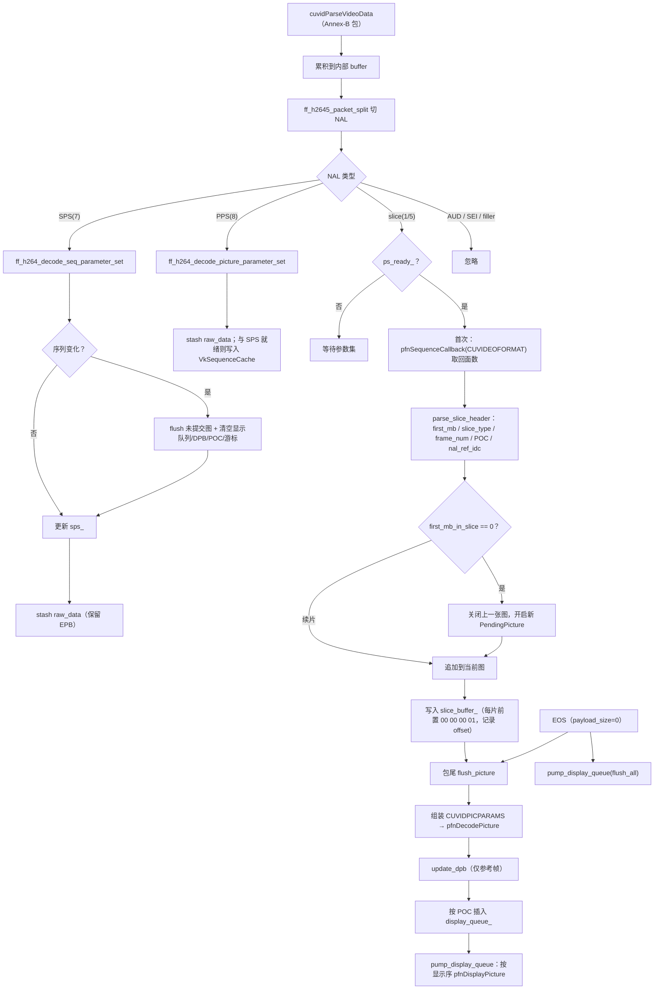
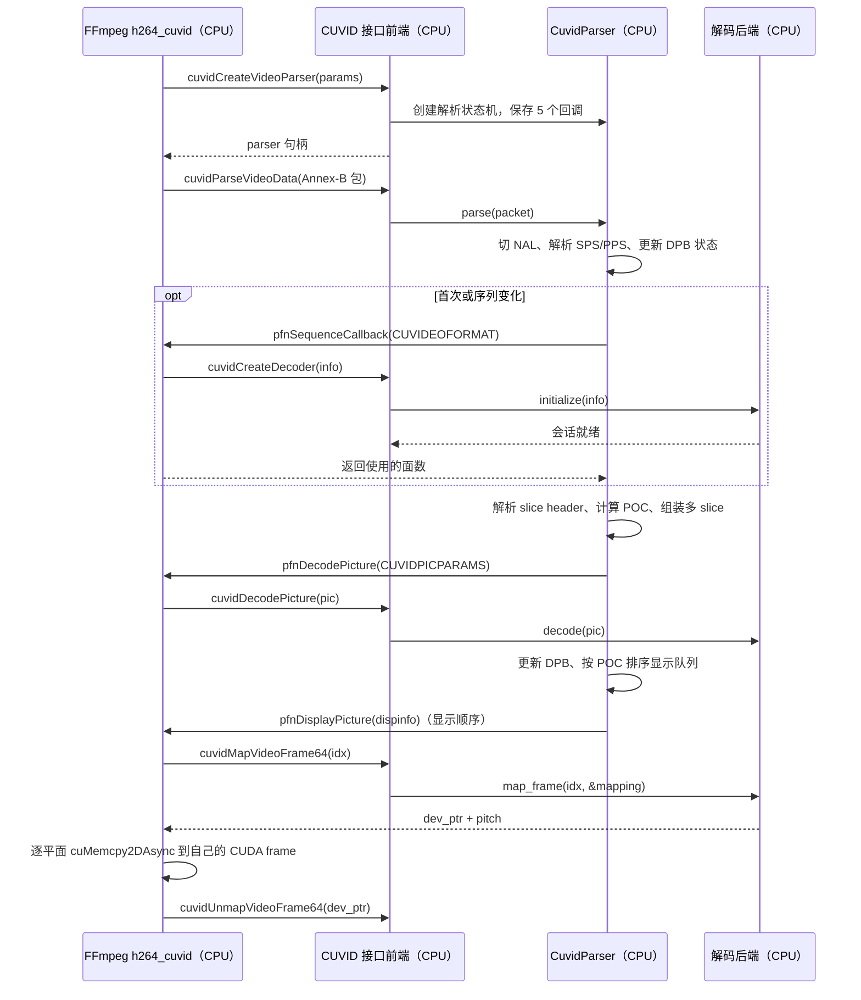
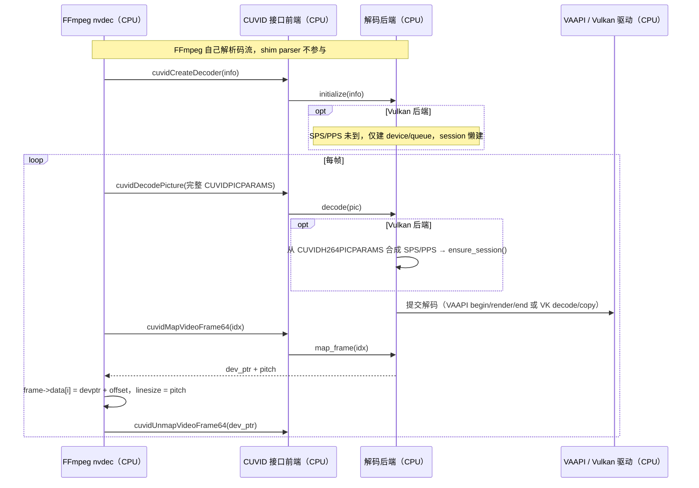
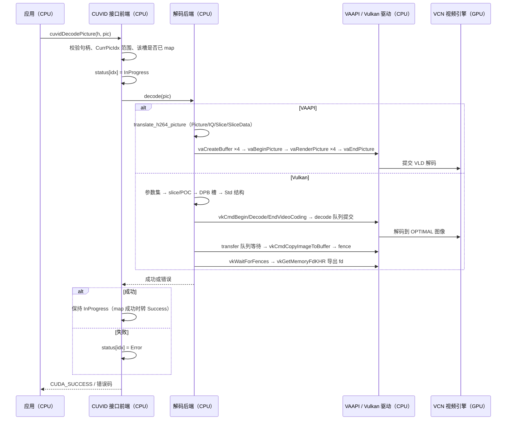
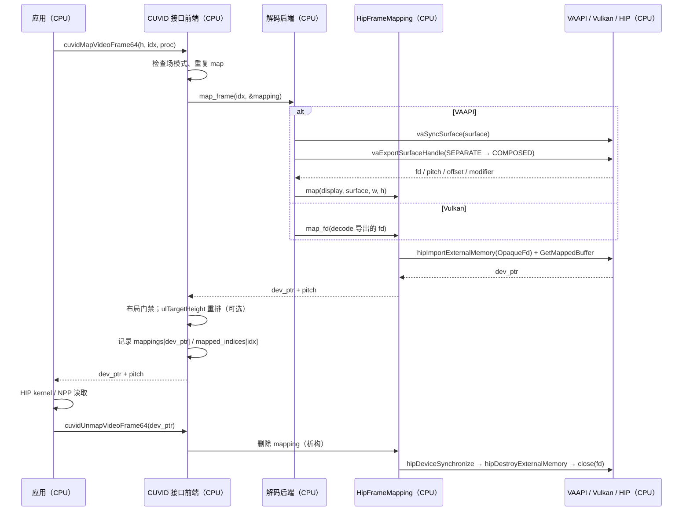

# 基于 VAAPI / Vulkan Video 的 CUVID 解码适配层实现方案

目标系统：Linux x86-64 / Ubuntu 24.04。前端 API：CUVID（nv-codec-headers `n12.1.14.1`，CUDA Driver API 12.0 语义）；解码后端：VAAPI 与 Vulkan Video H.264 Decode。

本方案的目标是：**应用继续调用 CUVID / CUDA Driver API，由适配层把解码工作交给目标 GPU 的 VAAPI 或 Vulkan Video 驱动执行，并把解码结果以 HIP 可直接寻址的设备指针交回应用。** 应用仍加载 `libcuda.so.1` 与 `libnvcuvid.so.1`，仍按原来的方式创建解码器、喂入码流、取回帧。

> 当前实现与验证边界以[当前能力矩阵](../当前能力矩阵.md)为唯一权威；本文只负责接口语义、分类数据流与逐接口实现设计。字段级速查见[CUVID 到 VAAPI 映射表](CUVID到VAAPI映射表.md)，内存与同步契约见[内存与同步模型](内存与同步模型.md)，Vulkan 接缝与排障见[Vulkan 后端实现](Vulkan后端实现.md)。

下文将 CUVID Video Decode API 简称为 CUVID。第 1～2 节说明适配目标和总体设计；第 3～6 节按接口分类展示能力查询、会话创建、码流解析、解码提交、帧映射、线程/数据源/CUDA 支撑；第 7 节说明参数转换；第 8 节逐个说明全部 API；第 9 节说明验证内容与复现入口。

| 阅读目的 | 对应章节 |
| --- | --- |
| 目标、接口全集与总体设计 | [适配目标](#1-适配目标)、[全部接口总表](#13-需要实现的接口总表)、[总体架构](#2-总体架构与模块职责) |
| 初始化与会话 | [接口加载、能力查询与会话创建](#3-接口加载能力查询与会话创建) |
| 码流解析与帧序 | [码流解析与帧序](#4-码流解析与帧序) |
| 解码、状态与取帧 | [解码提交、状态与帧映射](#5-解码提交状态与帧映射) |
| 线程、source、libcuda 支撑 | [线程、数据源与 CUDA 支撑接口](#6-线程数据源与-cuda-支撑接口) |
| 参数如何转换 | [参数转换](#7-参数转换) |
| 单个 API 怎么做 | [全部 API 的功能与实现思路](#8-全部-api-的功能与实现思路) |
| 验证与复现 | [验证](#9-验证) |

---

## 1. 适配目标

### 1.1 目标链路

FFmpeg 与客户应用有两条调用 CUVID 的方式，它们对适配层的要求不同，必须分别验收：

```text
parser 路径（FFmpeg h264_cuvid / 使用 cuvidCreateVideoParser 的应用）
  裸 Annex-B 码流 → cuvidParseVideoData → shim parser 切 NAL / 解析 SPS/PPS / 维护 DPB
  → pfnSequenceCallback → pfnDecodePicture → cuvidDecodePicture
  → pfnDisplayPicture（显示序）→ cuvidMapVideoFrame64 → 宿主逐平面 cuMemcpy2DAsync → unmap

直供路径（FFmpeg h264_nvdec，即 nvdec hwaccel）
  FFmpeg 自己解析码流 → 直接构造完整 CUVIDPICPARAMS → cuvidDecodePicture
  → cuvidMapVideoFrame64 → frame->data 直接指向 devptr + offset → HIP kernel / NPP 读取 → unmap

两条路径的公共后半段（后端差异所在）
  cuvidDecodePicture → DecoderBackend
      ├─ VAAPI  ：vaBegin/Render/EndPicture → LINEAR surface
      └─ Vulkan ：vkCmdDecodeVideoKHR → vkCmdCopyImageToBuffer → fd
  cuvidMapVideoFrame64 → HipFrameMapping → hipImportExternalMemory → CUdeviceptr + pitch
```

适配层对宿主承诺的只有一件事：**`cuvidMapVideoFrame64` 返回一个 HIP kernel 可直接使用的设备指针，且该指针在 `cuvidUnmapVideoFrame64` 之前保持有效、内容完整。** 这里起作用的是 UVA（统一虚拟地址）+ map/unmap 契约，不是 `cudaMallocManaged` 的 UVM。

### 1.2 能力与设计约束

优先实现以下核心能力；核心功能完成后再在统一框架上按应用需要扩展。

- **解码格式**：H.264、4:2:0、8-bit、NV12、逐行（progressive）。分辨率上限按实现与后端能力取小（当前实现上限 4096×4096）。
- **码流能力**：I/P/B、DPB 参考帧复用、显示序重排（POC）、多 slice access unit、crop、seek/flush、动态分辨率（宿主重建 decoder）、8 路并发。
- **输入方式**：cuvid parser 路径与 `CUVIDPICPARAMS` 直供路径并存，两者共用后端与会话契约。
- **输出方式**：`CUdeviceptr + pitch`，Y/UV 必须能由一个基址与 pitch 表达（连续 NV12）；不满足时显式返回不支持，不返回伪成功。
- **同步基线**：主机同步。VAAPI 用 `vaSyncSurface`，Vulkan 用 semaphore + fence + 主机等待；计算侧用 HIP stream/event。跨栈异步 fence（sync_file/syncobj）不在核心范围。
- **非目标**：NVENC、HEVC/AV1/VP9/MPEG-2、P010/10/12-bit、4:2:2/4:4:4、场/MBAFF、多 GPU、跨进程 DMA-BUF、完整 CUDA/NPP 二进制 drop-in。
- **错误原则**：不支持的能力必须返回 `CUDA_ERROR_NOT_SUPPORTED`(801)；不得静默改走 CPU 拷贝、软件解码或更换算法。

### 1.3 需要实现的接口总表

适配层产出两个动态库：`libcuda.so.1` 与 `libnvcuvid.so.1`。二者都由宿主通过 `dlopen + dlsym` 加载，**符号必须全部可解析**；符号存在不等于功能完成。

需要特别说明：**“nvdec” 不是一套独立 API，也没有自己的导出符号。** FFmpeg 7.1 中 `nvdec` 是 hwaccel 实现（`libavcodec/nvdec.c` 与 `nvdec_h264.c` 等封装），`h264_nvdec` 是它在 decoder 列表中的名字，不是独立 decoder，更不是需要兼容的库。它内部调用的仍然是 `libnvcuvid.so.1` 里的 CUVID 符号和 `libcuda.so.1` 里的 CUDA 符号。因此本方案的兼容面就是 22 个 CUVID 符号 + 82 个 CUDA 必需符号；两条宿主路径的差别只在“谁解析码流、传什么参数、map 后怎么用”，见 [1.3.6](#136-两条宿主路径的接口调用矩阵)。

#### 1.3.1 CUVID 接口（22 个）

| # | 分类 | API | 功能 | 是否区分后端 | 详见 |
| --- | --- | --- | --- | --- | --- |
| 1 | 能力查询 | `cuvidGetDecoderCaps` | 查询 codec × chroma × bitdepth 的支持情况、输出格式与尺寸范围 | **是**（探测源不同） | [8.1](#81-能力查询) |
| 2 | 会话管理 | `cuvidCreateDecoder` | 创建解码会话、surface/图像池、后端资源 | **是** | [8.2](#82-会话管理) |
| 3 | 会话管理 | `cuvidDestroyDecoder` | 销毁会话并回收全部资源 | 门面无关，资源释放分后端 | [8.2](#82-会话管理) |
| 4 | 会话管理 | `cuvidReconfigureDecoder` | 不销毁句柄改变尺寸/面池/目标尺寸 | **是** | [8.2](#82-会话管理) |
| 5 | 解码提交 | `cuvidDecodePicture` | 按解码顺序提交一张图 | **是**（提交方式与字段翻译） | [8.4](#84-解码提交与状态) |
| 6 | 解码状态 | `cuvidGetDecodeStatus` | 查询某个 picture index 的解码状态 | **是**（状态来源不同） | [8.4](#84-解码提交与状态) |
| 7 | 帧映射 | `cuvidMapVideoFrame64` | 把已解码帧映射为 HIP 设备指针 + pitch | **是**（导出方式） | [8.5](#85-帧映射) |
| 8 | 帧映射 | `cuvidUnmapVideoFrame64` | 结束映射，允许 surface 回收 | 否 | [8.5](#85-帧映射) |
| 9 | 线程同步 | `cuvidCtxLockCreate` | 创建宿主侧 context 锁 | 否 | [8.6](#86-线程与上下文锁) |
| 10 | 线程同步 | `cuvidCtxLockDestroy` | 销毁锁 | 否 | [8.6](#86-线程与上下文锁) |
| 11 | 线程同步 | `cuvidCtxLock` | 加锁 | 否 | [8.6](#86-线程与上下文锁) |
| 12 | 线程同步 | `cuvidCtxUnlock` | 解锁 | 否 | [8.6](#86-线程与上下文锁) |
| 13 | 数据源 | `cuvidCreateVideoSource` | 打开文件/流（demux + parser） | 否 | [8.7](#87-数据源video-source) |
| 14 | 数据源 | `cuvidCreateVideoSourceW` | 宽字符路径版本 | 否 | [8.7](#87-数据源video-source) |
| 15 | 数据源 | `cuvidDestroyVideoSource` | 销毁 source | 否 | [8.7](#87-数据源video-source) |
| 16 | 数据源 | `cuvidSetVideoSourceState` | 启动/停止/暂停 | 否 | [8.7](#87-数据源video-source) |
| 17 | 数据源 | `cuvidGetVideoSourceState` | 查询状态（返回 `cudaVideoState`） | 否 | [8.7](#87-数据源video-source) |
| 18 | 数据源 | `cuvidGetSourceVideoFormat` | 查询视频格式 | 否 | [8.7](#87-数据源video-source) |
| 19 | 数据源 | `cuvidGetSourceAudioFormat` | 查询音频格式 | 否 | [8.7](#87-数据源video-source) |
| 20 | 码流解析 | `cuvidCreateVideoParser` | 创建 parser 状态机并注册回调 | 否 | [8.3](#83-码流解析含回调) |
| 21 | 码流解析 | `cuvidParseVideoData` | 喂入 Annex-B 数据包、触发回调 | 否 | [8.3](#83-码流解析含回调) |
| 22 | 码流解析 | `cuvidDestroyVideoParser` | 销毁 parser | 否 | [8.3](#83-码流解析含回调) |

#### 1.3.2 CUVID 回调（5 个）

| 回调 | 注册位置 | 功能 | 返回约定 | 详见 |
| --- | --- | --- | --- | --- |
| `pfnSequenceCallback` | `CUVIDPARSERPARAMS` | 码流头就绪/序列变化时通知宿主，宿主在此创建或重建 decoder | 返回宿主使用的解码面数（>0），`<=0` 中止 | [8.3](#83-码流解析含回调) |
| `pfnDecodePicture` | `CUVIDPARSERPARAMS` | 一张图组装完成，宿主在此调用 `cuvidDecodePicture` | 非 0 继续，0 中止 | [8.3](#83-码流解析含回调) |
| `pfnDisplayPicture` | `CUVIDPARSERPARAMS` | 按显示顺序通知宿主可取帧 | 非 0 继续，0 暂停 | [8.3](#83-码流解析含回调) |
| `pfnGetOperatingPoint` | `CUVIDPARSERPARAMS` | AV1 operating point 选择（当前 codec 不涉及） | 非 0 表示已选择 | [8.3](#83-码流解析含回调) |
| `pfnGetSEIMsg` | `CUVIDPARSERPARAMS` | SEI 消息回调 | 非 0 继续 | [8.3](#83-码流解析含回调) |

#### 1.3.3 libcuda 接口（82 个必需 + 可选）

`FFmpeg` 的 `cuda_load_functions()` 用 `LOAD_SYMBOL` 加载 82 个必需符号，缺一个即整体加载失败；另有约 20 个 `LOAD_SYMBOL_OPT` 可选符号。下方按功能分组列出全部必需符号，逐个实现见 [8.8](#88-libcuda-支撑接口)。

| 分组 | API 列表 | 需要提供的行为 | 实现策略 |
| --- | --- | --- | --- |
| 初始化（2） | `cuInit`<br/>`cuDriverGetVersion` | 初始化驱动；返回 CUDA 语义版本 | HIP 映射 + 版本虚拟化（12000） |
| 设备与属性（5） | `cuDeviceGetCount`<br/>`cuDeviceGet`<br/>`cuDeviceGetAttribute`<br/>`cuDeviceGetName`<br/>`cuDeviceComputeCapability` | 枚举设备、查询属性/名称/CC | HIP 映射；属性逐项 switch；身份类值虚拟化 |
| 上下文（9） | `cuCtxCreate_v2`<br/>`cuCtxSynchronize`<br/>`cuCtxGetStreamPriorityRange`<br/>`cuCtxGetCurrent`<br/>`cuCtxSetLimit`<br/>`cuCtxPushCurrent_v2`<br/>`cuCtxPopCurrent_v2`<br/>`cuCtxDestroy_v2`<br/>`cuCtxGetDevice` | 创建/切换/销毁 context，同步 | HIP 映射；`cuCtxSynchronize` 用设备级同步 |
| Primary Context（5） | `cuDevicePrimaryCtxRetain`<br/>`cuDevicePrimaryCtxRelease`<br/>`cuDevicePrimaryCtxSetFlags`<br/>`cuDevicePrimaryCtxGetState`<br/>`cuDevicePrimaryCtxReset` | 主 context 生命周期 | HIP 映射；`GetState` 首参按值传 |
| 内存（8） | `cuMemAlloc_v2`<br/>`cuMemAllocPitch_v2`<br/>`cuMemAllocManaged`<br/>`cuMemFree_v2`<br/>`cuMemHostAlloc`<br/>`cuMemFreeHost`<br/>`cuMemAllocAsync`<br/>`cuMemFreeAsync` | 设备/页锁定/异步分配与释放 | HIP 映射（UVM 仅薄映射） |
| Memset（6） | `cuMemsetD8Async`<br/>`cuMemsetD16Async`<br/>`cuMemsetD32Async`<br/>`cuMemsetD2D8Async`<br/>`cuMemsetD2D16Async`<br/>`cuMemsetD2D32Async` | 1D/2D 异步填充 | HIP 映射 |
| Memcpy（10） | `cuMemcpy`<br/>`cuMemcpyAsync`<br/>`cuMemcpy2D_v2`<br/>`cuMemcpy2DAsync_v2`<br/>`cuMemcpyHtoD_v2`<br/>`cuMemcpyHtoDAsync_v2`<br/>`cuMemcpyDtoH_v2`<br/>`cuMemcpyDtoHAsync_v2`<br/>`cuMemcpyDtoD_v2`<br/>`cuMemcpyDtoDAsync_v2` | 一维/二维、H2D/D2H/D2D 拷贝 | HIP 映射；**pageable host 参与的 2D 拷贝必须同步** |
| 错误查询（2） | `cuGetErrorName`<br/>`cuGetErrorString` | 错误码转文字 | 静态表 |
| 流与事件（12） | `cuStreamCreate`<br/>`cuStreamCreateWithPriority`<br/>`cuStreamQuery`<br/>`cuStreamSynchronize`<br/>`cuStreamDestroy_v2`<br/>`cuStreamAddCallback`<br/>`cuStreamWaitEvent`<br/>`cuEventCreate`<br/>`cuEventDestroy_v2`<br/>`cuEventSynchronize`<br/>`cuEventQuery`<br/>`cuEventRecord` | 流创建/查询/同步/回调；事件记录与等待 | HIP 映射 |
| launch / module / JIT（10） | `cuLaunchKernel`<br/>`cuLaunchHostFunc`<br/>`cuLinkCreate`<br/>`cuLinkAddData`<br/>`cuLinkComplete`<br/>`cuLinkDestroy`<br/>`cuModuleLoadData`<br/>`cuModuleUnload`<br/>`cuModuleGetFunction`<br/>`cuModuleGetGlobal` | kernel 启动、模块加载、JIT 链接 | stub（801）：CUDA 计算走 HIPIFY 后的 HIP runtime |
| texture / array（6） | `cuTexObjectCreate`<br/>`cuTexObjectDestroy`<br/>`cuArrayCreate_v2`<br/>`cuArray3DCreate_v2`<br/>`cuArrayDestroy`<br/>`cuArray3DGetDescriptor_v2` | 纹理对象与数组 | stub（801） |
| GL interop（7） | `cuGLGetDevices_v2`<br/>`cuGraphicsGLRegisterImage`<br/>`cuGraphicsUnregisterResource`<br/>`cuGraphicsMapResources`<br/>`cuGraphicsUnmapResources`<br/>`cuGraphicsSubResourceGetMappedArray`<br/>`cuGraphicsResourceGetMappedPointer_v2` | OpenGL 互操作 | stub（801） |

#### 1.3.4 内部接口

| 接口 | 功能 | 详见 |
| --- | --- | --- |
| `DecoderBackend` | 门面与后端之间的唯一抽象：initialize / decode / map_frame / reset | [8.9](#89-内部后端接口) |
| `HipFrameMapping` | dma-buf fd → HIP 设备指针，布局门禁与 target-height 重排 | [8.9](#89-内部后端接口) |
| `CuvidParser` | NAL 切分、SPS/PPS、slice、DPB、显示序 | [4](#4-码流解析与帧序) |
| `VkSequenceCache` | parser → Vulkan 后端的 SPS/PPS 字节交接（线程局部） | [4.4](#44-spspps-交接与后端差异) |
| `h264_picture_translate` | `CUVIDPICPARAMS` → VAAPI 结构体 | [7.3](#73-逐字段映射) |
| `h264_direct_params` | `CUVIDPICPARAMS` → 最小 Annex-B SPS/PPS（Vulkan nvdec 路径） | [4.4](#44-spspps-交接与后端差异) |

#### 1.3.5 分类与数据流章节对照

| 接口分类 | 数据流章节 | 关键内容 |
| --- | --- | --- |
| C1 能力探测 | [3.2](#32-能力查询cuvidgetdecodercaps) | 探测源、caps 字段与后端能力的对应 |
| C2 会话生命周期 | [3.3](#33-会话创建与初始化流程) / [3.4](#34-会话销毁与重配置) | 建会话时序、销毁顺序、原子重配置 |
| C3 码流解析与帧序 | [4.1](#41-parser-状态机数据流)～[4.5](#45-poc--dpb--显示序规则) | parser 状态机、两条宿主路径时序、SPS/PPS 交接、POC/DPB/显示序 |
| C4 解码提交与状态 | [5.1](#51-解码提交与后端执行) / [5.2](#52-解码状态) | 提交时序（VAAPI/Vulkan 分列）、状态来源 |
| C5 帧映射与零拷贝 | [5.3](#53-帧映射与读取) / [5.4](#54-资源回收) | 导出/导入时序、布局门禁、资源回收 |
| C6 线程与上下文锁 | [6.1](#61-线程与上下文锁数据流) | 锁层级与调用顺序 |
| C7 数据源 | [6.2](#62-数据源video-source) | 明确不支持与占位语义 |
| C8 CUDA 支撑接口 | [6.3](#63-cuda-支撑接口的数据流) | 逐平面拷贝与 hwupload 两条流 |
| C9 内部后端接口 | [8.9](#89-内部后端接口) | 扩展点与职责 |

#### 1.3.6 两条宿主路径的接口调用矩阵

`h264_cuvid`（parser 路径）与 nvdec hwaccel（直供路径）调用的是**同一套符号**，只是调用子集和参数来源不同。下表用于确认“没有漏掉某个宿主会用的接口”，也用于验收时分别覆盖。

| 接口 | `h264_cuvid`（parser 路径） | nvdec hwaccel（`h264_nvdec` 等） | 说明 |
| --- | --- | --- | --- |
| `cuvidGetDecoderCaps` | 调用 | 调用 | 两条路径都先探测能力再建帧池 |
| `cuvidCreateVideoParser` | 调用 | **不调用** | nvdec 由 FFmpeg 自己解析码流 |
| `cuvidParseVideoData` | 调用 | **不调用** | 同上 |
| `cuvidDestroyVideoParser` | 调用 | **不调用** | 同上 |
| `pfnSequenceCallback` | 调用 | **不调用** | `h264_cuvid` 在此回调里建 decoder |
| `pfnDecodePicture` | 调用 | **不调用** | `h264_cuvid` 在此回调里调 `cuvidDecodePicture` |
| `pfnDisplayPicture` | 调用 | **不调用** | `h264_cuvid` 按显示序取帧 |
| `cuvidCreateDecoder` | 调用（sequence 回调内） | 调用（`init` 时） | nvdec 创建时可能还没有 SPS/PPS（Vulkan 懒建 session） |
| `cuvidDecodePicture` | 调用（`CodecSpecific` 由 shim parser 填） | 调用（`CodecSpecific` 由 FFmpeg 填全量字段） | 同符号、两种输入语义 |
| `cuvidMapVideoFrame64` | 调用 | 调用 | nvdec 是零拷贝验收路径 |
| `cuvidUnmapVideoFrame64` | 调用 | 调用 | 映射生命周期由 FFmpeg AVBuffer free 回调控制 |
| `cuvidGetDecodeStatus` | 静态扫描未发现直接调用 | 静态扫描未发现直接调用 | 加载表不要求，但实现保留 |
| `cuvidReconfigureDecoder` | 未调用（动态分辨率走销毁重建） | 未调用 | 当前为 stub |
| `cuvidCtxLock*`（4） | 由 FFmpeg 内部按需调用 | 由 FFmpeg 内部按需调用 | 创建参数里的 `vidLock` 会触发使用 |
| `cuvidCreateVideoSource*`（7） | 不调用 | 不调用 | 仅为加载表导出 |
| `libcuda`：设备/上下文/属性 | 调用（hwdevice 初始化） | 调用（hwdevice 初始化） | 两条路径共用 |
| `libcuda`：`cuMemAlloc`/`cuMemAllocPitch` | 调用 | 调用 | 帧池分配 |
| `libcuda`：`cuMemcpy2DAsync` | 调用（逐平面把映射帧拷到自己的 CUDA frame） | 一般不调用（`frame->data` 直接指向映射指针；`hwdownload` 时另行统计） | 决定是否“真零拷贝”的差异点 |
| `libcuda`：流/事件 | 调用 | 调用 | 同步与帧池生命周期 |

判据：**两条路径必须分别验收**，不能只跑通 `h264_cuvid` 就认为 nvdec 可用；反之亦然。两条路径的时序见 [4.2](#42-parser-路径h264_cuvid时序) 与 [4.3](#43-直供路径h264_nvdec时序)。

### 1.4 核心接口与扩展接口

**核心接口**是两条宿主路径实际调用、必须按语义完整实现的集合：

| 范围 | API |
| --- | --- |
| CUVID（13） | `cuvidGetDecoderCaps`、`cuvidCreateDecoder`、`cuvidDestroyDecoder`、`cuvidDecodePicture`、`cuvidMapVideoFrame64`、`cuvidUnmapVideoFrame64`、`cuvidCreateVideoParser`、`cuvidParseVideoData`、`cuvidDestroyVideoParser`、`cuvidCtxLockCreate`、`cuvidCtxLockDestroy`、`cuvidCtxLock`、`cuvidCtxUnlock` |
| libcuda（解码/上传下载链路） | `cuInit`、`cuDeviceGetCount`、`cuDeviceGet`、`cuDeviceGetAttribute`、`cuDeviceGetUuid_v2`、`cuDevicePrimaryCtxRetain/Release/SetFlags/GetState`、`cuCtxCreate_v2`、`cuCtxDestroy_v2`、`cuCtxGetCurrent`、`cuCtxPushCurrent_v2`、`cuCtxPopCurrent_v2`、`cuCtxGetDevice`、`cuMemAlloc_v2`、`cuMemAllocPitch_v2`、`cuMemFree_v2`、`cuMemHostAlloc`、`cuMemFreeHost`、`cuMemcpy2D_v2`、`cuMemcpy2DAsync_v2`、`cuMemcpyHtoD*`、`cuMemcpyDtoH*`、`cuMemcpyDtoD*`、`cuStreamCreate/Synchronize/Query/Destroy`、`cuEventCreate/Record/Synchronize/Query/Destroy`、`cuStreamWaitEvent`、`cuGetErrorName/String` |

**扩展接口**是加载表要求存在、但当前只承诺“明确不支持 + 可安全调用”的集合。未实现时返回 801，绝不伪造成功：

| 扩展类别 | API | 作为扩展的原因与实现考虑 |
| --- | --- | --- |
| 解码状态 | `cuvidGetDecodeStatus` | 有实现但语义依赖后端；VAAPI 无逐帧查询，只能自维护状态表；Vulkan 可用 query pool，属增强项 |
| 动态重配置 | `cuvidReconfigureDecoder` | 需要原子重建会话并处理在途帧；FFmpeg CLI 的动态分辨率走“销毁重建 decoder”，核心功能不依赖它 |
| 数据源 | `cuvidCreateVideoSource`、`cuvidCreateVideoSourceW`、`cuvidDestroyVideoSource`、`cuvidSetVideoSourceState`、`cuvidGetVideoSourceState`、`cuvidGetSourceVideoFormat`、`cuvidGetSourceAudioFormat` | 宿主（FFmpeg/客户）自做 demux，不依赖 CUVID source；只需符号存在 |
| CUDA launch / module / JIT | `cuLaunchKernel`、`cuLaunchHostFunc`、`cuLink*`、`cuModule*` | CUDA 计算不经 `libcuda`，由 HIPIFY 后的 HIP runtime 执行 |
| CUDA texture / array / GL | `cuTexObject*`、`cuArray*`、`cuGraphics*` | 解码链路不使用；OpenGL 互操作需独立设计 |
| 可选 CUDA 符号 | `LOAD_SYMBOL_OPT` 约 20 个（UUID/LUID/PCI、host 注册、非对齐 2D 拷贝等） | 缺失不影响加载；当前按需导出，调用到未实现项返回 801 |

### 1.5 不纳入本方案

- NVENC / `libnvidia-encode.so.1`、视频编码及 HIP→VAAPI 编码链路；
- HEVC、AV1、VP9、MPEG-2、JPEG、P010、10/12-bit、4:2:2、4:4:4；
- 场/MBAFF、长期参考（MMCO 5）、POC type 1、SP/SI（遇到必须显式 801）；
- 完整 CUDA driver/runtime 兼容、UVM 完整语义、IPC/VMM/外部 semaphore、多 GPU、跨进程 DMA-BUF；
- 性能达标承诺：只记录吞吐/延迟/资源，不设通过阈值。

---

## 2. 总体架构与模块职责

### 2.1 核心实现思路

对应用提供原有 CUVID 接口，内部通过 VAAPI 或 Vulkan Video 完成解码。适配层承担接口与参数转换、码流解析、帧映射与生命周期管理；硬件解码由目标 GPU 驱动执行。整体按以下过程组织：

1. **接收原有接口调用。** 应用加载同名动态库，通过 `dlsym` 取得 CUVID 符号，按原方式创建 parser/decoder、喂码流、map 取帧。适配层检查句柄、参数和调用顺序，维护应用看到的 decoder/parser/surface 状态。
2. **把解码要求转换为后端配置。** 将 codec/chroma/bitdepth/尺寸/面数/输出格式整理为内部配置，创建解码会话：VAAPI 用 config/context/LINEAR surface 池；Vulkan 用 video session、session parameters、output 图像与 DPB 图像。逐帧决定目标 surface、参考槽位与显示顺序。
3. **把解码输出直接共享给 HIP。** VAAPI 导出 LINEAR surface 的 dma-buf；Vulkan 先做一次 GPU 内 tiled→linear 拷贝再导出 fd。两条路径都通过 `hipImportExternalMemory(OpaqueFd)` + `hipExternalMemoryGetMappedBuffer` 得到 `CUdeviceptr`，并校验 Y/UV 能用“一个基址 + pitch”表达。
4. **保证先解码、后读取，读完再复用。** `map` 入口等待解码完成（`vaSyncSurface` / `vkWaitForFences`），返回时帧内容完整；`unmap` 前该 surface 不得被重新解码（门面拒绝写已 map 的槽），`unmap` 时先确认宿主异步拷贝已读完（`hipDeviceSynchronize`）再释放导入对象。
5. **帧序与资源分别管理。** 解码顺序由 `cuvidDecodePicture` 决定，显示顺序由共享 parser 按 POC 重排；surface 能否回收同时取决于 DPB 引用、mapped 引用和下游计算引用三类计数。

### 2.2 适配层对 HIP 与驱动层的需求

适配层需要调用 HIP 完成“把后端显存变成可寻址设备指针”，并调用 FFmpeg 的解析对象完成码流解析。

| 能力 | 目的 | 代表性 API |
| --- | --- | --- |
| 外部显存导入 | 把 dma-buf 变成 HIP 可寻址设备内存 | `hipImportExternalMemory`、`hipExternalMemoryGetMappedBuffer`、`hipDestroyExternalMemory` |
| 设备同步 | unmap 前确认宿主异步拷贝已读完；crop 重排前后保序 | `hipDeviceSynchronize`、`hipEventRecord`、`hipEventSynchronize` |
| 设备内拷贝 | `ulTargetHeight` 与 coded 高度不同时重排 NV12；验证读回 | `hipMemcpy2D`、`hipMemcpy` |
| 显存分配 | crop 重排用的目标高度缓冲 | `hipMalloc`、`hipFree` |
| 码流解析 | NAL 切分、SPS/PPS 解析、POC 计算、参考帧数 | FFmpeg 7.1 的 9 个解析对象 + `libavutil` |
| 解码会话 | 实际解码与输出布局 | VAAPI（libva/libdrm）或 Vulkan Video（loader + RADV/Mesa） |
| 应用侧 CUDA | 宿主自己的 context/内存/流/事件与逐平面拷贝 | 本文定义的 `libcuda.so.1` 薄映射层 |

### 2.3 模块结构

适配层是应用进程中加载的两个动态库：**`libnvcuvid.so.1` 是 CUVID 接口前端**，负责接收调用、检查参数、管理句柄、解析码流；**`DecoderBackend` 是解码后端**，负责准备后端资源、提交解码、导出帧。两者在同一进程中通过普通 C++ 调用连接；`libcuda.so.1` 是独立的 CUDA 薄映射库，供宿主做设备/内存/拷贝/流操作。

```text
应用 / FFmpeg（h264_cuvid / h264_nvdec）
  │ dlopen + dlsym（libcuda.so.1：82 必需符号；libnvcuvid.so.1：22 符号）
  ▼
libnvcuvid.so.1
  ├─ CUVID 接口前端：libnvcuvid.cpp
  │    句柄表、decoder/parser 状态、map/unmap 契约、参数校验
  │    │
  │    ├─ CuvidParser：cuvid_parser.cpp
  │    │    NAL 切分、SPS/PPS、slice header、DPB、显示队列
  │    │
  │    └─ DecoderBackend（backend_dispatch.cpp 选择）
  │         ├─ VaapiBackend  → VaapiH264Decoder + h264_picture_translate
  │         │                   libva / Mesa radeonsi / VCN
  │         └─ VulkanBackend → VulkanH264Decoder + h264_direct_params
  │                             Vulkan loader / RADV / VCN
  │
  └─ HipFrameMapping：hip_frame_mapper.cpp
       导出 fd → 导入 HIP → CUdeviceptr + pitch → 宿主

libcuda.so.1
  └─ CUDA driver API 薄映射：设备、上下文、内存、拷贝、流、事件；launch/module/GL 为 stub
```



---

## 3. 接口加载、能力查询与会话创建

### 3.1 动态库加载、符号表与 ABI

宿主通过 `ffnvcodec/dynlink_loader.h` 在解码器 `init` 时一次性 `dlopen + dlsym`：

- `libcuda.so.1`：82 个 `LOAD_SYMBOL` 必需符号 + 约 20 个可选符号；**缺任一必需符号即整体加载失败**，即使本次只走 VAAPI 路径。
- `libnvcuvid.so.1`：22 个符号；其中 `cuvidGetDecoderCaps` 为可选加载，其余全部必需（含 source 层 7 个）。
- 加载只看符号名，因此导出名必须与 `dlsym` 字符串逐字一致，包含 `_v2` 后缀（如 `cuCtxPushCurrent_v2`、`cuGraphicsResourceGetMappedPointer_v2`）。

ABI 兼容包括导出符号、调用约定、函数签名和结构体布局。**结构体一律使用 nv-codec-headers 的定义，shim 不重定义**；同一编译单元包含 HIP 头时加 `-D__HIP_PLATFORM_AMD__`。版本相符后，还需要通过能力查询和参数检查确认具体功能是否可用。

### 3.2 能力查询：`cuvidGetDecoderCaps`

能力查询回答“该 codec × chroma × bitdepth 能否解码、输出哪些格式、尺寸范围多少”。宿主据此决定 `AVHWFramesContext` 格式与是否回退。设计上有两条硬约束：

1. **探测源必须与实际建会话的后端一致**：先按 `CUVID_SHIM_BACKEND` 选择后端，再探测该后端；不允许“探 VAAPI 报能力、用 Vulkan 建会话”。
2. **探测结果不能宽于实现**：caps 说支持、创建却返回 801 是缺陷；caps 说支持但像素错误更不可接受。

```text
宿主 cuvidGetDecoderCaps(codec, chroma, bitdepth)
  → 静态范围判定（本实现仅 H.264 / 4:2:0 / 8-bit）
  → 选择后端（与 cuvidCreateDecoder 同一规则）
      ├─ VAAPI ：DRM node → vaInitialize → vaQueryConfigProfiles / vaQueryConfigEntrypoints
      │          → vaGetConfigAttributes(VAConfigAttribRTFormat)
      │          → vaQuerySurfaceAttributes(MaxWidth / MaxHeight / DRMFormatModifiers)
      └─ Vulkan：instance → 物理设备 → 队列族 → vkGetPhysicalDeviceVideoCapabilitiesKHR
                 → vkGetPhysicalDeviceVideoFormatPropertiesKHR(NV12 / OPTIMAL / external fd)
  → 填 CUVIDDECODECAPS → CUDA_SUCCESS
```

| 输出字段 | VAAPI 来源 | Vulkan 来源 |
| --- | --- | --- |
| `bIsSupported` | `VAProfileH264ConstrainedBaseline/Main/High` × `VAEntrypointVLD` 可用 | `vkGetPhysicalDeviceVideoCapabilitiesKHR` 查询成功；decode + transfer 队列族可用；`VK_KHR_external_memory_fd` 可用 |
| `nOutputFormatMask` | `VAConfigAttribRTFormat` 含 `VA_RT_FORMAT_YUV420` 才置 NV12 位 | `vkGetPhysicalDeviceVideoFormatPropertiesKHR` 对 `G8_B8R8_2PLANE_420` 返回且支持 OPAQUE_FD |
| `nMaxWidth`/`nMaxHeight` | `VASurfaceAttribMaxWidth/MaxHeight` 与实现上限取小 | `VkVideoCapabilitiesKHR.maxCodedExtent` 与实现上限取小 |
| `nMaxMBCount` | 由尺寸换算 | 由尺寸换算 |
| `nMinWidth`/`nMinHeight` | 驱动最小值，未暴露时取实现下界 | `minCodedExtent` |
| `bIsHistogramSupported` | 0 | 0 |

探测失败（DRM 打不开、libva 初始化失败、profile 不可用）应返回“不支持”而不是错误；不得把历史 NVIDIA 参考值（4096/65536）当作当前平台承诺。当前实现为静态表且不区分后端，属待补齐项。

### 3.3 会话创建与初始化流程

打开会话与初始化资源在同一调用中完成：`cuvidCreateDecoder` 接收完整创建参数，创建解码会话并返回句柄；后端差异全部收敛在 `initialize()` 内。



图中的 `DecoderState` 保存一次解码所需的：后端实例、内部 mutex、mapping 表、mapped index 表、状态表、创建参数副本。后续 API 通过句柄找到这份记录。

### 3.4 会话销毁与重配置

**销毁**：先从全局句柄表摘除（后续查找失败），再在对象锁内清空所有 mapping（逐个 `hipDestroyExternalMemory` + `close(fd)`），最后 `backend->reset()`。VAAPI 按 context → surfaces（先 `vaSyncSurface`）→ config → `vaTerminate` → `close(fd)` 逆序释放；Vulkan 按“等待在途工作 → session → session 内存 → 图像/缓冲/同步对象 → device → instance”释放，其中会话内存必须活到 `vkDestroyVideoSessionKHR` 之后。

**重配置**：`cuvidReconfigureDecoder` 的目标是“不销毁句柄改尺寸/面池”。设计为**原子重建**：

| 步骤 | 设计 |
| --- | --- |
| 1 | 校验只有 `ulWidth/ulHeight/ulNumDecodeSurfaces/ulTargetWidth/ulTargetHeight/display_area` 变化；codec/chroma/depth/format 变化 → 801 |
| 2 | 断言无 in-flight mapping，否则 `INVALID_VALUE` |
| 3 | 新建后端会话（VAAPI：新 config/context/surfaces；Vulkan：新 session/session params/图像池），失败保持旧会话不变 |
| 4 | 成功后切换并销毁旧会话；清空 DPB/POC/显示队列由宿主重发参数集完成 |

当前该接口为 stub（返回 801），FFmpeg 的动态分辨率走“销毁并重建 decoder”，因此核心链路不依赖它。

---

## 4. 码流解析与帧序

### 4.1 parser 状态机数据流

parser 是 CUVID 与 VAAPI 之间绕不开的组件：NVDEC 硬件可以吃完整码流自解析，而 VAAPI VLD 必须由 host 预解析成 `VAPictureParameterBuffer*` + `VASliceParameterBuffer*` + slice data；Vulkan 也需要 SPS/PPS、slice header 和 POC。



### 4.2 parser 路径（`h264_cuvid`）时序



该路径的特点是：shim parser 参与，`CUVIDPICPARAMS` 的 `CodecSpecific` 由 shim 填写；FFmpeg 自身还会用 `cuMemcpy2DAsync` 做一次设备内拷贝，因此**不能**用这条路径宣称零拷贝。

### 4.3 直供路径（`h264_nvdec`）时序



补充澄清：nvdec 并不是一套新的解码 API，而是 FFmpeg 内部的 hwaccel 实现；`h264_nvdec` 是它的 decoder 名称，不是独立 decoder。它没有自己的导出符号，调用的是与 `h264_cuvid` 完全相同的 CUVID/CUDA 符号，只是改由 FFmpeg 解析码流并填满 `CUVIDPICPARAMS`（详见 [1.3.6](#136-两条宿主路径的接口调用矩阵)）。

该路径是零拷贝目标路径：map 之后宿主直接把 `devptr + offset` 作为 `frame->data`，下游 HIP kernel/NPP 直接读。`unsafe_output` 需要宿主预留额外 surface（如 `-extra_hw_frames 16`），否则 frame pool 会耗尽。

### 4.4 SPS/PPS 交接与后端差异

| 宿主路径 | 参数集来源 | 后端如何取得 | 限制 |
| --- | --- | --- | --- |
| `h264_cuvid` | shim parser 看到 SPS/PPS | 原始 NAL 字节（`raw_data`，保留 EPB）写入线程局部 `VkSequenceCache`；后端读取后用 `ff_h2645_packet_split` 重新解析 | 每线程单槽；同线程交错多个 decoder 不支持（扩展方向：按 decoder 键控） |
| `h264_nvdec` | FFmpeg 自己解析，shim parser 收不到 | 从 `CUVIDH264PICPARAMS` 合成最小 Annex-B SPS/PPS，保存在 decoder 实例内 | 仅 4:2:0/8-bit/progressive/POC type 0/2；SPS/PPS ID 固定 0；非默认缩放矩阵、crop、VUI、profile constraint、精确 level 不可恢复 → 不满足显式 801 |

**字节语义是关键坑**：给后端/缓存重新解析的 SPS/PPS 必须存 `raw_data`（保留 `00 00 03` 防竞争字节）；存去转义后的 `data` 可能残留 `00 00 01`，被 `ff_h2645_extract_rbsp` 当成 start code 截断，表现为 `Overread VUI by 8 bits` / `sps_id 0 out of range`。`raw_data` 为空时回退到 `data`。

### 4.5 POC / DPB / 显示序规则

1. **IDR**：清 `prev_poc_msb/lsb`、`prev_frame_num`、DPB；POC 恒 0；先 flush 显示队列再清 DPB（否则全 IDR 流会攒到 EOS，surface 被反复覆盖）。
2. **POC type 0**：按 `log2_max_poc_lsb` 读位并做半回绕；写入后端结构时 `log2_max_pic_order_cnt_lsb_minus4` 必须减 4（FFmpeg 存完整位数，不减会让硬件多读 4 bit）。
3. **POC type 2**：`frame_num * 2`；POC type 1 当前不支持，必须显式 801。
4. **DPB**：只对 `nal_ref_idc != 0` 的参考帧执行滑动窗口；对 B 帧执行会误删参考帧。`ref_frame_count == 0` 时不得操作空容器。
5. **显示队列**：按 POC 有序插入；每次放出“POC 严格小于刚解出帧 POC”的条目；EOS/IDR 全部放出。回调必须按显示顺序，不能按解码顺序。
6. **surface 选择**：不能简单轮转整个面池。radeonsi VCN 的 `render_pic_list` 有上限（实测第 16 个不同输出面开始丢），当前实现把活跃窗口限制为 12 并跳过 DPB/待显示槽。这是 VAAPI 侧约束，被共享 parser 同时施加到 Vulkan（Vulkan 无此必要，属可配置项）。

---

## 5. 解码提交、状态与帧映射

### 5.1 解码提交与后端执行

`cuvidDecodePicture` 按解码顺序提交一张图。门面只做校验与状态维护，字段解释与提交属于后端。



提交语义要点：

- `cuvidDecodePicture` 成功只表示“已提交”，不表示“已解码完成”；宿主可以连续提交多帧再逐帧 map。
- Vulkan 当前实现是“一帧一提交一主机等待”，语义上等价同步解码；这是 P0 基线，异步化需要跨栈 fence。
- 多 slice access unit 必须完整提交：`nNumSlices` 与 `pSliceDataOffsets` 与 bitstream buffer 严格对应，不能只解第一片。
- 已 map 的 slot 不能被再次解码（门面返回 `INVALID_VALUE`），否则下游还在读时被覆盖。

### 5.2 解码状态

`cuvidGetDecodeStatus` 查询某 `picture_index` 的状态（`Invalid / InProgress / Success / Error`）。

| 后端 | 状态来源 | 语义 |
| --- | --- | --- |
| VAAPI | shim 自维护状态表：`decode` 的 `VAStatus` + `map` 入口 `vaSyncSurface` 结果 | 不能逐帧反映硬件错误；成功/失败的判定点在 decode/map |
| Vulkan | `VK_QUERY_TYPE_RESULT_STATUS_ONLY_KHR` 查询结果（可选）+ 状态表 | 可得到逐帧真实状态；队列族不支持时退回状态表 |

状态迁移只允许 `Invalid → InProgress → Success/Error`；同一 index 再次 decode 时重置为 `InProgress`；`Error` 不允许回到 `Success`。扩展方向：把 `query_status` 提升为 `DecoderBackend` 虚函数，门面不再自己维护语义。

### 5.3 帧映射与读取

`cuvidMapVideoFrame64` 是整条链路的核心契约：返回 HIP kernel 可直接使用的设备指针，unmap 前保持有效。



| 维度 | VAAPI | Vulkan |
| --- | --- | --- |
| 解码输出布局 | 显式请求 `DRM_FORMAT_MOD_LINEAR` | 宣告只有 `VK_IMAGE_TILING_OPTIMAL`；探针显示受支持格式可 LINEAR 直出（未宣告），当前实现仍走 tiled→linear 拷贝 |
| 导出 | `vaExportSurfaceHandle(DRM_PRIME_2)`，先 SEPARATE 后 COMPOSED | `decode()` 内已 `vkCmdCopyImageToBuffer` 到线性 buffer，再 `vkGetMemoryFdKHR` |
| 额外拷贝 | `h264_nvdec` 0 次；`h264_cuvid` 有 FFmpeg 自身 D2D；crop 高度重排额外一次 | 每帧 1 次 GPU 内拷贝；crop 高度重排额外一次 |
| 布局门禁 | Y/UV 同 object、同 pitch、`uv_offset == pitch*height` | 假定 `uv_offset == pitch*height`，用 `range_valid` 校验 |
| fd 所有权 | `vaExportSurfaceHandle` 产出，mapping 析构负责 close | `decode()` 产出存入 `exports_`，`map_frame` 移交，mapping 析构 close |

**不支持的映射请求**：`progressive_frame == 0`、`second_field != 0`、`unpaired_field != 0`、`raw_output_dptr != 0` 返回 801；`histogram_dptr` 不写且 caps 报不支持；`output_stream` 未接入（map 本身是同步的，语义更强、性能不同）。

### 5.4 资源回收

```text
DPB 引用（参考帧）──┐
mapped 引用（map 未 unmap）──┼──▶ surface 不可复用
下游计算引用（kernel/NPP 未读完）──┘

unmap → 删除 mapping → hipDeviceSynchronize → hipDestroyExternalMemory → close(fd)
DestroyDecoder → 强制清空所有 mapping → backend->reset() 释放会话资源
```

`cuvidUnmapVideoFrame64` 自己并不做 `hipDeviceSynchronize`；同步发生在 `HipFrameMapping` 析构/reset 内（仅连续 NV12 布局时），用于保证宿主异步拷贝在释放导入对象前已完成。

---

## 6. 线程、数据源与 CUDA 支撑接口

### 6.1 线程与上下文锁数据流

`cuvidCtxLock` 是宿主用来串行化 CUDA context 操作的锁，语义上**不是** HIP context lock。

```text
宿主 cuvidCtxLock(lock)
  → ContextLock::recursive_mutex.lock()
  → 宿主调用 cuvidDecodePicture / cuvidMapVideoFrame64
      → decoders_mutex（只查表）
      → state->mutex（串行化单个 decoder）
      → backend->decode / map_frame
  → 宿主 cuvidCtxUnlock(lock)
```

设计约束：

- 必须是递归锁（宿主可能在已持锁区间内再次加锁）；
- 锁顺序固定为“表锁 → 对象锁”，持 `state->mutex` 时不回调宿主；
- `vidLock` 字段不映射 HIP context lock，shim 只用自己的 mutex 保护内部状态；
- `reserved` 参数忽略，但保留签名。

### 6.2 数据源（Video Source）

7 个 source 符号只为满足 `dlsym`，功能不在范围内。数据流上它们不参与任何实际链路：

```text
cuvidCreateVideoSource → 返回 801，*source = NULL
cuvidSet/GetVideoSourceState → 801 / 占位状态
cuvidGetSourceVideoFormat / AudioFormat → 801
```

`cuvidGetVideoSourceState` 的返回类型是 `cudaVideoState`（不能返回 `CUresult`），设计为“非空句柄 → Started，空 → Error”，并在诊断中明确这是占位值，不代表 source 可用。

### 6.3 CUDA 支撑接口的数据流

`libcuda.so.1` 不参与解码本身，但参与宿主的帧池、逐平面拷贝和上传下载。两条典型流：

```text
① h264_cuvid 的逐平面拷贝（map 之后）
   cuvidMapVideoFrame64 → dev_ptr + pitch
   → FFmpeg 分配 CUDA frame
   → 对 Y/UV 各一次 cuMemcpy2DAsync（DEVICE→DEVICE）
   → cuvidUnmapVideoFrame64
   计数器：CUDA_SHIM_TRACE_COPY=1 时统计 D2D 次数（用于区分真零拷贝）

② hwupload（CPU 图像 → CUDA 帧）
   cuMemHostAlloc / cuMemAllocPitch
   → cuMemcpy2DAsync（HOST→DEVICE，pageable）
   → 宿主立即复用源帧
   要求：该“异步”调用必须在返回前完成 staging（见 §7 与 8.8.6）
```

设计原则：**同步/异步语义按 CUDA 对齐，而不是按 HIP 函数名对齐。** 凡 CUDA 保证“返回即安全复用源 buffer”的组合，必须同步完成。

---

## 7. 参数转换

### 7.1 参数转换模型

CUVID 的解码要求通过四类结构体传入/传出：

| 结构体 | 传入/传出接口 | 描述内容 |
| --- | --- | --- |
| `CUVIDDECODECREATEINFO` | `cuvidCreateDecoder` | 会话级：codec、chroma、bitdepth、coded 尺寸、面数、输出格式、去隔行、crop 与目标尺寸、ctx lock |
| `CUVIDEOFORMAT` | `pfnSequenceCallback`（输出） | 码流级：coded/display 尺寸、色度、位深、逐行标志、建议面数、帧率 |
| `CUVIDPICPARAMS` | `cuvidDecodePicture` | 帧级：目标 surface、access unit 字节与 slice 偏移、参考帧 DPB 快照、H.264 头字段 |
| `CUVIDPROCPARAMS` | `cuvidMapVideoFrame64` | 映射级：场模式、raw/histogram 扩展输出、output stream |
| `CUVIDPARSERPARAMS` | `cuvidCreateVideoParser` | parser 级：5 个回调、面数上限、错误阈值、显示延迟 |

**核心思路是：先解释 CUVID 参数表达的解码要求，形成统一的内部状态，再填充后端结构。** 同一语义可能需要合并多个结构体字段，也可能同时影响多个后端对象。

### 7.2 转换过程

1. **读取并解释输入。** 按字段语义识别默认值、可选项与不支持项。例如 `display_area` 是矩形坐标（含右/下边界），不是宽高；`ulTargetHeight` 在 `h264_cuvid` 是 crop 后偶数对齐值，在 `h264_nvdec` 等于 coded 尺寸。
2. **整理为内部表达。** 会话配置（codec/尺寸/面数/输出格式）、帧描述（CurrPicIdx/参考集/POC/头字段）、映射描述（场模式/目标尺寸）分别归档；单位、枚举、有效值统一。
3. **检查能否满足。** 单字段合法不等于组合可接受。例如尺寸在范围内但面数超过后端上限、格式支持但布局无法用一个基址表达，都应返回明确错误；自动值（如 level、POC 类型）应在约束下求值，无法求值时不猜。
4. **填充后端结构并调用后端 API。** VAAPI 填 `VAPictureParameterBufferH264` / `VAIQMatrixBufferH264` / `VASliceParameterBufferH264` 并调用 `vaBegin/Render/EndPicture`；Vulkan 填 `StdVideoDecodeH264PictureInfo` / `VkVideoReferenceSlotInfoKHR` / `VkVideoDecodeInfoKHR` 并录制 `vkCmdDecodeVideoKHR`。

### 7.3 逐字段映射

#### 7.3.1 `CUVIDDECODECREATEINFO`

| CUVID 字段 | VAAPI | Vulkan |
| --- | --- | --- |
| `CodecType` + `ChromaFormat` + `bitDepthMinus8` | `VAProfile`：H.264 Baseline→`VAProfileH264ConstrainedBaseline`、Main→Main、High→High | `VkVideoProfileInfoKHR` + `VkVideoDecodeH264ProfileInfoKHR`（profile_idc 来自 SPS） |
| `ulWidth`/`ulHeight` | `vaCreateSurfaces` / `vaCreateContext` 尺寸（coded） | output/DPB 图像 `codedExtent` |
| `ulNumDecodeSurfaces` | `vaCreateSurfaces` 数量（上限 64） | output 图像池大小 + `maxDpbSlots` 内分配 |
| `OutputFormat`（NV12） | `VA_RT_FORMAT_YUV420` | `VK_FORMAT_G8_B8R8_2PLANE_420_UNORM` |
| `ulCreationFlags` | 仅 `PreferCUVID` 支持 | 同左 |
| `DeinterlaceMode`（Weave） | 直通；Bob/Adaptive → 801 | 同左 |
| `display_area` / `target_rect` | VPP crop（目标设计）；当前不消费 | 当前不消费 |
| `ulTargetWidth/Height` | 由 C5 的 `repack_nv12_height` 处理高度差 | 同左 |
| `vidLock` | 不映射，shim 自带 mutex | 同左 |

#### 7.3.2 `CUVIDPICPARAMS`

| CUVID 字段/结构 | VAAPI | Vulkan |
| --- | --- | --- |
| `CurrPicIdx` | `CurrPic.picture_id = surfaces[idx]`；目标 surface | `dstPictureResource.imageViewBinding = outputs_[idx].view` |
| `PicWidthInMbs`/`FrameHeightInMbs` | `picture_width_in_mbs_minus1` / `picture_height_in_mbs_minus1` | `codedExtent` |
| `CodecSpecific.h264.seq_fields/pic_fields` | 逐项填入 `VAPictureParameterBufferH264` | 不使用（重新从 SPS/PPS 解析） |
| `CodecSpecific.h264.dpb[16]` | `ReferenceFrames[16]`（未用槽显式 INVALID） | `VkVideoReferenceSlotInfoKHR` + `StdVideoDecodeH264ReferenceInfo` |
| `WeightScale4x4/8x8` | `VAIQMatrixBufferH264`（全 0 时回退默认 16） | 不使用（SPS/PPS 自带缩放矩阵） |
| `pBitstreamData` + `nNumSlices` + `pSliceDataOffsets` | `VASliceParameterBufferH264[]` + `VASliceDataBufferType` | Annex-B buffer + `VkVideoDecodeH264PictureInfoKHR.pSliceOffsets` |
| `ref_pic_flag`/`intra_pic_flag` | `CurrPic.flags` / `pic_fields.reference_pic_flag` | `StdVideoDecodeH264PictureInfo.flags.is_reference` / `is_intra` / `IdrPicFlag` |
| `field_pic_flag` 等 | 非 0 → 801 | 非 0 → 801 |

#### 7.3.3 `CUVIDPROCPARAMS`

| 字段 | 设计 |
| --- | --- |
| `progressive_frame` | 0 → 801 |
| `second_field` / `unpaired_field` | 非 0 → 801 |
| `top_field_first` | 逐行流忽略 |
| `raw_output_dptr` / `raw_output_pitch` | 非 0 → 801 |
| `histogram_dptr` / `histogram_pitch` | 不写；caps 报不支持 |
| `output_stream` | 未接入；map 是同步语义 |

#### 7.3.4 关键字段陷阱

| 陷阱 | 后果 | 设计对策 |
| --- | --- | --- |
| `log2_max_pic_order_cnt_lsb_minus4` 未减 4 | 硬件多读 4 bit，slice 整体错位 | parser 填 CUVID 结构前统一减 4 |
| `ReferenceFrames` 未把空槽标 `VA_INVALID_SURFACE` + INVALID flag | 驱动把 0 值槽当有效短参考 | 每次填前先整表置无效 |
| IQ matrix 全 0 | 残差归零，输出平坦灰 | 必须填 4x4×6 + 8x8×2；全 0 回退 16 |
| `ReferenceFrames` 填全量 DPB | radeonsi 从第 3 个 B 帧起输出退化为参考帧拷贝 | 只填本图实际引用的参考帧（按 RefPicList 并集去重） |
| NV12 plane 1 拷贝单位 | 色度整片错 | `imageExtent={W/2,H/2}`、`bufferRowLength=pitch/2` |
| SPS/PPS 存去转义后的 RBSP | 重新解析被 `00 00 01` 截断 | 存 `raw_data`（保留 EPB） |

### 7.4 枚举映射速查

| CUVID | VAAPI | Vulkan |
| --- | --- | --- |
| `cudaVideoCodec_H264` | `VAProfileH264*` | `VK_VIDEO_CODEC_OPERATION_DECODE_H264_BIT_KHR` |
| `cudaVideoChromaFormat_420` | `chroma_format_idc = 1` | `VK_VIDEO_CHROMA_SUBSAMPLING_420_BIT_KHR` |
| `cudaVideoSurfaceFormat_NV12` | `VA_RT_FORMAT_YUV420` | `VK_FORMAT_G8_B8R8_2PLANE_420_UNORM` |
| `cudaVideoDeinterlaceMode_Weave` | 直通 | 直通 |
| `cudaVideoCreate_PreferCUVID` | 支持 | 支持 |

---

## 8. 全部 API 的功能与实现思路

前面章节按时序说明接口如何配合；本节回到第 1.3 节的全部接口，逐项解释作用与内部处理。查询、句柄、参数校验主要在前端完成；会话、提交、导出需要后端组合多个驱动调用。

### 8.1 能力查询

| API | 功能 | 实现核心思想 | 后端差异 |
| --- | --- | --- | --- |
| `cuvidGetDecoderCaps` | 查询 codec × chroma × bitdepth 的支持情况、输出格式与尺寸范围。 | 先做静态范围判定（H.264/420/8-bit）；再按将使用的后端做运行时探测；`nOutputFormatMask` 只置真实可导出的格式；直方图恒不支持；探测失败返回“不支持”而非错误。 | **VAAPI**：`vaQueryConfigProfiles`/`vaQueryConfigEntrypoints` + `vaGetConfigAttributes(RTFormat)` + `vaQuerySurfaceAttributes(MaxWidth/MaxHeight/DRMFormatModifiers)`。**Vulkan**：`vkGetPhysicalDeviceVideoCapabilitiesKHR` + `vkGetPhysicalDeviceVideoFormatPropertiesKHR`，并要求 decode/transfer 队列族与 external fd 可用。 |

### 8.2 会话管理

| API | 功能 | 实现核心思想 | 后端差异 |
| --- | --- | --- | --- |
| `cuvidCreateDecoder` | 创建解码会话、面池/图像池和后端资源，返回句柄。 | 校验 codec/chroma/depth/format/场/尺寸/面数/flags；分配 `DecoderState`（后端、mutex、mapping、状态表、info 副本）；后端初始化失败时不注册句柄、不留下半会话；句柄级固定后端选择。 | **VAAPI**：open DRM node → `vaInitialize` → 按 profile 建 `vaCreateSurfaces`（LINEAR NV12）→ `vaGetConfigAttributes` → `vaCreateConfig` → `vaCreateContext`。**Vulkan**：instance → 物理设备 → decode/transfer 队列 → 命令池/信号量/fence/query；**不建 session**，等 SPS/PPS 就绪后 `ensure_session()`。 |
| `cuvidDestroyDecoder` | 销毁会话并回收全部资源。 | 从全局表摘除（并发销毁只有一个成功），在对象锁内清空全部 mapping（逐个销毁导入对象并 close fd），再 `backend->reset()`；非法句柄返回 `INVALID_VALUE`。 | **VAAPI**：context → surfaces（先 sync）→ config → `vaTerminate` → close。**Vulkan**：等待在途工作 → session → session 内存 → 图像/缓冲/同步对象 → device/instance。 |
| `cuvidReconfigureDecoder` | 不销毁句柄改变尺寸/面池/目标尺寸。 | 校验变化集合；拒绝在途 mapping；原子重建（新会话成功后再切旧）；codec/chroma/depth/format 变化 → 801。 | **VAAPI**：无就地 API，销毁重建 config/context/surfaces。**Vulkan**：重建 session + session parameters + 图像池。当前均为 stub。 |

### 8.3 码流解析（含回调）

| API | 功能 | 实现核心思想 |
| --- | --- | --- |
| `cuvidCreateVideoParser` | 创建 parser 状态机并注册回调。 | 校验 codec（仅 H.264）与 `pfnSequenceCallback`/`pfnDecodePicture`；复制 `CUVIDPARSERPARAMS`（含 `pUserData`）；初始化 FFmpeg 解析状态（`AVCodecContext{codec_id=H264}`、`H264ParamSets`）、DPB、显示队列、slice 缓冲；注册句柄。 |
| `cuvidParseVideoData` | 喂入 Annex-B 数据包并同步触发回调。 | `payload_size == 0` 视为 EOS：先 flush 未提交图，再按 POC 放出全部显示队列。正常包：累积 → `ff_h2645_packet_split` → SPS/PPS 解析与序列变化检测 → slice header/POC → 多 slice 组装 → `pfnDecodePicture` → DPB 更新与显示序 `pfnDisplayPicture`。回调中止返回 801。 |
| `cuvidDestroyVideoParser` | 销毁 parser。 | 从表摘除后释放；不自动 flush（CUVID 语义要求宿主自己发 EOS）。 |

| 回调 | 功能 | 实现核心思想 |
| --- | --- | --- |
| `pfnSequenceCallback` | 码流头就绪/序列变化，宿主据此建 decoder。 | 填 `CUVIDEOFORMAT`：coded 尺寸、chroma、bitdepth、`display_area`（矩形边界）、`progressive_sequence`、`min_num_decode_surfaces = ref+3`（钳到 2..32）；返回面数决定 parser 后续使用的池大小。 |
| `pfnDecodePicture` | 一张图组装完成。 | 填 `CUVIDPICPARAMS`：`CurrPicIdx`（parser 选空闲槽）、`ref_pic_flag`/`intra_pic_flag`、bitstream 与 slice offsets、`CodecSpecific.h264`（头字段、DPB 快照、IQ 矩阵）。 |
| `pfnDisplayPicture` | 按显示顺序输出。 | 从按 POC 排序的显示队列放出条目；`CUVIDPARSERDISPINFO` 填 picture_index/timestamp/progressive_frame/top_field_first；返回 0 时保留剩余条目。 |
| `pfnGetOperatingPoint` | AV1 operating point。 | 当前 codec 不涉及，不调用。 |
| `pfnGetSEIMsg` | SEI 消息。 | 可选；当前可不回调。 |

### 8.4 解码提交与状态

| API | 功能 | 实现核心思想 | 后端差异 |
| --- | --- | --- | --- |
| `cuvidDecodePicture` | 按解码顺序提交一张图。 | 校验句柄/`CurrPicIdx`/是否已 map；置 `InProgress`；调 `backend->decode`；失败置 `Error` 并原样返回。不解释 `CodecSpecific`，只透传。 | **VAAPI**：`translate_h264_picture` 填 Picture/IQ/Slice/SliceData，`vaBegin/Render/EndPicture`，临时 buffer 用后销毁；只填本图实际引用的 `ReferenceFrames`。**Vulkan**：参数集 → slice/POC → DPB 槽（升序最小空闲）→ 参考槽 + setup 槽 → Std 结构 → decode 队列 → transfer 队列拷贝 → fence 等待 → 导出 fd → DPB 更新。 |
| `cuvidGetDecodeStatus` | 查询某 picture index 的状态。 | 门面访问状态表；状态迁移 `Invalid → InProgress → Success/Error`；同一 index 重新 decode 时重置。 | **VAAPI**：状态来自 decode 的 `VAStatus` 与 map 入口 `vaSyncSurface`。**Vulkan**：可用 `VK_QUERY_TYPE_RESULT_STATUS_ONLY_KHR` 得到逐帧真实状态，队列族不支持时退回状态表。 |

### 8.5 帧映射

| API | 功能 | 实现核心思想 | 后端差异 |
| --- | --- | --- | --- |
| `cuvidMapVideoFrame64` | 把已解码帧映射为设备指针 + pitch。 | 检查场参数；拒绝重复 map；调 `backend->map_frame`；布局门禁（连续 NV12）；`ulTargetHeight` 与 coded 不同时做 target-height 重排；记录 mapping 并把状态置 `Success`。 | **VAAPI**：`vaSyncSurface` → `vaExportSurfaceHandle`（SEPARATE→COMPOSED）→ 逐 object 导入 HIP → 校验同 object/同 pitch/`uv_offset == pitch*h`。**Vulkan**：取 `decode()` 导出的 fd → `map_fd`（导入 + range 校验，假定 Y/UV 连续）。 |
| `cuvidUnmapVideoFrame64` | 结束映射，允许 surface 复用。 | 以 `dev_ptr` 反查 mapping 并删除（析构时同步、销毁导入对象、close fd）；同步删除 `mapped_indices`；找不到返回 `INVALID_VALUE`。 | 无 |

### 8.6 线程与上下文锁

| API | 功能 | 实现核心思想 |
| --- | --- | --- |
| `cuvidCtxLockCreate` | 创建宿主 context 锁。 | 分配 `{CUcontext 记录值, std::recursive_mutex}`，返回不透明指针；`ctx` 允许为空。 |
| `cuvidCtxLockDestroy` | 销毁锁。 | 释放对象；允许销毁未加锁的锁。 |
| `cuvidCtxLock` | 加锁。 | 递归锁 `lock()`；`reserved` 忽略。 |
| `cuvidCtxUnlock` | 解锁。 | 递归锁 `unlock()`。 |

### 8.7 数据源（Video Source）

| API | 功能 | 实现核心思想 |
| --- | --- | --- |
| `cuvidCreateVideoSource` | 打开文件/流（demux + parser）。 | `*source = NULL`，返回 801；不得伪造可用 source。 |
| `cuvidCreateVideoSourceW` | 宽字符路径版本。 | 同上。 |
| `cuvidDestroyVideoSource` | 销毁 source。 | 返回 801。 |
| `cuvidSetVideoSourceState` | 启动/停止/暂停。 | 返回 801。 |
| `cuvidGetVideoSourceState` | 查询状态。 | 返回类型是 `cudaVideoState`：非空句柄 → `Started`，空 → `Error`；占位值，不代表可用。 |
| `cuvidGetSourceVideoFormat` | 查询视频格式。 | 返回 801。 |
| `cuvidGetSourceAudioFormat` | 查询音频格式。 | 返回 801。 |

### 8.8 libcuda 支撑接口

#### 8.8.1 初始化

| API | 功能 | 实现 |
| --- | --- | --- |
| `cuInit` | 初始化驱动。 | `hipInit(flags)`，错误码显式映射。 |
| `cuDriverGetVersion` | 返回驱动版本。 | 固定返回 `12000`（CUDA 12.0 语义）；不得透传 ROCm 版本。 |

#### 8.8.2 设备与属性

| API | 功能 | 实现 |
| --- | --- | --- |
| `cuDeviceGetCount` | 设备数量。 | `hipGetDeviceCount`。 |
| `cuDeviceGet` | 按序号取设备。 | `hipDeviceGet`（`CUdevice` 与 `hipDevice_t` 同为 int）。 |
| `cuDeviceGetAttribute` | 查询设备属性。 | 逐项 `switch` 到 `hipDeviceAttribute_t`；无对应项回 0（如 `MULTI_GPU_BOARD_GROUP_ID`）；未知 → `INVALID_VALUE`。 |
| `cuDeviceGetName` | 设备名。 | `hipDeviceGetName`。 |
| `cuDeviceComputeCapability` | 计算能力。 | 可映射到 HIP；对宿主应按“兼容的 CUDA CC”虚拟化，避免暴露 ROCm 架构号导致宿主拒绝。 |

额外导出（可选加载）：`cuDeviceGetUuid_v2`（`hipDeviceGetUuid`）、`cuDeviceGetLuid`（801）、`cuDeviceGetByPCIBusId` / `cuDeviceGetPCIBusId`（HIP 对应函数）。

#### 8.8.3 上下文

| API | 功能 | 实现 |
| --- | --- | --- |
| `cuCtxCreate_v2` | 创建 context。 | `hipCtxCreate`，指针强转。 |
| `cuCtxDestroy_v2` | 销毁 context。 | `hipCtxDestroy`。 |
| `cuCtxGetCurrent` | 当前 context。 | `hipCtxGetCurrent`。 |
| `cuCtxPushCurrent_v2` | 压栈。 | `hipCtxPushCurrent`。 |
| `cuCtxPopCurrent_v2` | 出栈。 | `hipCtxPopCurrent`。 |
| `cuCtxGetDevice` | context 所属设备。 | `hipCtxGetDevice`。 |
| `cuCtxSynchronize` | 同步 context。 | `hipDeviceSynchronize`（`hipCtxSynchronize` 在 ROCm 7.x 已废弃；设备级语义更强但安全）。 |
| `cuCtxGetStreamPriorityRange` | 流优先级范围。 | `hipDeviceGetStreamPriorityRange`。 |
| `cuCtxSetLimit` | 设置上下文限额。 | `switch` 到 `hipDeviceSetLimit`；`DEV_RUNTIME_*` → 801。 |
| `cuDevicePrimaryCtxRetain` | 保留主 context。 | `hipDevicePrimaryCtxRetain`。 |
| `cuDevicePrimaryCtxRelease` | 释放主 context。 | `hipDevicePrimaryCtxRelease`。 |
| `cuDevicePrimaryCtxSetFlags` | 设置主 context 标志。 | `hipDevicePrimaryCtxSetFlags`。 |
| `cuDevicePrimaryCtxGetState` | 查询主 context 状态。 | `hipDevicePrimaryCtxGetState`；**第一个参数按值传 `CUdevice`**。 |
| `cuDevicePrimaryCtxReset` | 重置主 context。 | `hipDevicePrimaryCtxReset`。 |

#### 8.8.4 内存

| API | 功能 | 实现 |
| --- | --- | --- |
| `cuMemAlloc_v2` | 设备显存分配。 | `hipMalloc`。 |
| `cuMemAllocPitch_v2` | 带行距分配。 | `hipMallocPitch`；`ElementSizeBytes` 忽略。 |
| `cuMemAllocManaged` | 统一内存分配。 | `hipMallocManaged`；仅薄映射，不等于 NVIDIA UVM。 |
| `cuMemFree_v2` | 释放设备显存。 | `hipFree`。 |
| `cuMemHostAlloc` | 页锁定主机内存。 | `hipHostMalloc`。 |
| `cuMemFreeHost` | 释放页锁定内存。 | `hipHostFree`。 |
| `cuMemAllocAsync` | 异步分配。 | `hipMallocAsync`（依赖默认内存池）。 |
| `cuMemFreeAsync` | 异步释放。 | `hipFreeAsync`。 |

#### 8.8.5 Memset

| API | 功能 | 实现 |
| --- | --- | --- |
| `cuMemsetD8Async` | 8-bit 元素 1D 异步填充。 | `hipMemsetD8Async`。 |
| `cuMemsetD16Async` | 16-bit 元素 1D 异步填充。 | `hipMemsetD16Async`。 |
| `cuMemsetD32Async` | 32-bit 元素 1D 异步填充。 | `hipMemsetD32Async`。 |
| `cuMemsetD2D8Async` | 8-bit 元素 2D 异步填充。 | `hipMemsetD2D8Async`；`Width` 是元素个数。 |
| `cuMemsetD2D16Async` | 16-bit 元素 2D 异步填充。 | `hipMemsetD2D16Async`；`Width` 是元素个数。 |
| `cuMemsetD2D32Async` | 32-bit 元素 2D 异步填充。 | `hipMemsetD2D32Async`；`Width` 是元素个数。 |

#### 8.8.6 Memcpy

| API | 功能 | 实现 |
| --- | --- | --- |
| `cuMemcpy` | 设备内拷贝。 | `hipMemcpy(DeviceToDevice)`。 |
| `cuMemcpyAsync` | 异步设备内拷贝。 | `hipMemcpyAsync(DeviceToDevice)`。 |
| `cuMemcpy2D_v2` | 二维同步拷贝。 | 逐字段构造 `hip_Memcpy2D` → `hipMemcpyParam2D`；不支持的 memory type → `INVALID_VALUE`。 |
| `cuMemcpy2DAsync_v2` | 二维异步拷贝。 | 若 src 或 dst 为 HOST，改用同步 `hipMemcpyParam2D`（CUDA 对 pageable host 的“异步”在返回前已完成 staging；HIP 异步可能在 staging 读完前返回，导致 FFmpeg 复用源帧时跨帧损坏）。D2D 保持异步。 |
| `cuMemcpyHtoD_v2` / `Async` | 主机→设备。 | `hipMemcpyHtoD(Async)`。 |
| `cuMemcpyDtoH_v2` / `Async` | 设备→主机。 | `hipMemcpyDtoH(Async)`。 |
| `cuMemcpyDtoD_v2` / `Async` | 设备→设备。 | `hipMemcpyDtoD(Async)`；`CUDA_SHIM_TRACE_COPY=1` 时计数（只统计 D2D）。 |

#### 8.8.7 错误查询

| API | 功能 | 实现 |
| --- | --- | --- |
| `cuGetErrorName` | 错误码转名字。 | 静态表覆盖 shim 会返回的错误码；未知回 `"CUDA_ERROR_UNKNOWN"` 并返回 `INVALID_VALUE`。 |
| `cuGetErrorString` | 错误码转描述。 | 复用同一张表。 |

#### 8.8.8 流与事件

| API | 功能 | 实现 |
| --- | --- | --- |
| `cuStreamCreate` | 创建流。 | `hipStreamCreateWithFlags`。 |
| `cuStreamCreateWithPriority` | 带优先级创建。 | `hipStreamCreateWithPriority`。 |
| `cuStreamQuery` | 查询流状态。 | `hipStreamQuery`；`NotReady` → `CUDA_ERROR_NOT_READY`。 |
| `cuStreamSynchronize` | 同步流。 | `hipStreamSynchronize`。 |
| `cuStreamDestroy_v2` | 销毁流。 | `hipStreamDestroy`。 |
| `cuStreamAddCallback` | 流回调。 | `hipStreamAddCallback`；`flags` 忽略。 |
| `cuStreamWaitEvent` | 流等待事件。 | `hipStreamWaitEvent`。 |
| `cuEventCreate` | 创建事件。 | `hipEventCreateWithFlags`。 |
| `cuEventDestroy_v2` | 销毁事件。 | `hipEventDestroy`。 |
| `cuEventSynchronize` | 等待事件。 | `hipEventSynchronize`。 |
| `cuEventQuery` | 查询事件。 | `hipEventQuery`。 |
| `cuEventRecord` | 记录事件。 | `hipEventRecord`。 |

#### 8.8.9 stub 组

| API | 功能 | 实现 |
| --- | --- | --- |
| `cuLaunchKernel`、`cuLaunchHostFunc` | kernel 启动。 | 801；CUDA 计算由 HIPIFY 后的 HIP runtime 执行。 |
| `cuLinkCreate`、`cuLinkAddData`、`cuLinkComplete`、`cuLinkDestroy` | JIT 链接。 | 801。 |
| `cuModuleLoadData`、`cuModuleUnload`、`cuModuleGetFunction`、`cuModuleGetGlobal` | 模块加载与符号。 | 801。 |
| `cuTexObjectCreate`、`cuTexObjectDestroy` | 纹理对象。 | 801。 |
| `cuArrayCreate_v2`、`cuArray3DCreate_v2`、`cuArrayDestroy`、`cuArray3DGetDescriptor_v2` | 数组。 | 801。 |
| `cuGLGetDevices_v2`、`cuGraphicsGLRegisterImage`、`cuGraphicsUnregisterResource`、`cuGraphicsMapResources`、`cuGraphicsUnmapResources`、`cuGraphicsSubResourceGetMappedArray`、`cuGraphicsResourceGetMappedPointer_v2` | OpenGL 互操作。 | 801。 |

### 8.9 内部后端接口

| 接口 | 功能 | 实现核心思想 |
| --- | --- | --- |
| `DecoderBackend::initialize` | 建后端会话。 | VAAPI 建 display/config/context/surfaces；Vulkan 建 instance/device/queue（session 懒建）。 |
| `DecoderBackend::decode` | 提交一张图。 | VAAPI 翻译并 `vaBegin/Render/End`；Vulkan 组 Std 结构、双队列提交、等待、导出 fd。 |
| `DecoderBackend::map_frame` | 产出可导入的映射。 | VAAPI 导出 surface 并导入；Vulkan 移交已导出的 fd。 |
| `DecoderBackend::reset` | 释放后端资源。 | 按依赖逆序销毁；Vulkan 会话内存最后释放。 |
| `HipFrameMapping::map` / `map_fd` | fd → 设备指针。 | 导入、映射、布局与范围校验；不满足连续 NV12 时显式失败。 |
| `HipFrameMapping::repack_nv12_height` | 目标高度重排。 | 设备内 2D 拷贝 luma/chroma 到新分配；target > coded 或奇数 → `INVALID_VALUE`。 |
| `VkSequenceCache::store/fetch` | SPS/PPS 交接。 | 线程局部单槽，自动前置 start code；同线程多 decoder 需按实例键控（扩展）。 |

---

## 9. 验证

核心链路按三个方面验证：

1. **解码主流程。** 两条宿主路径分别跑通“创建会话 → 喂码流/提交帧 → map 取帧 → 下游读取”，像素与软件解码逐字节一致。
2. **帧共享与布局。** VAAPI 的 LINEAR surface 导出 dma-buf、Vulkan 的 tiled→linear 拷贝后导出，都能被 HIP 导入并按 `dev_ptr + pitch` 正确读取；Y/UV 连续性、pitch 跨行、separate layers 均覆盖。
3. **同步与资源。** map 返回即可读、unmap 前 surface 不复用、`DestroyDecoder` 不泄漏 fd/显存；多线程与池复用下的顺序正确。

| 验证项 | 入口 | 判据 |
| --- | --- | --- |
| 符号面 | `cuda_shim/tests/verify_symbols.cpp`、`verify_cuvid_symbols.cpp`、`make check` | 82 + 22 全部 `dlsym` 成功 |
| libcuda 功能子集 | `cuda_shim/tests/test_func_full.cpp` | 47 项带数据校验 PASS |
| 会话/parser | `verify_cuvid_session`、`verify_cuvid_parser` | 建/销毁无泄漏；回调顺序与帧数正确 |
| 端到端像素 | `tests/zerocopy/verify_decode_to_hip`、`verify_vk_decode_to_hip` | 四路码流逐字节一致；fd/显存无泄漏 |
| mapped 指针 | `verify_kernel_read` | kernel 可寻址、event 顺序正确；**不校验画面** |
| 画面正确性 | `CUVID_DUMP_NV12_DIR` + 软解参考对比 | 逐帧逐平面一致（注意 pitch 跨行与 NV12 交织） |
| 宿主矩阵 | `tests/quick-verify/run_ffmpeg_compare.sh` | `h264_cuvid`/`h264_nvdec` × VAAPI/VK，像素、帧数、PTS、D2D 计数 |
| 复杂场景 | `run_decode_scenarios.sh`、`run_size_matrix.sh` | 多 slice/crop/seek、1080p/4K |
| 同步协议 | `tests/sync/verify_sync` | S1–S8 顺序与资源协议通过 |
| 异步能力 | `tests/sync/verify_semaphore_async.cpp` | HIP external semaphore 不支持；syncobj/sync_file 原语可用 |

验证口径：符号可解析、功能跑通、像素正确是三件事，不能互相替代；`verify_kernel_read` 的 `errors=0` 只证明 GPU 与 CPU 读到同一块内存。当前覆盖范围与未闭环项以[当前能力矩阵](../当前能力矩阵.md)为准。

---

## 附录 A：错误与降级语义

| 输入/场景 | 接口 | 返回 |
| --- | --- | --- |
| 非 H.264 / 非 4:2:0 / 非 8-bit | `CreateDecoder` / `CreateVideoParser` / `GetDecoderCaps` | 801 / 801 / `bIsSupported=0` |
| 非 NV12、Bob/Adaptive、PreferCUDA/DXVA | `CreateDecoder` | 801 |
| 场/MBAFF、SP/SI、POC type 1、非默认缩放矩阵（合成路径） | `DecodePicture` | 801 |
| `CurrPicIdx` 越界、已 map 槽再 decode、重复 map | `DecodePicture` / `MapVideoFrame64` | `INVALID_VALUE` |
| 场参数非法、raw 输出 | `MapVideoFrame64` | 801 |
| 非连续 NV12、非 NV12 fourcc、非线性 modifier | `MapVideoFrame64` | 801 |
| Video source 全部功能 | source 7 个 | 801（状态查询返回占位值） |
| kernel/module/texture/array/GL | libcuda stub 组 | 801 |
| 设备丢失 / fence 超时 | `DecodePicture` / `MapVideoFrame64` | `CUDA_ERROR_UNKNOWN` + latch |

禁忌：返回成功但内容错误、返回成功但未初始化输出、静默降级为 CPU 拷贝/软解/换算法。

## 附录 B：诊断开关

| 变量 | 作用 |
| --- | --- |
| `CUVID_SHIM_BACKEND=vaapi\|vk` | 选择解码后端（默认 vaapi；未知值回落默认） |
| `CUVID_SHIM_DRM_NODE` | 指定 DRM render node，默认 `/dev/dri/renderD128` |
| `CUVID_SHIM_MIN_SURFACES` | 覆盖 `min_num_decode_surfaces`（默认 `ref+3`） |
| `CUVID_SHIM_DEBUG_NAL` | 打印 NAL 切分与序列变化 |
| `CUVID_SHIM_DEBUG_DPB` | 打印 DPB / 显示队列状态 |
| `CUVID_SHIM_TRACE_PARAMS` | 打印每次 decode 的 frame_num/POC/DPB |
| `CUVID_SHIM_TRACE_SURF` | 打印 surface 分配、decode、map/unmap |
| `CUVID_SHIM_DEBUG_VK` | 打印 Vulkan 每帧解码参数、参考槽、DPB 空闲表 |
| `CUVID_SHIM_NOCOPY` | Vulkan 只解码不导出，分离解码参数与导出/同步问题 |
| `CUVID_SHIM_DEBUG_VASUM` / `CUVID_SHIM_DUMP_VASUM` | 绕过 HIP 直接读 VA surface |
| `CUVID_SHIM_PLAIN_SURFACES` | 建普通 VA surface，对比 modifier 问题 |
| `CUVID_SHIM_DEBUG_DUMP` / `CUVID_SHIM_DUMP_RAW` | 打印/落盘 Picture/Slice 结构，做字段级 diff |
| `CUVID_DUMP_NV12_DIR` | dump NV12 帧与软解参考比对 |
| `CUDA_SHIM_TRACE_COPY=1` | 统计 D2D 次数，区分真零拷贝与 FFmpeg 内部拷贝 |

## 附录 C：构建与 ABI 约束

| 项 | 约束 |
| --- | --- |
| SONAME | `libcuda.so.1`、`libnvcuvid.so.1`，并建开发软链 |
| 头文件 | nv-codec-headers；HIP 同编译单元需 `-D__HIP_PLATFORM_AMD__` |
| 符号名 | 与 `dynlink_loader.h` 的 `dlsym` 字符串逐字一致（含 `_v2`）；无版本脚本 |
| `libnvcuvid` 依赖 | `libamdhip64`、`libva`、`libva-drm`、`libdrm`、`libvulkan`、FFmpeg 7.1 的 9 个解析 `.o` + `libavutil` |
| FFmpeg 对象 | `h2645_parse` / `h264_ps` / `h2645_vui` / `h2645data` / `h264data` / `h264_parse` / `golomb` / `mathtables` / `refstruct`（7.1 的 `ff_h2645_packet_split` 是 8 参数） |
| 编译约束 | 访问 FFmpeg 内部头需 `HAVE_AV_CONFIG_H=1`；`AVCodecContext` 不能传 NULL；SPS/PPS 从 `sps_list[]`/`pps_list[]` 取 |
| 链接顺序 | `-lamdhip64` 放源文件后并用全路径（`--as-needed` 会丢弃未及时出现的依赖） |
| 许可证边界 | 9 个解析对象为 LGPL；NPP 相关 nonfree 构建由客户自行完成，不属于解码层发布物 |
